# 工作任务

客户现场的问题通常不会按学科出现。这里按**要完成的动作**组织入口；底层原理仍链接到唯一的学科文章，避免同一结论在多个地方出现不同版本。

| 任务 | 典型问题 | 入口 |
| --- | --- | --- |
| 选型 | 需要多高精度？气隙能放多大？磁体选铁氧体还是 NdFeB？接口选哪种？ | [编码器选型](selection.md) |
| 误差分配 | 角度误差里，芯片、磁体、偏心、倾斜、温漂各占多少？ | [误差预算](error-budget.md) |
| 仿真建议 | 这个结构能不能用 2D？磁体充磁怎么设？网格和边界够不够？ | [仿真建议](simulation.md) |
| 现场排障 | 角度跳变、重复性差、温漂、上电异常、CRC 错误，先查什么？ | [现场排障](troubleshooting.md) |
| 复盘 | 怎样把一次支持记录变成可复用证据？ | [案例模板](../authoring/case.md) |

## 一次完整支持的推荐顺序

<figure class="kb-figure">
  
  <figcaption>从需求到证据闭环的 FAE 支持流程</figcaption>
</figure>

!!! tip "先问条件，再谈精度"
    “多少度精度”若没有说明机械角范围、温度、气隙、转速、校准方式和统计口径，就不是一个可验收的指标。先统一定义，见[选型需求清单](selection.md#requirements)。
