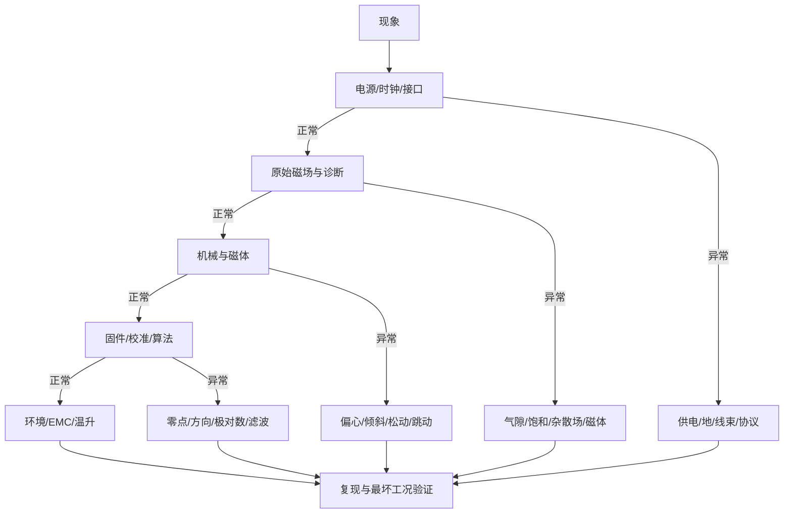

# 磁编码器现场排障路径

<div class="kb-status">
<span>状态：已复核（方法级）</span><span>复核：2026-10-25</span><span>适用：样机与客户现场</span>
</div>

## 适用范围

本文提供磁编码器“无输出、角度跳变、重复性差、温漂、噪声、接口错误”等问题的分层排查路径，强调先建立证据链，再改硬件或固件。

不针对某一具体芯片型号的寄存器、CRC 多项式或固件 API；这些必须查目标型号数据手册和平台代码。

## 先给结论

1. **先保安全，再复现。** 电机可能飞车、堵转或过流时，先断动力电、限流、限速，不在危险状态反复试。
2. **先分层，再定位。** 电源/接口 → 磁场 → 机械 → 固件/校准 → 环境，逐层排除，不要一上来换芯片。
3. **先看原始量，再看角度。** 能读 $B_x/B_y/B_z$、AGC、诊断位、温度和电源时，不要只看最终角度。
4. **“每转一次/两次”的误差是线索。** 用 FFT 和受控实验区分偏心、倾斜、磁化和算法。
5. **“换一颗就好了”不是根因。** 可能是焊接、装配、批次或 ESD 的差异，必须保留失效件和现场条件。
6. **修复后要验证最坏工况。** 常温恢复不代表高温、最大气隙、最大转速和干扰下都恢复。

## 第一步：定义故障

让客户用一句话回答：

- 什么产品、什么结构、什么磁体？
- 什么现象？角度跳变、无输出、漂移、噪声、CRC 错误、过流？
- 何时发生？上电、加速、高温、特定角度、特定批次？
- 发生频率？每转一次、随机、只在某一方向？
- 是否复现？换板、换磁体、换位置是否变化？
- 有没有原始数据、波形、日志、照片？

把“角度不准”拆成可测现象，是排障的起点。

## 分层排查图



## 第一层：电源、时钟与接口

### 检查项

- 供电电压、纹波、上电斜率、复位时序、电流能力；
- 地平面、回流路径、去耦电容位置和容值；
- 时钟/晶振、启动时间、寄存器配置；
- 接口电平、上拉、终端、线束长度、屏蔽和接地；
- SPI/I²C 模式、位序、CRC 初始化/多项式、帧格式；
- 采样率、滤波器、DMA/中断优先级；
- ESD/焊接/清洗残留。

### 典型现象

| 现象 | 先查 |
| --- | --- |
| 完全无输出 | 供电、复位、片选、时钟、焊接 |
| 上电偶发失败，重新上电恢复 | 上电斜率、复位时序、NVM 加载、时钟稳定 |
| 读数固定 0xFFFF/0x0000 | 总线无响应、MISO 悬空、片选/模式错误 |
| CRC 错误 | 多项式/初值/位序、帧长、时序、干扰 |
| 高速时丢帧 | 采样率、总线带宽、DMA、中断延迟 |
| 电机启动时干扰 | 地弹、共模、线束、屏蔽、电源跌落 |

!!! warning "不要用“重新上电就好了”结案"
    上电偶发失败通常有确定的时序或状态条件。记录电源、复位、时钟和总线波形，找到第一次失败的时刻，而不是让客户反复重启。

## 第二层：原始磁场与诊断

如果芯片能输出原始分量、AGC、诊断或温度，优先看这些。

### 检查项

- 芯片处 $B$ 的幅值是否在数据手册窗口；
- $B_x/B_y/B_z$ 是否正交、是否有偏置；
- 旋转一圈的幅值变化、相位差、谐波；
- AGC 是否顶到极限（如果是自动增益型号）；
- 是否触发饱和、弱场、断线、CRC、诊断位；
- 温度、供电和磁场是否同步变化；
- 电机通电前后、靠近磁铁前后的差异。

### 典型判断

- **幅值随角度大幅变化：** 磁体不对称、偏心、倾斜或磁路不均。
- **某一角度饱和：** 气隙过小、磁体过强或外部场。
- **幅值整体偏低：** 气隙过大、磁体过弱、磁化不足、温度过高。
- **原始量正常但角度异常：** 算法、校准、零点、方向、极对数或输出映射。
- **原始量有尖峰：** EMC、电源、接地、采样或磁体缺陷。

AS5600 的 AGC 与气隙、磁体条件相关，但具体范围只适用于该型号 [ENC-04](../sources/vendor.md#ENC-04)；3D Hall 的场强/温度诊断也要按具体型号解读 [ENC-08](../sources/vendor.md#ENC-08)。

## 第三层：机械与磁体

### 机械

- 磁体与传感器同心度、端面平行度、轴向气隙；
- 轴承游隙、轴跳动、联轴器背隙、齿轮背隙；
- 磁体粘接/压装是否松动，温度循环后是否滑移；
- PCB 固定、壳体变形、螺钉铁磁件；
- 线束拉力是否改变传感器位置。

### 磁体

- 牌号、批次、充磁方向、极数、相位；
- 尺寸、圆度、镀层、裂纹、崩边；
- 高温/低温后的不可逆损失；
- 来料表面场是否用固定夹具测量；
- 磁体是否被后续装配/电机充磁改变。

### 受控实验

| 实验 | 目的 |
| --- | --- |
| 改变气隙（垫片） | 判断场强窗口/波形敏感性 |
| 人为径向偏心 | 确认 1× 误差来源 |
| 加垫片倾斜 | 确认 2×/1× 变化 |
| 磁体旋转 180° 重装 | 判断磁化不对称 |
| 换同批次/不同批次磁体 | 判断来料一致性 |
| 正反向旋转 | 判断迟滞/背隙 |
| 电机断电/通电 | 判断杂散场/EMC |

## 第四层：固件、校准与算法

### 检查项

- 角度零点、方向、极对数、机械/电角度换算；
- 角度展开/多圈计数是否正确；
- 滤波系数、更新率、延迟；
- 校准表版本、温度点、插值方式；
- 输出映射（0–360、-180–180、CW/CCW）；
- 诊断/饱和/错误处理；
- 校准后是否用独立点验证。

### 典型现象

| 现象 | 可能原因 |
| --- | --- |
| 角度在 0°/360° 跳变 | 展开/模运算错误，或输出范围定义不一致 |
| 角度随转速成比例滞后 | 滤波/采样延迟 |
| 电机换相电流大、效率低 | 极对数、方向、零点错误 |
| 正反转同一位置读数不同 | 迟滞、背隙、校准方向 |
| 校准后某些角度更差 | 过拟合、校准点不足、训练/验证不独立 |
| 多圈计数丢失 | 掉电保存、上电初始化、溢出 |

## 第五层：环境与 EMC

- 电机 PWM、逆变器开关、继电器、接触器；
- 电源共模/差模干扰、地弹；
- 相邻磁体、扬声器、电磁阀、制动器；
- 温度、湿度、凝露、油污、清洗剂；
- 振动、冲击、线缆疲劳；
- 外部磁铁靠近（客户现场很常见）。

EMC 问题常表现为“特定转速/特定电机状态出现”，而静态测试正常。用示波器看电源和总线，用频谱看干扰，比反复换芯片有效。

## 客户数据包

一次升级/远程支持至少收集：

```text
1. 产品型号、硬件版本、固件版本、磁体规格
2. 结构图/照片（标注气隙、偏心、倾斜）
3. 供电、接口、线束、接地
4. 现象视频/波形/原始日志
5. 发生条件：角度、转速、温度、电机状态
6. 复现步骤与频率
7. 已尝试的对照实验
8. 失效样品数量、批次、日期
```

没有这些信息，容易把机械问题误判为芯片问题，或把 EMC 误判为算法问题。

## 根因表述

合格的根因结论应包含：

- **证据：** 哪次测量/对照实验支持；
- **机制：** 为什么会导致该现象；
- **范围：** 哪些样本/工况适用；
- **残余风险：** 还有什么未排除；
- **验证：** 修复后如何确认。

“磁铁消磁了”“芯片坏了”“干扰大”都不是完整根因。

## 来源

- [ENC-02](../sources/vendor.md#ENC-02)：AMR/GMR 数据手册，诊断与输出条件示例。
- [ENC-03](../sources/vendor.md#ENC-03)：TMR 数据手册，模拟前端与系统设计边界。
- [ENC-04](../sources/vendor.md#ENC-04)：AS5600 AGC、气隙与磁体条件。
- [ENC-08](../sources/vendor.md#ENC-08)：HAL 3930 3D Hall 诊断与杂散场说明。
