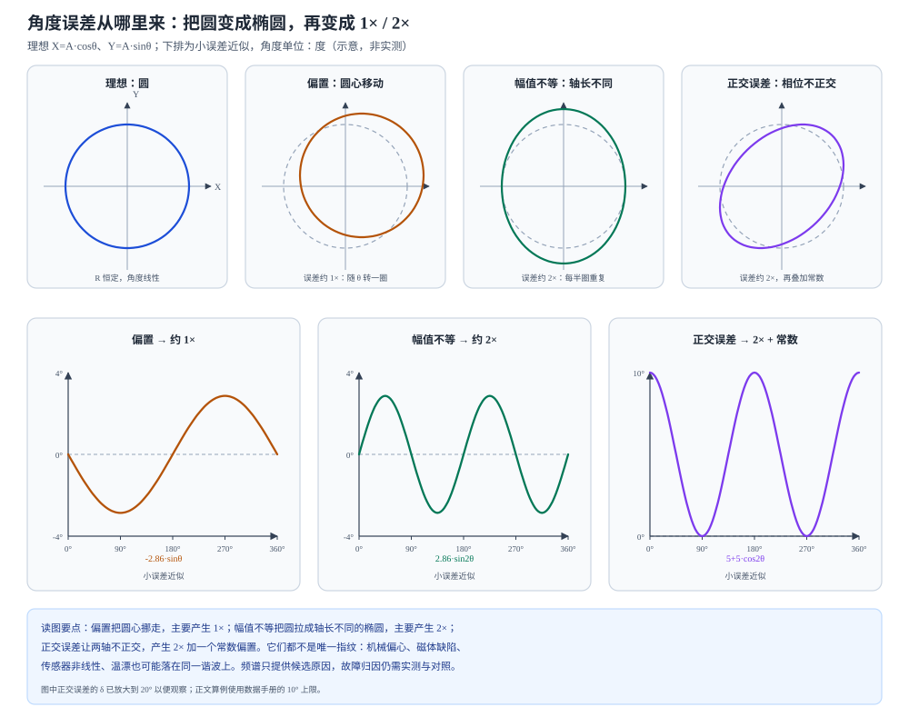

# 角度误差从哪里来：偏置、幅值、正交与谐波

状态：草稿整理：2026-10-26范围：误差机理

> 本篇回答：为什么磁体偏心常以每转一次的误差出现，而正余弦幅值不等常出现每转两次的成分？
> 先修：[从磁场到角度](angle-sensing.md)、[编码器磁体、充磁图形与安装几何](encoder-magnet-and-mounting.md)；预计阅读 25 分钟。
> 读完能回答：① 理想正余弦为什么画成一个圆？② 偏置、幅值不等、正交误差分别把圆变成什么？③ 为什么角度误差的频谱只是线索，不是唯一故障指纹？

## 适用范围

本文用教学模型解释“物理原因—信号畸变—角度误差”的链路，重点是建立直觉和量级判断。完整的误差预算、校准方案和现场排障仍在 FAE 页面；具体芯片的精度、温漂和校准收益必须绑定型号、温度、场强和测试条件。文中的小误差公式只在偏置、幅值差和正交误差较小时成立，不能外推到任意大误差。

## 先看一个现象

同一只编码器，磁体装得偏一点，角度误差看起来像一条每转一次的慢波；把另一只传感器的两路正余弦接到示波器上做 XY 图，图形不是圆，而是一个椭圆；再换一只磁体，误差的主峰又跑到每转两次。三种现象都可能来自“机械装配”，但它们在信号上的表现不同。

原因是角度不是直接测量的，而是由两路正余弦算出来的：

$$
X=A\cos\theta,\qquad Y=A\sin\theta,\qquad
\theta_{meas}=\operatorname{atan2}(Y,X)
$$

只要 $X$、$Y$ 不再是一个等幅、正交、同心的正余弦对，$\operatorname{atan2}$ 就会给出随角度变化的误差。**李萨如图的形状，比单看一条角度误差曲线更容易看出是哪一类畸变。**

## 一张图建立直觉

<figure class="kb-figure" markdown="1">
  
  <figcaption>图 1　偏置、幅值不等和正交误差对李萨如图及角度误差的影响（示意，非实测）。上排虚线是理想圆，实线是畸变后的轨迹；下排是相应的小误差近似。正交误差的 δ 在图中放大到 20° 以便观察，正文算例使用数据手册的 10° 上限。</figcaption>
</figure>

理想情况下，$X$、$Y$ 幅值相等、相位差 90°、零点重合，李萨如图是一个以原点为圆心的圆。偏置把圆心整体挪走；幅值不等把圆拉成轴长不同的椭圆；正交误差让两轴不正交，轨迹变成一个倾斜的椭圆。角度误差是“实际轨迹上的相位”与“理想圆上的角度”之差，所以不同畸变会在不同谐波上留下痕迹。

## 概念、符号与单位

设真实角度为 $\theta$，测量角为 $\theta_{meas}$，角度误差定义为：

$$
E(\theta)=\theta_{meas}(\theta)-\theta
$$

角度单位统一用度（°）；公式推导时用弧度（rad），最后再换算。$1\ \text{rad}=180°/\pi\approx57.30°$。

### 偏置：圆心移动，误差约 1×

若两路各有一个加性偏置：

$$
X=A\cos\theta+o_x,\qquad Y=A\sin\theta+o_y
$$

在小偏置 $|o_x|,|o_y|\ll A$ 时，对 $\operatorname{atan2}$ 做一阶展开：

$$
E(\theta)\approx\frac{o_y\cos\theta-o_x\sin\theta}{A}
=\frac{r}{A}\sin(\theta+\phi_0)
$$

其中 $r=\sqrt{o_x^2+o_y^2}$，$\phi_0$ 由偏置方向决定。也就是说，**偏置主要产生每转一次（1×）的误差**，幅值约为 $r/A$ 弧度。注意这是小误差近似；偏置很大时，误差波形会偏离正弦，还会出现更高次项。

### 幅值不等：圆变椭圆，误差约 2×

若两路幅值不同：

$$
X=A\cos\theta,\qquad Y=A(1+\varepsilon)\sin\theta
$$

$\varepsilon$ 是相对幅值差。对小 $\varepsilon$：

$$
E(\theta)\approx\frac{\varepsilon}{2}\sin 2\theta
$$

**幅值不等主要产生每转两次（2×）的误差**，幅值约为 $\varepsilon/2$ 弧度。直观上，$X$ 和 $Y$ 在 0°、90°、180°、270° 的“谁大谁小”每半圈重复一次，所以误差以 180° 机械角为周期。

### 正交误差：相位差不是 90°，误差约 2× 加常数

若 $Y$ 相对 $X$ 多了 $\delta$ 的相位：

$$
X=A\cos\theta,\qquad Y=A\sin(\theta+\delta)
$$

对小 $\delta$：

$$
E(\theta)\approx\frac{\delta}{2}+\frac{\delta}{2}\cos 2\theta
$$

它包含一个常数项 $\delta/2$ 和一个 2× 项。也就是说，**正交误差不是简单的“1×”或“2×”，而是 2× 叠加一个角度偏置**；在小误差下，误差在 0° 附近约为 $\delta$，在 90° 附近约为 0°。如果只看到 2× 就断定是幅值不等，就会漏掉正交误差。

### 为什么频谱不是唯一指纹

同一个谐波可能来自不同原因：

| 误差成分 | 常见候选原因 | 不能只凭频谱断定的理由 |
| --- | --- | --- |
| 1× | 磁体/传感器偏心、零偏、温漂、轴向跳动 | 偏置和偏心都能产生 1×，相位和正反转表现不同 |
| 2× | 两路幅值不等、正交误差、磁体/场形椭圆化 | 幅值差和正交误差都落在 2×，需要看李萨如形状或正反转 |
| $p$× | 多极环的极对数相关谐波、极距/相位误差 | 极对数、充磁缺陷和安装角都可能贡献 |
| 宽带 | 噪声、振动、采样抖动 | 不是某个机械原因的特征峰 |

所以正确的顺序是：先看李萨如图和正反转，再结合频谱、温度、转速和装配记录，最后才归因。**频谱是线索，不是判决书。**

## 公式怎样使用（含完整算例）

### 例 1：偏置的 1× 误差

取 $A=1$、$o_x=0.05$、$o_y=0$。在 $\theta=90°$ 时：

$$
X=0,\qquad Y=1,\qquad X+o_x=0.05
$$

$$
\theta_{meas}=\operatorname{atan2}(1,0.05)=87.14°,\qquad
E=87.14°-90°=-2.86°
$$

小误差公式给出 $E\approx-0.05\sin90°=-0.05\ \text{rad}=-2.86°$，与精确值一致。这个误差随 $\theta$ 转一圈，是典型的 1×。

### 例 2：幅值不等的 2× 误差

取 $A=1$、$\varepsilon=0.10$，即 $Y$ 的幅值是 $1.10$。在 $\theta=45°$：

$$
X=0.7071,\qquad Y=1.10\times0.7071=0.7778
$$

$$
\theta_{meas}=\operatorname{atan2}(0.7778,0.7071)=47.73°,\qquad
E=2.73°
$$

小误差公式给出 $E\approx(0.10/2)\sin90°=0.05\ \text{rad}=2.86°$，量级一致。误差在 45°、135°、225°、315° 附近最大，每半圈重复，是典型的 2×。

### 例 3：正交误差的 2× 加常数

取 $A=1$、$\delta=10°$。在 $\theta=0°$：

$$
X=1,\qquad Y=\sin10°=0.1736,\qquad
\theta_{meas}=\operatorname{atan2}(0.1736,1)=9.85°
$$

误差约 $9.85°$。在 $\theta=45°$：

$$
X=0.7071,\qquad Y=\sin55°=0.8192,\qquad
\theta_{meas}=49.21°,\qquad E=4.21°
$$

在 $\theta=90°$：$X=0$、$Y=\sin100°=0.9848$，$\theta_{meas}=90°$，误差为 0。小误差公式给出 $E\approx5°+5°\cos2\theta$：$\theta=0°$ 时约 10°，$\theta=45°$ 时约 5°，$\theta=90°$ 时约 0°。趋势一致。**正交误差同时有常数项和 2× 项，不能只用“有没有 2×”来判断。**

### 例 4：把数据手册的桥路容差放到一起看

TLE5501 的典型差分输出幅值约 320 mV/V，差分偏置最大 ±5 mV/V，幅值同步率 90%–110%，正交误差最大 ±10° [ENC-03，p.10](../sources/vendor.md#ENC-03)。用上面的小误差式做量级估算：

- 偏置：$5/320=1.56\%$，约 $0.90°$ 的 1× 误差；
- 幅值差：$10\%/2=5\%$，约 $2.86°$ 的 2× 误差；
- 正交误差：$10°$ 的常数项约 $5°$，再加约 $5°$ 的 2× 项。

把这些最坏值直接算术相加，会得到约 $13.8°$ 的“教学上限”。但这不是数据手册的角度误差：该型号在 25°C、25–80 mT、差分输出，并对偏置、正交和幅值做补偿时，最大角度误差为 0.8°；全温度/寿命条件下最大 1.5°；迟滞最大 0.4° [ENC-03，p.12](../sources/vendor.md#ENC-03)。**桥路容差不是最终误差，补偿条件和温度范围才是读数的一部分。** 直接把几个 nameplate 数值相加，会既高估又误解系统。

### 例 5：厂商线性化的收益是特定案例

A1335 的应用笔记把误差分成传感器 IC 自身的非线性/温漂/噪声，以及磁输入相关的场强变化/场非线性。它的谐波线性化用一次旋转的数据做 FFT，取 11 个校正谐波，把某个侧轴/离轴案例中超过 ±20° 的误差降到约 ±0.3°，并强调这是特定器件、磁体和实验条件 [ENC-06，p.1–2](../sources/vendor.md#ENC-06)。这不是“任何编码器校准后都能到 0.3°”。同一份笔记的 FFT 还显示，侧轴/离轴案例的主峰是 2×，但 1×、4×、3× 也有贡献，根因与径向/切向场分量的幅值不匹配有关 [ENC-06，p.4](../sources/vendor.md#ENC-06)。这正好说明：**2× 可以指向幅值不匹配，但不能只凭 2× 断定机械偏心或某一个零件。**

## 曲线和结构变化时会怎样

- **正反转对比能区分一部分“几何”与“信号”原因。** 偏心、间隙和磁体缺陷在正反转时可能给出不同的误差路径；纯电子偏置通常在两个方向上都存在，但符号/相位关系不同。只测一个方向，容易把迟滞和几何误差混在一起。
- **温度会改变偏置、幅值和磁体场。** 在 25°C 校准后，温漂会让零点和幅值再次偏移；TLE5501 的全温度/寿命误差 1.5° 就说明了这一点 [ENC-03，p.12](../sources/vendor.md#ENC-03)。校准残差为零，不代表 125°C 也为零。
- **安装公差会被结构放大或缩小。** ENC-01 的摘要指出，优化后的轴向系统对装配公差的角度误差约为垂直系统的 3 倍；这是该端轴无磁通导向模型的结论，不是所有封装的固定比例 [ENC-01，摘要](../sources/vendor.md#ENC-01)。
- **未校准的桥路容差可以很大。** TLE5x09 的数据手册把 GMR 的非正交误差标到 ±12°、die-to-package 旋转位移 ±3°，未校准总误差 ±15°；同系列的 AMR 非正交误差可忽略 [ENC-02，p.12](../sources/vendor.md#ENC-02)。这些是未校准的型号示例，经过系统校准后数据手册的角度误差是另一组条件值，不能把 ±15° 当成校准后的精度。
- **多极环的极对数会把机械误差乘到电角度。** 12 对极环的 1° 机械误差对应 12° 电角度；这类误差在角度频谱上可能落在与极对数相关的阶次，不能只用 1×/2× 解释。
- **滤波和平均能降噪声，但会增加延迟。** 噪声、振动和采样抖动不是静态查表能消除的；滤波的代价在 D06 展开。把“误差曲线变平滑”当成“精度提高”，可能在高速时付出相位滞后。

## 常见误区

| 常见误区 | 为什么不对 | 更稳妥的说法 |
| --- | --- | --- |
| “看到 1× 就断定磁体偏心” | 偏置、温漂、轴向跳动和偏心都可能产生 1×；相位和正反转表现不同 | 结合李萨如、正反转、温度和装配记录归因 |
| “校准后残差为零，所有温度和转速都准确” | 校准通常在一个温度/一组条件下做；温漂、迟滞和动态延迟仍在 | 问校准条件、温度范围和动态指标 |
| “滤波可以消除噪声且没有代价” | 滤波降低噪声但增加群延迟，高速时变成角度滞后 | 把噪声和带宽/延迟一起看 |
| “频谱峰就是故障原因” | 同一个谐波有多个候选原因；频谱不是唯一指纹 | 用多源证据（李萨如、正反转、温度、装配）交叉验证 |

## 自测

自测 1：$X=\cos\theta$、$Y=1.1\sin\theta$。主导误差是 1× 还是 2×？幅值约多少？

答案：幅值不等，主导是 2×，小误差幅值约 $\varepsilon/2=0.05\ \text{rad}=2.86°$。在 45° 附近用精确 atan2 算得约 2.73°，量级一致。

自测 2：$X=\cos\theta+0.05$、$Y=\sin\theta$。在 $\theta=90°$ 的角度误差约多少？这是什么阶次？

答案：$\operatorname{atan2}(1,0.05)=87.14°$，误差约 −2.86°，是 1×（偏置型）。

自测 3：为什么幅值不等和正交误差都可能表现为 2×？

答案：两者都破坏了“等幅、正交”的正余弦关系，使李萨如轨迹偏离圆；在小误差下，幅值不等给出 $\sin2\theta$，正交误差给出常数加 $\cos2\theta$。要区分它们，需要看李萨如形状、常数偏置和正反转，而不能只看频谱有没有 2×。

自测 4：在 25°C 校准后残差为 0.1°，能否保证 125°C 也是 0.1°？

答案：不能。温漂会改变偏置、幅值和磁体场；TLE5501 的数据手册给出全温度/寿命条件下最大 1.5° 的角度误差（在指定场和补偿条件下）。校准条件必须和实际工作温度、场强一起看。

## 本篇小结

- 理想正余弦在李萨如图上是一个圆；偏置移动圆心，幅值不等拉成椭圆，正交误差让椭圆倾斜。
- 小误差下，偏置主要给 1×，幅值不等主要给 2×，正交误差给 2× 加常数；这不是任意大误差下的普遍定律。
- 频谱只是线索；同一个谐波可能来自机械、磁体、桥路或温度，必须交叉验证。
- 数据手册的角度误差是“带补偿条件”的结果；桥路容差不能直接相加当最终误差。

## 工程出口

- [FAE 误差预算](../fae/error-budget.md)：把偏置、幅值、正交、噪声、温漂和机械误差分项列出。
- [FAE 排障](../fae/troubleshooting.md)：用正反转、李萨如、温度和装配记录定位根因。
- [分辨率、采样、带宽与输出定义](encoder-output-and-dynamics.md)：噪声、滤波、延迟和回绕对误差读数的影响。

## 来源与待确认项

- [ENC-01](../sources/vendor.md#ENC-01)：Ausserlechner，PIER B 49 (2013)，归档为摘要页。本文只使用摘要中的垂直/轴向系统分类和“优化轴向系统装配公差误差约为垂直系统 3 倍”的模型结论。
- [ENC-02](../sources/vendor.md#ENC-02)：TLE5x09A16(D) V2.1，p.12；用于 GMR 非正交误差 ±12°、AMR 可忽略、die-to-package ±3° 和未校准总误差 ±15° 的型号示例。
- [ENC-03](../sources/vendor.md#ENC-03)：TLE5501 Rev.1.0，p.10–12；用于桥路偏置、幅值同步率、正交误差和角度误差表。
- [ENC-06](../sources/vendor.md#ENC-06)：Allegro AN296127 Rev.1；p.1–2 线性化方法与误差分类，p.4 侧轴/离轴案例的谐波分析。±20°→±0.3° 是特定案例，不是通用收益。
- 待补：ENC-05 未取得可读正文（403），本文不使用其偏心/气隙具体数值；相关磁体选择和误差结论留待取得正文后补证。
