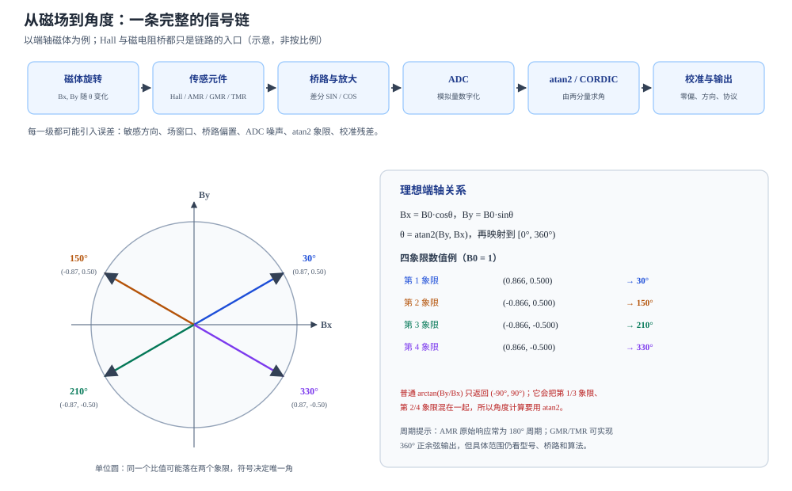

# 从磁场到角度：Hall 与磁电阻传感信号链

状态：草稿整理：2026-10-26范围：系统信号链

> 本篇回答：传感器测到的是几个磁场分量或桥电压，怎样变成 0–360° 的角度？
> 先修：[从磁场到材料响应](field-and-measurement.md)、[磁电阻效应：AMR、GMR 与 TMR](magnetoresistance.md)；预计阅读 25 分钟。
> 读完能回答：① Hall 与 AMR/GMR/TMR 分别测什么？② 桥路、ADC、atan2/CORDIC、校准和输出怎样串起来？③ 为什么 atan2 必须保留象限，而 “ADC 位数” 不能直接当角度精度？

## 适用范围

本文讲“从磁体到数字角度”的系统链路，重点是每一级在做什么、会引入什么误差。MR 的材料机理在 D01；磁体、充磁和安装几何在 D03；偏置/幅值/正交的误差展开在 D04；分辨率、采样、带宽和输出协议在 D06。所有场窗口、周期、精度和 AGC 结论都绑定具体型号与测试条件，不能改写成行业通用规则。

## 先看一个现象

把一只径向充磁的圆柱磁体装在轴端，传感器放在正下方。慢慢转动轴，用示波器看芯片的两路模拟输出：一路像余弦，一路像正弦；转到 90° 时，一路接近最大值，另一路接近零；转到 180° 时，两路的符号都反过来。芯片并没有“直接读出角度”，它给出的是与角度有关的两个电压，角度是后级算出来的。

如果芯片是 AMR 变体，原始输出可能只在一个 180° 区间内单调；如果是 GMR/TMR 变体，才可能在整个 360° 内给出正余弦。**“技术名词”只说明机理，不说明成品输出范围。** TLE5x09 系列就同时提供 AMR 0–180° 和 GMR 0–360° 的变体 [ENC-02，p.1](../sources/vendor.md#ENC-02)；TLE5501 则给出 360° 差分正余弦 [ENC-03，p.1](../sources/vendor.md#ENC-03)。

## 一张图建立直觉

<figure class="kb-figure" markdown="1">
  
  <figcaption>图 1　从磁场到角度的信号链与 atan2 四象限（示意）。上排是链路的功能级；下排左侧是单位圆上的四个示例矢量，右侧给出对应的 atan2 结果。真实芯片可能把其中几级集成在片内，也可能只输出模拟正余弦，由主控完成 ADC 和角度计算。</figcaption>
</figure>

理想端轴结构中，传感器处的横向磁场可以写成：

$$
B_x=B_0\cos\theta,\qquad B_y=B_0\sin\theta
$$

$\theta$ 是磁体相对传感器坐标系的机械角，$B_0$ 是横向场幅值。两路信号经过桥路、放大和 ADC 后，角度由：

$$
\theta=\operatorname{atan2}(B_y,B_x)
$$

得到。$\operatorname{atan2}$ 的值域通常取 $(-180°,180°]$，再映射到 $[0°,360°)$。**关键是它同时使用 $B_x$ 和 $B_y$ 的符号**；普通的 $\arctan(B_y/B_x)$ 只返回 $(-90°,90°)$，会把相差 180° 的方向混在一起。

## 概念、符号与单位

### Hall 与 MR 测的不是同一个东西

Hall 元件测量磁通密度的一个分量。以 AS5600 为例，它使用平面 Hall 传感器测量垂直于芯片表面的 $B_z$ 分量，再把霍尔信号放大、滤波、经 12 位 ADC 和 CORDIC 求角度 [ENC-04，PDF p.11、p.10](../sources/vendor.md#ENC-04)。3D Hall 可以同时测三个分量，适合侧轴、离轴或杂散场补偿，但具体能力仍看型号。

AMR/GMR/TMR 则利用磁电阻桥对**磁场方向**的响应。TLE5501 由 8 个 TMR 电阻组成两个惠斯通电桥，X 桥给余弦、Y 桥给正弦，均为差分输出 [ENC-03，p.4](../sources/vendor.md#ENC-03)。TLE5x09 的框图中也能看到 X-GMR/Y-GMR 或 X-AMR/Y-AMR 桥、放大器和 COS_P/N、SIN_P/N 引脚 [ENC-02，p.10](../sources/vendor.md#ENC-02)。

两类器件的共同点是：**它们都只给出与角度有关的电信号，角度是后级算出来的。** 区别在于 Hall 直接测分量，MR 测的是场方向引起的电阻变化；在端轴结构中，两者都可能被组织成正余弦。

### 桥路、差分与共模

惠斯通电桥把电阻变化变成差分电压。差分输出的好处是：电源、地弹、温度共模和一部分外部均匀场会同时作用在两端，相减后被抑制。但差分不是万能的：桥臂不匹配会留下偏置，两条桥的幅值不一致会留下椭圆，相位不正交会留下角度误差。TLE5501 的数据手册把这些分别列为桥电阻、差分输出幅值、正交误差、幅值同步率和偏置电压 [ENC-03，p.10–11](../sources/vendor.md#ENC-03)。

### ADC、atan2/CORDIC 与校准

信号链可以写成：

$$
\text{磁场} \rightarrow \text{敏感元件} \rightarrow \text{桥路/放大} \rightarrow \text{ADC}
\rightarrow \operatorname{atan2} \rightarrow \text{校准} \rightarrow \text{输出}
$$

- **ADC** 把模拟电压变成数字量；它的位数决定量化步进，不决定总误差。
- **atan2/CORDIC** 由两路分量求角；atan2 保留象限，CORDIC 用迭代旋转实现同类计算。AS5600 的框图明确画出 12 位 ADC 后接 ATAN（CORDIC），再进入数字处理和 12 位 DAC/PWM [ENC-04，PDF p.4、p.11](../sources/vendor.md#ENC-04)。
- **校准** 修正零偏、方向、幅值、正交性和非线性。TLE5501 的角度误差表明确写着：在 25°C、25–80 mT、差分输出，并对偏置、正交和幅值做补偿时，最大角度误差 0.8°；全温度/寿命条件下最大 1.5° [ENC-03，p.12](../sources/vendor.md#ENC-03)。没有这些补偿条件，不能把 0.8° 当成“上电即得”。

**INL（积分非线性）** 是输出角度与理想角度关系的最大偏差，属于系统误差，不是分辨率，也不是随机噪声。数据手册给 INL 时必须带角度范围、拟合方式和测试条件；AS5600 的系统 INL 标为 ±1°（最佳拟合直线、360°、无磁体位移、未做零点编程）[ENC-04，PDF p.10](../sources/vendor.md#ENC-04)。

### 场窗口不是装饰

MR 元件需要足够的场使自由层饱和，Hall 元件也需要落在规定的线性/工作范围。下面几张表只说明**这些型号在各自条件下**的要求，不能外推：

| 器件/机理 | 场窗口或条件 | 输出/备注 |
| --- | --- | --- |
| TLE5x09 GMR | $B_{XY}$ 24–60 mT（25°C，$B_z=0$）；26–100 mT（−40°C）；21–50 mT（125°C） | 模拟正余弦（差分/单端）；具体见数据手册 |
| TLE5x09 AMR | $B_{XY}$ 最小 20 mT，准静态测试到 500 mT | 0–180° 输出；AMR 原始 180° 周期 |
| TLE5501 TMR | 20–100 mT；扩展到 20–130 mT 会附加角度误差 | 差分正余弦，需外部 ADC/算法 |
| AS5600 Hall | $B_z$ 30–90 mT，在芯片表面沿 1 mm 圆测量；检测门限 8 mT | 片内 12 位 ADC、CORDIC、AGC |

数据分别来自 [ENC-02，p.18](../sources/vendor.md#ENC-02)、[ENC-03，p.9](../sources/vendor.md#ENC-03) 和 [ENC-04，PDF p.10、p.35](../sources/vendor.md#ENC-04)。注意 TLE5x09 的 GMR 窗口随温度变化，AS5600 要求的是 $B_z$ 而不是任意方向的总场；同一句“工作场强”在不同机理下含义不同。

**AGC 也是型号特性。** AS5600 用自动增益控制补偿温度、气隙和磁体老化带来的场强变化，5 V 时 AGC 范围 0–255、3.3 V 时 0–128；原厂建议把增益放在范围中心以获得更稳健的性能 [ENC-04，PDF p.22](../sources/vendor.md#ENC-04)。这不是所有 Hall 编码器都有的功能，也不能替代场窗口校核。

## 公式怎样使用（含完整算例）

**教学算例：用两路分量算角度，并检查象限。**

假设归一化后的两路信号为 $B_x=0.60$、$B_y=-0.80$（这里把幅值归一化为 1.0，只练 atan2；真实芯片的场强要落在上表的窗口内）。

第一步，算幅值：

$$
B_0=\sqrt{0.60^2+(-0.80)^2}=1.00
$$

第二步，用 atan2：

$$
\theta=\operatorname{atan2}(-0.80,0.60)=-53.13°
$$

第三步，映射到 $[0°,360°)$：

$$
\theta=360°-53.13°=306.87°
$$

如果只用普通 $\arctan$，会得到 $\arctan(-0.80/0.60)=-53.13°$，看起来一样；但如果信号是 $B_x=-0.60$、$B_y=-0.80$，普通 $\arctan$ 仍然给出 $-53.13°$，而 atan2 给出 $-126.87°$，映射后是 $233.13°$。两者的比值相同，符号不同，象限就不同。

再假设某个 12 位输出把 $[0°,360°)$ 线性映射到 $0–4095$：

$$
\text{count}=\frac{306.87}{360}\times4096\approx3492
$$

一个 LSB 对应 $360°/4096=0.0879°$。但这只是**量化步进**，不是角度精度；同一颗 AS5600 的 INL 最大 ±1°，噪声在慢滤波下约 0.015°、快滤波下约 0.043° [ENC-04，p.8](../sources/vendor.md#ENC-04)。把 0.0879° 当成“误差”会低估系统误差，也会忽略噪声和校准残差。

## 曲线和结构变化时会怎样

- **AMR 的 180° 周期需要额外处理。** TLE5x09 的 AMR 变体输出 0–180°，GMR 变体输出 0–360°；数据手册用图 9 对比了两者的输出斜率和 AMR 的反相 SIN 虚线。AMR 的方向二义性要靠桥路、反相通道或算法恢复，不能只看一条电阻曲线 [ENC-02，p.12](../sources/vendor.md#ENC-02)。
- **GMR/TMR 的 360° 也不是“无误差”。** TLE5501 的正交误差最大 ±10°、幅值同步率 90%–110%、差分偏置 ±5 mV/V；这些是桥路层面的容差，经过校准后数据手册才给出 0.8°/1.5° 的角度误差 [ENC-03，p.10–12](../sources/vendor.md#ENC-03)。
- **场强偏离窗口，信噪比或线性度会变差。** 场太弱，MR 自由层可能没有充分饱和；场太强，可能进入非线性或热风险区。TLE5501 把 20–130 mT 标为“扩展范围”，并明确会附加角度误差 [ENC-03，p.9](../sources/vendor.md#ENC-03)。
- **气隙变化对 MR 的影响要看条件。** TLE5x09 的数据手册强调 MR 原理“不受气隙变化影响”，但同一份手册又给出 $B_{XY}$ 窗口随温度变化 [ENC-02，p.1、p.18](../sources/vendor.md#ENC-02)。更准确的读法是：在饱和且波形不变的前提下，MR 主要读方向，幅值变化不直接变成角度；一旦场强跌出窗口或空间波形畸变，气隙仍会通过饱和与谐波影响角度。
- **集成度不同，系统责任不同。** AS5600 片内完成 ADC、CORDIC、AGC 和输出；TLE5x09/TLE5501 只给模拟正余弦，ADC、atan2、校准和诊断由主控承担。把“芯片输出”与“系统角度”混为一谈，会漏掉后级的噪声、采样和算法误差。

## 常见误区

| 常见误区 | 为什么不对 | 更稳妥的说法 |
| --- | --- | --- |
| “atan2 就是 arctan” | arctan 只返回值域 $(-90°,90°)$；atan2 用两个符号恢复四个象限 | 用 atan2，并明确输出是 $(-180°,180°]$ 还是 $[0°,360°)$ |
| “磁场越强越好” | 超出窗口会饱和/非线性/热风险；太弱则信噪比不足 | 按目标型号的场窗口和温度条件设计气隙与磁体 |
| “ADC 位数就是角度精度” | 位数只决定量化步进；噪声、INL、偏置、正交和校准残差都进入误差 | 把分辨率、噪声、INL、总误差分开列 |
| “某型号的 AGC/SFI 特性可以推广到所有芯片” | AGC、差分配置、杂散场免疫都是具体型号和模式的功能 | 查目标型号的数据手册和应用条件 |

## 自测

自测 1：$B_x=-0.50$、$B_y=0.866$（归一化）。角度是多少？

答案：atan2(0.866, −0.50) = 120°。它落在第二象限；普通 arctan(0.866/−0.50) 会给出 −60°，必须靠符号恢复象限。

自测 2：为什么 AMR 原始响应常是 180° 周期，而 GMR/TMR 可以做到 360°？

答案：AMR 的电阻项是 $\cos^2\theta$，θ 与 θ+180° 同值；GMR/TMR 的自旋阀/隧道结电阻取决于自由层与钉扎层的相对角 $\varphi$，相对角走满 360° 才回到同一状态。成品输出范围还要看桥路和算法。

自测 3：某 12 位角度输出的 LSB 是 0.0879°，是否说明它的角度误差不超过 0.0879°？

答案：不是。LSB 只是量化步进；还要看噪声、INL、偏置、正交误差、温漂和校准。AS5600 的数据手册给 12 位分辨率、INL 最大 ±1°，噪声约 0.015°/0.043°，这些量不能用一个 LSB 代替。

自测 4：TLE5x09 的 GMR 变体在 125°C 时的 $B_{XY}$ 窗口是多少？这个数能直接用于另一颗 GMR 芯片吗？

答案：数据手册给出 21–50 mT（125°C）；这是该系列在指定测试条件下的窗口，不能直接推广到其他 GMR 芯片。换型号必须重新查数据手册。

## 本篇小结

- Hall 测磁场分量，AMR/GMR/TMR 测场方向引起的电阻变化；两者都要经过桥路/放大、ADC、atan2/CORDIC、校准和输出。
- atan2 必须保留 $B_x$、$B_y$ 的符号；普通 arctan 只覆盖两个象限。
- 场窗口、输出周期、AGC 和精度都是型号特性；数据手册的条件和补偿状态必须一起读。
- 分辨率只是量化步进，不能替代噪声、INL、重复性和总角度误差。

## 工程出口

- [编码器磁体、充磁图形与安装几何](encoder-magnet-and-mounting.md)：磁体、气隙、偏心和敏感轴怎样改变两路信号。
- [角度误差从哪里来](angle-error-mechanisms.md)：偏置、幅值、正交和谐波怎样进入角度。
- [分辨率、采样、带宽与输出定义](encoder-output-and-dynamics.md)：位数、延迟、滤波和接口的工程含义。

## 来源与待确认项

- [ENC-01](../sources/vendor.md#ENC-01)：Ausserlechner，PIER B 49 (2013)。归档为摘要页；本文只使用摘要中的系统分类：垂直系统用磁电阻或垂直 Hall，轴向系统用 Hall 板。
- [ENC-02](../sources/vendor.md#ENC-02)：Infineon TLE5x09A16(D) V2.1，2024-06-28。p.1 特性，p.10 框图，p.12 输出周期与未校准误差，p.18 工作范围与温度相关场窗口。
- [ENC-03](../sources/vendor.md#ENC-03)：Infineon TLE5501 Rev.1.0，2018-07-24。p.1 特性，p.4 双桥结构，p.9 场范围，p.10–12 电气参数、正交/幅值/偏置与角度误差条件。
- [ENC-04](../sources/vendor.md#ENC-04)：ams OSRAM AS5600 v1-06，2018-06-20。PDF p.4 框图，p.11 功能描述，p.10 磁特性与系统指标，p.22 AGC，p.35 磁体要求与气隙。
- 待确认项：目标磁体在目标气隙、温度和偏心下的实际 $B_x/B_y/B_z$ 与空间波形；目标芯片的敏感体积、推荐场窗口和校准条件；主控 ADC 的噪声、采样率与 atan2 实现。
