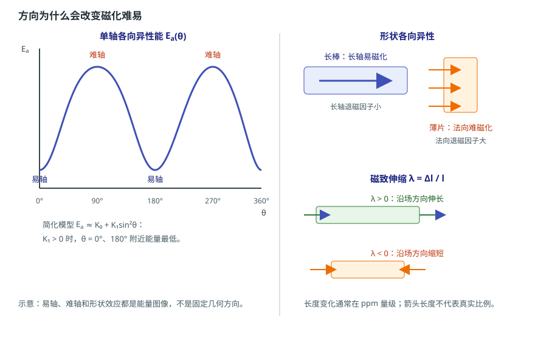

# 磁各向异性与磁致伸缩：为什么方向会改变磁化难易

状态：草稿（来源级待逐条终审）草稿日期：2026-10-26教材：第 3 章

> **本篇回答：** 同一材料沿不同方向磁化，为什么曲线和所需外场不同？压装、过盈配合或灌封之后，磁性能为什么可能变化？
> **先修：** [A02：磁矩、磁性分类与居里温度](magnetic-origin-and-classes.md)；[A03：磁畴与畴壁](magnetic-domains.md)。
> **预计阅读：** 20 分钟。

读完你能回答：

1. 易轴、难轴和各向异性能是什么？
2. 磁晶、形状、应力三种各向异性各自由什么造成？
3. 磁致伸缩 $\lambda=\Delta l/l$ 怎样计算，为什么它不只与噪声有关？

## 先看一个现象

同一牌号的取向永磁体，沿制造时的取向方向磁化，比较容易得到较高的剩磁；沿难磁化方向磁化，达到同样磁化状态往往需要更大的外场，曲线也不同。另一个场景：一个软磁件在自由状态下磁导率很高，压入过盈配合或灌封固化后，读数下降；这不是“材料牌号变了”，而是应力改变了磁化难易。

这两个现象都指向同一件事：**磁性材料不是各向同性的标量介质；磁化曲线有方向，也有应力条件。**

## 一张图建立直觉

<figure class="kb-figure" markdown="1" style="box-sizing:border-box;max-width:calc(100vw - 2rem);margin-left:auto;margin-right:auto">
  { style="width:100%;height:auto;max-width:100%" }
  <figcaption>示意：左图易轴在 0°、180° 附近，难轴在 90°、270° 附近；右上长轴易磁化、薄片法向难磁化；右下为正、负磁致伸缩的长度变化趋势。图不按比例。</figcaption>
</figure>

左图是单轴各向异性能随磁化方向角 $\theta$ 的变化：磁矩停在易轴附近时能量低，转向难轴时要跨过能量势垒。右上图说明形状也会产生方向性：细长磁体沿长轴退磁因子小，容易磁化；薄片沿法向退磁因子大，难磁化。右下图是磁致伸缩：正磁致伸缩材料沿场方向伸长，负磁致伸缩材料沿场方向缩短。

## 概念、符号与单位

### 各向异性能与易轴

磁各向异性就是“不同方向磁化难易不同”。对单轴各向异性，常用下式描述能量随方向的变化：

$$
E_a=K_0+K_1\sin^2\theta+K_2\sin^4\theta
$$

其中 $\theta$ 是磁化矢量与参考轴的夹角，$K_0$、$K_1$、$K_2$ 是各向异性常数（单位常用 $\text{J/m}^3$）。在只保留 $K_1$ 的简化模型里，$K_1>0$ 时 $\theta=0^\circ$ 和 $180^\circ$ 附近能量最低，这两个方向就是易轴；$K_1<0$ 时，$\theta=90^\circ$ 附近的平面可能更容易磁化。若 $K_2$ 不可忽略，易面还可能变成易锥。教材用磁晶各向异性、形状各向异性和应力各向异性解释这种方向依赖 [BOOK-01，第 3 章，书 p.71 起 / PDF p.80 起](../sources/book.md#BOOK-01)。

工程上不需要先算出 $K_1$，但必须记住：**磁化曲线是有方向条件的。** 数据表若只给一个 $B_r$ 或一个磁导率，要问清楚是沿哪个方向、在什么温度和什么磁场下测的。

### 三种来源

| 来源 | 物理原因 | 典型表现 |
| --- | --- | --- |
| 磁晶各向异性 | 晶格中不同晶向的原子环境不同 | 单晶沿不同晶轴磁化曲线不同；取向多晶有宏观易轴 |
| 形状各向异性 | 有限尺寸样品的退磁场与形状有关 | 长棒沿长轴易磁化；薄片法向难磁化 |
| 应力各向异性 | 磁致伸缩与机械应力耦合 | 压装、弯折、冲压、灌封后磁化难易改变 |

形状各向异性来自退磁场：

$$
\mathbf{H}_d=-N\mathbf{M}
$$

其中 $N$ 是退磁因子，与形状和磁化方向有关。对椭球，三个主轴方向满足 $N_x+N_y+N_z=1$；细长方向 $N$ 小，退磁场弱，所以更容易磁化；薄片法向 $N$ 接近 1，退磁场强，所以难磁化。完整的退磁场、负载线和工作点计算放在 A06。

### 磁致伸缩

铁磁或亚铁磁材料在外场中磁化时，长度和体积会发生微小变化，这叫磁致伸缩。沿外场方向的相对长度变化定义为：

$$
\lambda=\frac{\Delta l}{l}
$$

其中 $\Delta l$ 是长度变化，$l$ 是原长，$\lambda$ 无量纲，工程上常用 ppm（$10^{-6}$）表示。外场增大到饱和磁化场时，纵向磁致伸缩趋于一个稳定值，叫饱和磁致伸缩 $\lambda_s$。教材指出：$\lambda_s>0$ 的材料沿场方向伸长，$\lambda_s<0$ 的材料沿场方向缩短；不同材料、不同晶向的符号和大小可以不同 [BOOK-01，§3.6，书 p.85 起 / PDF p.94 起](../sources/book.md#BOOK-01)。

磁致伸缩不只与声学噪声有关。它还会：
- 让材料在磁化时产生微小尺寸变化，影响精密结构的间隙；
- 与装配应力耦合，改变磁化曲线和磁导率；
- 在电机、变压器中通过磁致伸缩和 Maxwell 力产生振动噪声；
- 让应力成为磁性能的一个“隐藏输入”，而不仅是机械问题。

### 取向、充磁与易轴不是一回事

| 术语 | 关注点 | 不是什么 |
| --- | --- | --- |
| 易轴 | 材料能量图上的低能方向 | 不是成品当前的磁化方向 |
| 取向 | 制造时晶粒/磁畴是否沿某方向排列 | 不是充磁方向，也不保证成品磁场形状 |
| 充磁 | 成品被磁化到何种空间分布 | 不是材料易轴的代名词 |

“各向同性磁体”通常指宏观上不进行晶粒取向，不等于单个晶粒没有磁晶各向异性。它只是没有明显的宏观织构，因此沿不同方向充磁的差别可能小一些，但微观各向异性仍在 [MAG-01](../sources/vendor.md#MAG-01)。

## 公式怎样使用：一个完整算例

**教学假设：** 一根原长 $l=20.000\ \text{mm}$ 的磁致伸缩棒，磁化后长度增加 $\Delta l=0.40\ \mu\text{m}$。求 $\lambda$；若同一材料的饱和磁致伸缩为 $\lambda_s=20\ \text{ppm}$，另一根 $50\ \text{mm}$ 长的棒在饱和时长度变化约多少？

先统一单位：$0.40\ \mu\text{m}=0.40\times10^{-6}\ \text{m}$，$20.000\ \text{mm}=0.020000\ \text{m}$。

$$
\lambda=\frac{\Delta l}{l}
=\frac{0.40\times10^{-6}}{0.020000}
=2.0\times10^{-5}
=20\ \text{ppm}
$$

再算 $50\ \text{mm}$ 的棒：

$$
\Delta l=\lambda_s l
=(20\times10^{-6})(50\ \text{mm})
=1.0\times10^{-3}\ \text{mm}
=1.0\ \mu\text{m}
$$

**结果解释：** $20\ \text{ppm}$ 看起来很小，但在 $50\ \text{mm}$ 长度上就是约 $1\ \mu\text{m}$ 的尺寸变化。对微米级气隙或高精度装配，这个量级不能忽略。上面的 $\lambda_s=20\ \text{ppm}$ 是教学值，不是某个牌号的保证值；实际材料要查对应温度、应力和磁场下的数据。

## 条件变化时会怎样

- **沿难轴磁化：** 需要更大外场才能达到同样的磁化强度；若充磁场不足，成品可能没有达到预期磁化状态。
- **形状改变：** 长径比、薄片方向和气隙改变退磁因子，进而改变工作点。形状不改变材料 $B_r$，但会改变成品内部的 $B$ 和抗退磁表现，详见 A06。
- **加应力：** 应力通过磁致伸缩改变各向异性能；软磁材料的磁导率可能下降，永磁体的工作点也可能移动。符号和大小取决于材料、应力方向和磁化方向，不能套用统一结论。
- **温度改变：** 各向异性常数、饱和磁化强度和磁致伸缩都随温度变化；高温下易轴可能减弱，抗退磁能力下降。具体温度曲线要查牌号资料。

## 常见误区

!!! warning "四个常见错误"
    1. **“晶粒取向、磁体充磁方向和易轴是一回事。”** 易轴是能量图上的方向；取向是制造织构；充磁是成品当前的磁化分布。三者可以相关，但不能互相替代。
    2. **“各向同性磁体没有各向异性。”** 宏观不取向不等于微观没有磁晶各向异性；它只是没有明显的宏观织构。
    3. **“磁致伸缩只与声学噪声有关。”** 它还会造成尺寸变化、应力耦合、气隙变化和传感器偏置；噪声只是其中一个工程表现。
    4. **“应力对磁性能的影响方向对所有材料都一样。”** 正、负磁致伸缩材料的响应方向不同；同一材料在不同应力方向下也可能不同。必须按材料和应力状态验证。

## 自测

**1.** 在只保留 $K_1$ 的简化模型中，$K_1>0$ 时易轴在哪里？

查看答案

易轴在 $\theta=0^\circ$ 和 $180^\circ$ 附近，因为 $\sin^2\theta=0$ 时各向异性能最低。若 $K_1<0$，则 $\theta=90^\circ$ 附近的平面更容易磁化；若 $K_2$ 不可忽略，还可能出现易锥。

**2.** 某材料 $\lambda_s=-10\ \text{ppm}$，沿场方向长度怎样变化？$30\ \text{mm}$ 长的样品变化多少？

查看答案

负号表示沿场方向缩短。$\Delta l=\lambda_s l=(-10\times10^{-6})(30\ \text{mm})=-0.30\ \mu\text{m}$，即缩短约 $0.30\ \mu\text{m}$。这是饱和磁致伸缩下的估算，实际还受应力、温度和磁化历史影响。

**3.** 为什么“各向同性磁体”仍然可能有方向性？

查看答案

“各向同性”通常指宏观上不进行晶粒取向，但单个晶粒仍有磁晶各向异性；此外，成品形状会产生形状各向异性，充磁和装配也可能引入方向性。因此宏观不取向不等于完全没有方向效应。

## 本篇小结

- 各向异性就是不同方向磁化难易不同；易轴是能量低的方向，难轴需要更大外场。
- 磁晶、形状、应力三种来源可以叠加；形状各向异性来自退磁场，不是材料牌号常数。
- 磁致伸缩用 $\lambda=\Delta l/l$ 描述，正负号取决于材料；它会影响尺寸、应力、噪声和工作点。

## 工程出口

- 需要把“形状改变工作点”算清楚时，继续读 [A06：退磁场与形状效应](demagnetizing-field-and-shape.md)。
- 装配应力导致磁性能变化时，按 [FAE 排障路径](../fae/troubleshooting.md) 做自由状态与装配状态的对照测量。
- 充磁图形、取向标识和安装几何的图纸检查见 [D03：编码器磁体、充磁图形与安装几何](encoder-magnet-and-mounting.md)；本文只解释方向性的物理来源，不替代磁体图纸和充磁工艺。

## 适用边界

本文不提供具体材料的 $K_1$、$K_2$、$\lambda_s$ 或应力灵敏度；这些参数与成分、晶粒取向、温度、应力和测量方向有关。图中的能量曲线和长度变化是示意，不是实测。实际装配应力、噪声和可靠性需要样件测试、结构仿真和供应商数据支撑；不能把某一个牌号的方向性结论直接推广到所有材料。

## 来源与待确认项

- [BOOK-01](../sources/book.md#BOOK-01)：第 3 章书 p.71 起 / PDF p.80 起；§3.6 书 p.85 起 / PDF p.94 起。页码为章节起始页锚点，各向异性能和磁致伸缩定义已对照扫描页，仍待逐条终审。
- [MAG-01](../sources/vendor.md#MAG-01)：Arnold Magnetic Technologies，磁学基础要素；支持易轴、晶粒取向与各向同性磁体的区别。

待确认：目标材料的 $K_1$、$K_2$、$\lambda_s$ 随温度的变化；装配应力的实际方向和大小；客户把“取向”与“充磁”混用时，图纸上到底标了哪一个。
