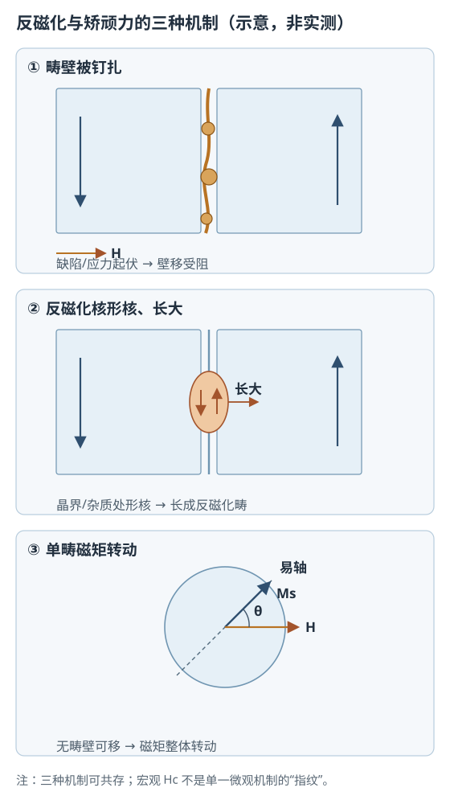

# 反磁化与矫顽力：形核、钉扎和磁矩转动

状态：草稿整理：2026-10-26教材：§5.4、§5.5

> 本篇回答：两种材料的饱和磁化强度差不多，为什么抵抗退磁的能力可以差很多？
> 先修：B01《技术磁化与磁滞回线》、A04《磁各向异性》、A06《退磁场与形状效应》；预计阅读 20 分钟。
> 读完能回答：① 反磁化过程中可能发生哪三种机制？② 为什么“晶粒越小，$H_c$ 一定越高”不成立？③ $H_{cB}$ 和 $H_{cJ}$ 分别说明什么？

## 先看一个现象

拿两块饱和磁化强度 $M_s$ 接近的永磁材料，在第二象限从饱和点往反向逐渐加场。一块的 $J$–$H$ 曲线很快弯折，反向场稍大就掉下来；另一块能撑到更大的反向场。它们的“磁矩总量”相近，抵抗反向磁化的能力却差很多。这说明**矫顽力不是由 $M_s$ 单独决定的**，而是由材料内部“反磁化怎么发生、在哪里被挡住”决定。

教材把反磁化过程概括为三种阻碍机制：畴壁位移受阻、反磁化核的形成与长大、以及没有畴壁时的磁矩转动 [BOOK-01，§5.4，书 p.131 / PDF p.140](../sources/book.md#BOOK-01)。实际材料往往几种机制同时存在，不能用一个模型解释所有牌号和温度。

## 一张图建立直觉

<figure class="kb-figure" markdown="1">
  
  <figcaption>图 1　反磁化的三种机制（示意，非按比例、非实测显微图）。左：缺陷与应力起伏让畴壁走走停停；中：晶界或杂质处先形成反磁化核，核长大后才推动畴壁；右：单畴颗粒没有可移动畴壁，只能靠磁矩转动越过各向异性能垒。三种机制可共存。</figcaption>
</figure>

图 1 的左、中两幅都涉及“畴壁”，但阻碍的位置不同：左图是畴壁在移动途中被缺陷、应力或夹杂物钉住；中图是先在晶界或缺陷处“生出”一个反向的小区域，再长大成反磁化畴。右图则假设材料已经接近单畴，没有畴壁可移，只能让整个磁矩转向。三条路径对应的微观参数不同，所以不能用一个 $H_c$ 数值反推材料一定属于哪种机制。

## 概念、符号与单位

反磁化是从一个方向的技术磁化饱和状态，转到相反方向的饱和状态。两个最常用的宏观量是：

- **$H_{cB}$（磁感矫顽力）：** 在 $B$–$H$ 回线上使 $B=0$ 的反向场。
- **$H_{cJ}$（内禀矫顽力）：** 在 $J$–$H$ 或 $M$–$H$ 回线上使 $J=0$ 或 $M=0$ 的反向场。

它们不是同一个量。对永磁材料，第二象限中 $|H_{cJ}|$ 通常大于 $|H_{cB}|$；教材还指出，$B=0$ 时 $|H_{cB}|$ 不会超过剩磁对应的磁化强度，因此 $\mu_0|H_{cB}|\le B_r$ [BOOK-01，§5.5.3，书 p.139 / PDF p.148](../sources/book.md#BOOK-01)。这句话的工程含义是：**$B_r$ 高不代表 $H_{cB}$ 一定高**，更不能由 $B_r$ 单独判断抗退磁能力。TDK 的定义也把 $H_{cB}$ 明确为 $B$ 回到零所需的反向场 [MAT-01，§1.2.4，PDF p.3](../sources/vendor.md#MAT-01)。

### 三种机制分别看什么

| 机制 | 物理图像 | 主要受阻因素 | 常见材料线索 |
| --- | --- | --- | --- |
| 畴壁位移受阻 | 畴壁从一个畴向另一个畴移动，遇到缺陷/应力起伏停住或跳跃 | 内应力起伏、夹杂物、晶界、缺陷 | 软磁中很常见；$H_c$ 通常较低 |
| 反磁化核形核、长大 | 在晶界、杂质或应力集中处先形成反向小区域，再长大 | 形核位置、晶粒尺寸、易轴取向、局部退磁场 | 高 $H_{cJ}$ 永磁的重要机制之一 |
| 磁矩转动 | 单畴颗粒内部磁矩整体转向，越过各向异性能垒 | 磁晶、应力、形状各向异性 | 单畴颗粒、AlNiCo（铝镍钴）等脱溶合金 |

## 公式怎样使用（含完整算例）

### 钉扎：为什么矫顽力与缺陷起伏有关

对 180° 畴壁，如果畴壁厚度 $\delta$ 远小于应力起伏周期 $l$，教材给出量级估计

$$
H_c \approx \frac{\delta\,\lambda_s\,\Delta\sigma}{l\,\mu_0 M_s}
$$

若 $\delta$ 远大于 $l$，则改为

$$
H_c \approx \frac{l\,\lambda_s\,\Delta\sigma}{\delta\,\mu_0 M_s}
$$

其中 $\delta$ 是畴壁厚度（m），$\lambda_s$ 是饱和磁致伸缩系数（无量纲），$\Delta\sigma$ 是内应力起伏幅值（Pa），$l$ 是起伏周期（m），$\mu_0M_s$ 的单位是 T，$H_c$ 的单位是 A/m。**适用条件：** 这两个式子只用于数量级估计和定性趋势，不能当作牌号保证值；实际 $\delta$、$l$、$\Delta\sigma$ 很难独立确定。

含杂模型给出另一个量级关系：

$$
H_c \sim \frac{\delta K_1}{d\,\mu_0 M_s}\,\beta^{2/3}
$$

其中 $K_1$ 是磁晶各向异性常数（J/m³），$d$ 是夹杂物直径（m），$\beta$ 是夹杂物体积分数（无量纲）。它说明：夹杂物尺寸与畴壁厚度相当时，钉扎作用可能最强；夹杂物过多、过粗又会带来别的效应。**同样只能作趋势判断，不能跨材料套数值。**

### 形核：先有“反向小核”，才谈长大

理想饱和状态下，材料内部本来没有畴壁。反磁化要发生，往往先在晶界、杂质、应力不均匀处形成一个与饱和方向相反的小区域，即反磁化核。核要长大，必须克服畴壁能、退磁能和钉扎阻力。教材给出晶界形核的临界场量级式

$$
H_c \approx \frac{1}{6}\pi M_s\left(\cos\theta_1-\cos\theta_2\right)
$$

其中 $M_s$ 的单位是 A/m，$\theta_1$、$\theta_2$ 是相邻晶粒易轴与晶界法线的夹角（rad 或 °，三角函数内用弧度），$H_c$ 的单位是 A/m。**适用条件：** 这是理想化的晶界形核模型，用于解释趋势；真实材料还受缺陷分布、局部退磁场和热激活影响。

由这个图像可以理解两条工程规律：细化晶粒、让相邻晶粒易轴尽量平行，可以降低局部退磁能、抑制形核；但把 $K_1$ 提得过高又会阻碍畴壁位移，反而提高 $H_c$。所以“提高各向异性”不是无条件的好事，要看它作用在哪个环节。

### 转动：单畴颗粒的理想上限

对单轴、单畴、无缺陷、磁矩一致转动的颗粒，沿易轴加反向场时，理想矫顽力约为

$$
H_c \approx \frac{2K_1}{\mu_0 M_s}
$$

**适用条件：** 单畴、单轴各向异性、一致转动（coherent rotation）、无热激活、无缺陷；这是理想上限，不是实际牌号值。若外场与易轴成 45°，理想值会降到 $K_1/(\mu_0M_s)$ 量级。

**教学算例（明确假设，不对应任何牌号）：** 取 $K_1=4.0\times10^{5}\ \text{J/m}^3$，$\mu_0M_s=1.2\ \text{T}$。沿易轴时

$$
H_c\approx\frac{2\times4.0\times10^{5}}{1.2}
=6.7\times10^{5}\ \text{A/m}
=670\ \text{kA/m}
$$

若把 $K_1$ 提高到 $8.0\times10^{5}\ \text{J/m}^3$，理想 $H_c$ 约翻倍到 $1.33\times10^{6}\ \text{A/m}$。**结果解释：** 各向异性越强，理想转动越难；但实际材料若有形核中心或缺陷，测到的 $H_c$ 往往明显低于这个理想值。算例只说明“$K_1/(\mu_0M_s)$ 的量级”，不能拿来给材料定牌号。

## 曲线和结构变化时会怎样

- **$H_{cB}$ 与 $H_{cJ}$ 分开看。** $H_{cB}$ 描述 $B$ 过零，$H_{cJ}$ 描述内禀磁化反转；在第二象限，两者之间隔着一段 $B$–$H$ 曲线的斜率。比较材料时先说清是哪条曲线。
- **晶粒尺寸不是单向旋钮。** 对形核控制的永磁，细化晶粒可能减少形核位置、提高 $H_c$；对纳米晶软磁，晶粒细化到纳米尺度反而会平均掉磁晶各向异性、降低 $H_c$。所以“晶粒越小，$H_c$ 必然越大”是错的，必须绑定材料体系和机制。
- **缺陷是双刃剑。** 形核需要减少缺陷中心；钉扎又需要足够多的缺陷来挡住畴壁。教材明确指出这两类需求互相矛盾，不能只增加或只减少缺陷 [BOOK-01，§5.5.3，书 p.140 / PDF p.149](../sources/book.md#BOOK-01)。
- **温度改变所有竞争项。** $M_s$、$K_1$、$\lambda_s$、热激活和畴壁厚度都随温度变化，$H_c$ 的温度系数可正可负。室温 $H_c$ 不能直接代表高温或低温性能。
- **形状和应力会叠加。** 退磁场、应力各向异性和形状各向异性都会改变局部反磁化路径；同一牌号做成不同长径比，测到的 $H_c$ 也可能不同。

## 常见误区与自测

| 常见误区 | 为什么不对 | 更稳妥的说法 |
| --- | --- | --- |
| “$H_c$ 完全由 $B_r$ 决定” | $B_r$ 只是剩磁状态；$H_c$ 还取决于各向异性、缺陷、晶界、应力和温度 | 同时看 $B_r$、$H_{cB}$、$H_{cJ}$、膝点和温度曲线 |
| “晶粒越小，$H_c$ 一定越高” | 机制不同，趋势可以相反；纳米晶软磁就是反例 | 先判断是形核控制、钉扎控制还是转动控制 |
| “一个微观模型能解释所有牌号” | 实际材料多种机制共存，缺陷和工艺历史不同 | 把模型当趋势工具，用显微组织和实测曲线验证 |
| “$H_{cB}$ 和 $H_{cJ}$ 可以互换” | 定义在不同曲线上，数值一般不同 | 报告 $H_c$ 时必须注明 $B$–$H$ 还是 $J$–$H$ |

自测 1：两条 $J$–$H$ 曲线的 $B_r$ 接近，$H_{cJ}$ 分别为 1600 kA/m 和 800 kA/m。哪条更难发生本征退磁？能否据此判断高温下也更好？

答案：$H_{cJ}=1600\ \text{kA/m}$ 的那条在室温下更难发生本征反转。但不能只凭室温 $H_{cJ}$ 判断高温性能；还要看 $H_{cJ}(T)$、膝点、负载线、最大反向场和允许损失。$B_r$ 接近也不说明两者的 $H_{cB}$ 相同。

自测 2：某材料细化晶粒后 $H_c$ 升高，可能是什么机制在起作用？这个结论能推广到所有材料吗？

答案：可能是晶粒细化减少了形核位置，或增加了晶界对畴壁的钉扎。不能推广：若材料是纳米晶软磁，晶粒细化可能平均掉各向异性、降低 $H_c$；必须结合材料体系和显微组织判断。

自测 3：用 $K_1=4.0\times10^{5}\ \text{J/m}^3$、$\mu_0M_s=1.2\ \text{T}$ 计算理想单畴转动 $H_c$。若实测只有 300 kA/m，说明什么？

答案：理想值约 $6.7\times10^{5}\ \text{A/m}=670\ \text{kA/m}$。实测更低说明实际反磁化没有达到理想一致转动，可能由形核、缺陷钉扎、热激活或非一致转动提前触发；不能说材料“各向异性只有一半”。

自测 4：为什么“$B_r$ 高”不能保证“抗退磁强”？

答案：$B_r$ 是零场剩磁，$H_{cB}$ 是使 $B$ 过零的反向场，二者受不同因素控制；教材还给出 $\mu_0|H_{cB}|\le B_r$ 的约束。高 $B_r$ 只说明剩磁高，不能说明膝点、$H_{cJ}$ 和高温稳定性好。

## 本篇小结

- 反磁化可能由畴壁位移受阻、反磁化核形核长大、磁矩转动实现，实际材料常多种机制共存。
- 钉扎、形核和转动的公式都是量级/趋势模型，不能跨牌号套数值；$H_c$ 必须绑定温度、形状和测试曲线。
- $H_{cB}$ 与 $H_{cJ}$ 定义不同；高 $B_r$ 不等于高 $H_c$。
- 晶粒尺寸和缺陷的影响取决于机制，不能用一个方向性结论概括所有材料。

## 工程出口

- [永磁参数与工作点](permanent-magnet-parameters.md)：把 $H_{cB}$、$H_{cJ}$、膝点和负载线放在同一张第二象限图上读。
- [温度稳定性与退磁](magnet-stability-and-demagnetization.md)：可逆、不可逆和永久损失怎样随温度与反向场发生。

## 来源与待确认项

- [BOOK-01](../sources/book.md#BOOK-01)：第 5 章技术磁化。§5.4 反磁化过程，书 p.131 / PDF p.140；§5.4.1 畴壁位移阻碍，书 p.132 / PDF p.141；§5.4.2 反磁化形核，书 p.133 / PDF p.142；§5.4.3 磁畴转动阻碍，书 p.135 / PDF p.144；§5.5.3 矫顽力，书 p.139 / PDF p.148。本次查阅了这些节的起始页和相邻扫描页，未做全书 OCR；只使用概念与量级关系，不复制教材图。
- [MAT-01](../sources/vendor.md#MAT-01)：TDK，*General – Definitions*，2022-10。§1.2.4 矫顽场定义，PDF p.3。
- 待确认项：目标牌号的 $H_{cJ}(T)$、膝点、最大反向场和测试方法；显微组织与工艺历史；晶粒尺寸、缺陷和应力对实测 $H_c$ 的贡献。教材以 AlNiCo 单畴和 NdFeB 晶界/缺陷作为机制示例，具体牌号性能必须查供应商数据和原始论文，不能用教材示例代替。
