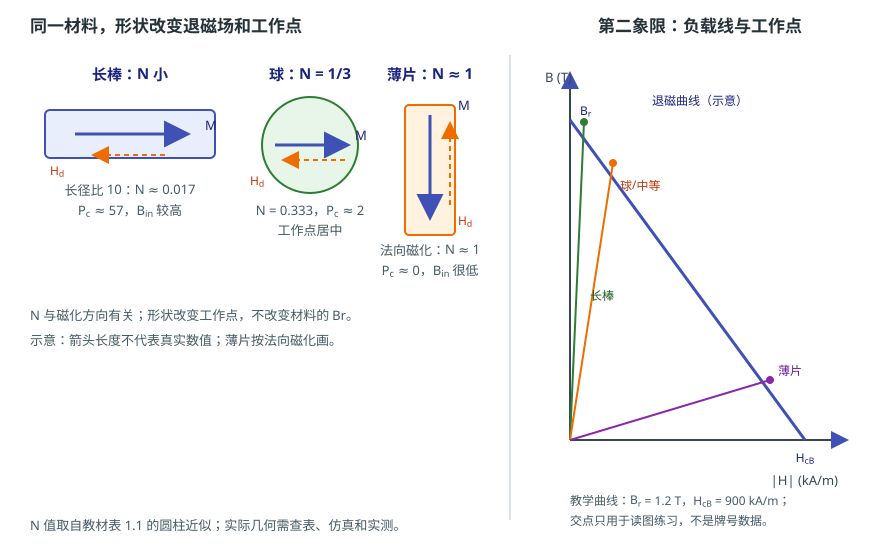

# 退磁场与形状效应：为什么尺寸会改变表现

状态：草稿（来源级待逐条终审）草稿日期：2026-10-26教材：§1.1、第 3 章、§10.1

> **本篇回答：** 同一牌号、同一体积的磁体，做成细长棒和薄片，为什么抗退磁表现不同？为什么数据表写着 $B_r\approx1.2\ \text{T}$，芯片处却不可能直接按 $1.2\ \text{T}$ 设计？
> **先修：** [A01：B、H、M、J 与磁通](field-and-measurement.md)；[A04：磁各向异性与磁致伸缩](anisotropy.md)；[A05：磁通、磁阻与磁路](magnetic-circuits.md)。
> **预计阅读：** 20 分钟。

读完你能回答：

1. 退磁场 $H_d$ 从哪里来，为什么它和形状有关？
2. 退磁因子 $N$ 为什么不是材料牌号的常数？
3. 形状怎样改变负载线和工作点，为什么 $B_r$ 不是气隙场？

## 先看一个现象

取同一牌号、同一体积的磁体，一块做成长径比很大的细长棒，一块做成很薄的圆片。都沿各自的长方向或法向磁化，然后放在同一个测量位置。细长棒往往更容易保持较高的工作点，薄片则更容易被退磁场拉到较低的工作点；如果温度升高或受到反向场，薄片可能更早出现不可逆损失。

磁体材料没有换，体积也没有换，变的是**自由磁极分布和退磁场**。

## 一张图建立直觉

<figure class="kb-figure" markdown="1" style="box-sizing:border-box;max-width:calc(100vw - 2rem);margin-left:auto;margin-right:auto">
  { style="width:100%;height:auto;max-width:100%" }
  <figcaption>示意：左图长棒 $N$ 小、球 $N=1/3$、薄片法向 $N\approx1$，$H_d$ 与 $M$ 反向；右图用 $|H|$ 表示第二象限，三条负载线对应不同形状。$B_r=1.2\ \text{T}$、$H_{cB}=900\ \text{kA/m}$ 为教学值，不是牌号数据。</figcaption>
</figure>

左图画出三种形状。磁体内部有磁化强度 $M$，表面出现自由磁极后，内部产生一个大致与 $M$ 反向的退磁场 $H_d$。长棒的退磁场弱，薄片的退磁场强；球介于两者之间。右图把退磁曲线画在第二象限，但横轴用 $|H|$ 表示。不同形状对应不同斜率的负载线，负载线与退磁曲线的交点就是工作点。

## 概念、符号与单位

### 退磁场

对均匀磁化的椭球，退磁场可以写成：

$$
\mathbf{H}_d=-N\mathbf{M}
$$

其中 $N$ 是退磁因子，无量纲；负号表示 $H_d$ 与 $M$ 方向相反。这里的 $M$ 是磁化强度（A/m），$H_d$ 是磁体内部的退磁场（A/m）。$N$ 取决于几何形状**和磁化方向**，不是材料牌号的常数。

对椭球，三个主轴方向的退磁因子满足：

$$
N_x+N_y+N_z=1
$$

- 细长方向：$N$ 小，退磁场弱，容易磁化；
- 球：$N=1/3$，三个方向相同；
- 薄片法向：$N$ 接近 1，退磁场强，难磁化。

教材表 1.1 给出沿长轴磁化的圆柱、长椭球和扁椭球的近似值：例如长径比 10 的圆柱 $N\approx0.0172$，长径比 2 的圆柱 $N\approx0.140$，长径比 1 的圆柱 $N\approx0.270$，球 $N=1/3$ [BOOK-01，§1.1，表 1.1，书 p.11 / PDF p.20](../sources/book.md#BOOK-01)。这些是特定几何、特定方向的表值，不能随手套到任意圆柱或任意磁化状态。

### 内部磁通密度与“表观剩磁”

在开路磁体中，没有外加场，内部磁场主要就是退磁场，所以 $H_{\text{in}}\approx H_d=-NM$。由 $B=\mu_0(H+M)$：

$$
B_{\text{in}}
=\mu_0(H_d+M)
=\mu_0M(1-N)
$$

如果磁体在第二象限的回复曲线接近直线，且 $J=\mu_0M\approx B_r$，则可近似写成：

$$
B_{\text{in}}\approx B_r(1-N)
$$

这个 $B_{\text{in}}$ 是磁体内部的磁通密度，**不是气隙场，也不是芯片处场**。气隙场还要经过气隙、漏磁和传感器位置，通常低于 $B_{\text{in}}$，而且空间分布不均匀。

### 负载线与工作点

在理想开路、均匀磁化、忽略膝点和漏磁的模型里，令 $H_m$ 为第二象限中有符号的磁场（负值），$|H_m|=NM$，则

$$
B_m=\mu_0(H_m+M)
=\mu_0M(1-N)
=\mu_0|H_m|\left(\frac{1}{N}-1\right)
$$

所以用 $|H_m|$ 定义的负载线斜率为：

$$
P_c=\frac{B_m}{\mu_0|H_m|}=\frac{1}{N}-1
$$

$P_c$ 越大，负载线越陡，工作点越靠高 $B$、低 $|H|$ 一侧；$P_c$ 越小，工作点越靠低 $B$、高 $|H|$ 一侧，越接近退磁曲线的膝部。教材式 (10.2) 采用有符号的 $H_d$ 定义，写成 $P=B_d/(\mu_0H_d)=1-1/N$，会得到负值；本文为读图方便使用 $|H_m|$，所以取正号。两种写法描述的是同一条直线，关键是不要混用符号约定 [BOOK-01，§10.1，式 (10.2)，书 p.248 / PDF p.257](../sources/book.md#BOOK-01)。

## 公式怎样使用：一个完整算例

**教学假设：** 一块圆柱磁体，沿长轴磁化，长径比为 2，取教材表 1.1 的近似 $N=0.14$。设材料 $B_r=1.2\ \text{T}$（教学值，不是牌号），并假设第二象限退磁曲线在所用范围内近似为直线、$J\approx B_r$、没有膝点。求 $M$、$H_d$、$B_{\text{in}}$ 和 $P_c$。

先算磁化强度：

$$
M=\frac{B_r}{\mu_0}
=\frac{1.2}{4\pi\times10^{-7}}
\approx9.55\times10^{5}\ \text{A/m}
$$

退磁场：

$$
H_d=-NM
=-0.14\times9.55\times10^{5}
\approx-1.34\times10^{5}\ \text{A/m}
\approx-134\ \text{kA/m}
$$

内部磁通密度：

$$
B_{\text{in}}
=\mu_0M(1-N)
=1.2\times(1-0.14)
\approx1.03\ \text{T}
$$

负载线斜率：

$$
P_c=\frac{1}{0.14}-1\approx6.14
$$

对比同一材料的其他形状（同样假设 $B_r=1.2\ \text{T}$）：

| 形状与方向 | $N$ | $H_d$ | $B_{\text{in}}$ | $P_c$ |
| --- | --- | --- | --- | --- |
| 圆柱，长径比 2，沿长轴 | 0.140 | $-134\ \text{kA/m}$ | 1.03 T | 6.14 |
| 圆柱，长径比 1，沿长轴 | 0.270 | $-258\ \text{kA/m}$ | 0.88 T | 2.70 |
| 圆柱，长径比 10，沿长轴 | 0.0172 | $-16.4\ \text{kA/m}$ | 1.18 T | 57.1 |

**结果解释：** 长径比越大，$N$ 越小，$H_d$ 越弱，$B_{\text{in}}$ 越高，负载线越陡；薄片法向 $N\approx1$，$B_{\text{in}}\approx0$，负载线几乎贴着 $|H|$ 轴。这里的 $B_{\text{in}}$ 只是内部平均量的教学估算，不是气隙场；实际工作点还要用真实退磁曲线、温度和几何求交点。

## 条件变化时会怎样

- **形状改变：** $N$ 改变，负载线斜率改变，工作点在退磁曲线上移动。细长形状通常有更高 $P_c$，更远离膝部；薄片法向更靠近低 $B$、高 $|H|$ 区域。
- **磁化方向改变：** 同一块磁体沿不同方向磁化，$N$ 不同。例如薄片沿平面内磁化和沿法向磁化，退磁场差很多；不能只按外形判断。
- **温度升高：** 退磁曲线整体下移、膝点提前，原本安全的工作点可能进入不可逆损失区。形状越好，通常余量越大，但不能替代温度校核。
- **附近有软磁件：** 软磁件会改变磁通路径和局部退磁场，$N$ 的“孤立椭球”假设失效；需要把磁体、软磁件和气隙放在一起仿真或实测。
- **闭路与开路：** 材料 $B_r$ 通常在闭合磁路或规定测试条件下测得；开路成品的表面场低于 $B_r$，且随位置变化。测量方法和不确定度见 [B02：磁测量](magnetic-measurement.md)，这里只强调“闭路样品”和“开路成品”不是同一件事 [MEAS-01](../sources/vendor.md#MEAS-01)。

## 常见误区

!!! warning "四个常见错误"
    1. **“细长磁体的 $B_r$ 更高。”** $B_r$ 是材料参数；细长形状改变的是 $N$、负载线和内部工作点，不是材料本身的 $B_r$。看起来“更强”是因为工作点更高、退磁更弱。
    2. **“$N$ 可以直接用于任意圆柱和任意磁化状态。”** 严格的 $N$ 定义适用于椭球和均匀磁化；圆柱表值是近似，非椭球、非均匀磁化、附近有软磁件时 $N$ 会变。实际几何要查表、仿真或实测。
    3. **“退磁场等于外部杂散场。”** $H_d$ 是磁体内部的反向场；外部用 Hall 探头测到的是 $B$，两者分布和含义不同。不能把表面高斯计的读数直接当成 $H_d$。
    4. **“$B_r$ 就是气隙场。”** $B_r$ 是规定条件下的剩磁；气隙场受形状、气隙、漏磁和传感器位置影响，通常低于 $B_{\text{in}}$，更低于 $B_r$。

## 自测

**1.** 球的 $N=1/3$，若 $M=9.0\times10^{5}\ \text{A/m}$，$H_d$ 是多少？

查看答案

$H_d=-NM=-(1/3)(9.0\times10^{5})=-3.0\times10^{5}\ \text{A/m}=-300\ \text{kA/m}$。负号表示与 $M$ 反向。实际磁体的 $M$ 不一定等于 $B_r/\mu_0$，还要看退磁曲线和工作点。

**2.** 为什么长棒的负载线比薄片陡？

查看答案

长棒的退磁因子 $N$ 小，$P_c=1/N-1$ 大，所以负载线斜率大、工作点更靠高 $B$、低 $|H|$ 一侧。薄片法向 $N\approx1$，$P_c\approx0$，负载线很平，工作点靠近低 $B$、高 $|H|$ 一侧。

**3.** 同一牌号、同一体积的磁体，做成薄片后表面场更低，是否说明材料 $B_r$ 下降了？

查看答案

不能这样判断。薄片的退磁因子更大，工作点更低，表面场也会随位置和气隙变化；$B_r$ 是材料参数，需要用闭合磁路或规定测试条件测量。表面场低可能是形状和工作点造成的，不一定是材料退化。

## 本篇小结

- 退磁场 $H_d=-NM$ 由表面自由磁极产生，$N$ 取决于几何和磁化方向，不是材料常数。
- 开路磁体的内部 $B_{\text{in}}\approx B_r(1-N)$；它既不是气隙场，也不是芯片处场。
- 负载线斜率 $P_c=1/N-1$（用 $|H_m|$）把形状和工作点连起来；细长形状通常更远离膝部，但不能替代温度和真实几何校核。

## 工程出口

- 想把形状与磁路、气隙放在一起估算，回读 [A05：磁通、磁阻与磁路](magnetic-circuits.md)。
- 需要判断实际几何的工作点和退磁风险时，用 [FAE 仿真建议](../fae/simulation.md) 建立含磁体、软磁件、气隙和空气域的模型。
- 现场出现“同牌号磁体表现不一致”时，按 [FAE 排障路径](../fae/troubleshooting.md) 先核对形状、方向、气隙、温度和测量位置，再判断材料。

## 适用边界

本文的 $N$ 和负载线公式是**理想化教学模型**：椭球或近似椭球、均匀磁化、$N$ 为常数、第二象限退磁曲线近似直线、忽略膝点、漏磁和附近软磁件。实际圆柱、方块、多极充磁和装配结构通常不满足这些条件；$N$ 会随磁化方向、材料磁导率和周围结构变化，局部 $M$ 也不均匀。具体牌号的工作点、温度稳定性和不可逆损失必须用供应商曲线、有限元和实测确认，不能只靠本文的表值。

## 来源与待确认项

- [BOOK-01](../sources/book.md#BOOK-01)：§1.1 退磁场与表 1.1，书 p.11–12 / PDF p.20–21；第 3 章形状各向异性，书 p.71 起 / PDF p.80 起；§10.1 负载线与工作点，书 p.247 起 / PDF p.256 起。页码为章节起始页锚点，表值和公式已对照扫描页，仍待逐条终审。
- [MEAS-01](../sources/vendor.md#MEAS-01)：Arnold Magnetic Technologies，永磁材料磁性能与测量技术；支持闭合磁路测量与开路表面场的区别。

待确认：目标磁体的实际长径比、充磁方向、镀层和圆角；附近软磁件对 $N$ 的影响；退磁曲线膝点位置和温度曲线族；$B_r=1.2\ \text{T}$ 仅为本文教学假设，不能当作牌号数据。
