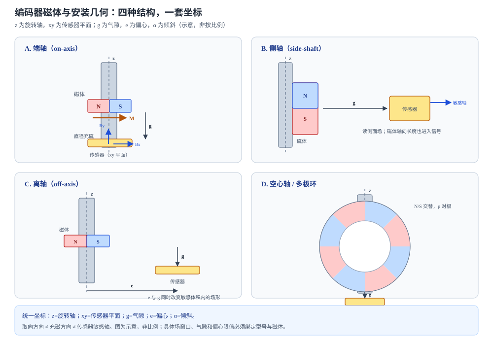

# 编码器磁体、充磁图形与安装几何

状态：草稿整理：2026-10-26范围：磁体与结构

> 本篇回答：同一颗芯片、同一牌号磁体，只改变充磁方向、气隙或偏心，角度输出为什么可能完全不同？
> 先修：[永磁参数与工作点](permanent-magnet-parameters.md)、[从磁场到角度](angle-sensing.md)；预计阅读 30 分钟。
> 读完能回答：① 轴向、径向、直径充磁分别在说什么？② 端轴、侧轴、离轴、空心轴多极环的几何差异是什么？③ 气隙、偏心和倾斜怎样进入磁场波形与角度误差？

## 适用范围

本文讨论编码器磁体的充磁图形、安装几何和图纸字段，以及它们怎样改变传感器处的场。具体芯片的场窗口、精度和输出定义仍在 D02、D04、D06；材料牌号和退磁曲线在 C04–C06。文中所有型号数值都只用于说明“该型号在该条件下”的要求，不能当成通用设计规则。

## 先看一个现象

同一只径向充磁的圆柱磁体，装在轴端、气隙 1.5 mm 时，角度输出很平稳；把磁体换成轴向充磁，或把传感器从轴线上移开 1 mm，输出可能仍然“能转”，但波形出现偏置、幅值变化和高次谐波，角度误差随位置重复。变的是**传感器敏感体积里看到的场形**。

编码器不是“磁体越强越好”的简单题。磁体的充磁方向决定场的方向分布，几何决定传感器处看到的是哪一段场，气隙和偏心决定幅值与谐波，芯片的敏感轴和算法决定这些场怎样变成角度。

## 一张图建立直觉

<figure class="kb-figure" markdown="1">
  
  <figcaption>图 1　四种常见安装几何与统一坐标（示意，非按比例）。z 是旋转轴，xy 是传感器平面；g 是气隙，e 是偏心，α 是倾斜。端轴看轴向/横向场，侧轴和离轴看侧面场，空心轴多极环还要看极对数、极距和充磁相位。实际结构的角度误差必须用目标几何仿真或实测确认。</figcaption>
</figure>

## 概念、符号与单位

### 取向、充磁与敏感轴

这三个词经常被混用：

| 术语 | 关注点 | 对角度信号的意义 |
| --- | --- | --- |
| 取向 | 制造时晶粒/磁畴是否沿某方向排列 | 决定材料能提供多高的方向性剩磁和能积 |
| 充磁 | 成品被磁化到何种空间分布 | 决定气隙中的场形、极数、极性和相位 |
| 敏感轴 | 芯片真正响应哪个方向的场 | 决定 $B_x$、$B_y$、$B_z$ 中哪一个进入角度 |

对烧结各向异性永磁体，毛坯取向方向与最终充磁方向要分别标注；对粘结、注塑和多极环，充磁夹具的分布可能与材料取向不同。**“各向异性”不等于“任意方向充磁都得到同样的表面场”。** 材料层面的取向与磁化在 [磁各向异性与取向](anisotropy.md) 中展开。

### 三种常见充磁方向

- **轴向充磁：** 磁化矢量沿圆柱/圆环的轴线。端轴结构中，传感器看到的主要是轴向分量 $B_z$；某些 Hall 芯片（如 AS5600）正是测 $B_z$。
- **径向充磁：** 磁化矢量沿半径方向。多极环常按圆周交替径向充磁，形成 N/S 交替的极。
- **直径充磁：** 圆柱或圆片的磁化矢量沿一条直径，一侧 N、一侧 S。端轴角度传感器最常用的就是直径充磁的圆柱/圆片；磁体旋转时，传感器处的横向场矢量旋转。

注意“径向”与“直径”不是同义词：径向充磁描述每一点的磁化沿半径，直径充磁描述整体磁化沿一条直径。口语常把直径充磁叫“径向充磁”，图纸应写清磁化矢量方向。

### 四种安装几何

| 几何 | 传感器位置 | 主要看到的场 | 常见风险 |
| --- | --- | --- | --- |
| 端轴（on-axis） | 磁体轴线上方 | 横向 $B_x/B_y$，或轴向 $B_z$ | 气隙、轴向跳动、磁化偏心 |
| 侧轴（side-shaft） | 磁体侧面 | 侧面法向/切向分量 | 磁体轴向长度、传感器方向、边缘场 |
| 离轴（off-axis） | 偏离磁体轴线 | 多个分量的组合 | 偏心、倾斜、场形不再是纯正余弦 |
| 空心轴/多极环 | 环内或环外 | 周向多极场 | 极对数、极距、相位、圆度和安装角 |

端轴结构可以做成“磁体在轴端、传感器在 PCB 上”，也可以做成“磁体在轴上、传感器在侧面”。侧轴和离轴不是把端轴磁体转 90° 就能复用：磁体的轴向长度、边缘漏磁和敏感体积平均都会改变波形。ENC-01 的摘要把系统分为“垂直系统”（检测垂直于旋转轴的分量，常用磁电阻或垂直 Hall）和“轴向系统”（检测平行于旋转轴的分量，常用 Hall 板），并指出优化后的轴向系统对装配公差的角度误差约为垂直系统的 3 倍；这是该理论模型的结论，不能当成所有结构的固定系数 [ENC-01，摘要](../sources/vendor.md#ENC-01)。

### 气隙、偏心与倾斜

- **气隙 $g$：** 磁体与传感器之间的距离。它首先改变场强，其次改变场的空间分布。场强跌出芯片窗口，信噪比或线性度会变差。
- **偏心 $e$：** 旋转轴与磁体几何轴、或传感器中心与磁体轴不重合。偏心会让传感器扫描的场圆发生平移，常引入低阶角度误差。
- **倾斜 $\alpha$：** 磁体端面、传感器平面或轴线的夹角。倾斜会把不同方向的场分量混进来，可能产生额外的谐波。

AS5600 的数据手册给出一个具体例子：参考磁体直径 6 mm 时，旋转轴相对封装中心的最大允许位移为 0.25 mm；典型气隙 0.5–3 mm，取决于磁体，较强/较大的磁体允许更大间隙；原厂建议用 AGC 值居中来找气隙 [ENC-04，PDF p.35](../sources/vendor.md#ENC-04)。该数值只属于该型号和参考磁体，不是通用规则。

## 公式怎样使用（含完整算例）

**教学算例：用偶极近似估算气隙变化后的场强。**

AS5600 要求芯片表面沿 1 mm 圆的 $B_z$ 在 30–90 mT [ENC-04，PDF p.10](../sources/vendor.md#ENC-04)。假设某 6 mm 直径磁体在气隙 1.5 mm 处实测 $B_z=60\ \text{mT}$。把磁体近似为偶极子，轴上场强随距离 $r$ 约按 $1/r^3$ 衰减：

$$
B(r_2)\approx B(r_1)\left(\frac{r_1}{r_2}\right)^3
$$

在 $r_2=3.0\ \text{mm}$ 处：

$$
B(3.0)\approx60\times\left(\frac{1.5}{3.0}\right)^3
=60\times0.125=7.5\ \text{mT}
$$

这个值低于 30 mT 下限。即使 AGC 还能调增益，芯片也没有足够的方向信息；正确做法是减小气隙、换更强/更大的磁体，或重新设计磁路，而不是只把 AGC 拉满。若把气隙改为 2.0 mm：

$$
B(2.0)\approx60\times\left(\frac{1.5}{2.0}\right)^3
=60\times0.422=25.3\ \text{mT}
$$

仍低于 30 mT；1.7 mm 时约 41 mT，才进入窗口。这个估算只用于说明“偶极场的量级趋势”；真实磁体的形状、充磁分布和软磁件会让数值偏离，最终必须用目标几何的仿真或实测。

**读图例：封装气隙与晶体气隙不是同一个距离。**

A1335 的应用笔记区分两种气隙：封装气隙是从传感器外壳最近边缘到磁体最近面的距离，晶体气隙是从封装内部敏感元件到磁体最近面的距离。该笔记的侧轴/离轴示例中，晶体气隙标 4.000 mm、封装气隙标 2.407 mm；敏感元件在外壳顶面下方 0.36 mm，敏感元件中心到封装短边为 1.593 mm [ENC-06，p.2](../sources/vendor.md#ENC-06)。如果你拿图纸上的封装气隙去对比一个按晶体气隙定义的数据手册限值，就会把 1.593 mm 的封装厚度差算错。**先问“这个气隙是从哪里量到哪里”，再谈数值。**

## 磁体图纸应该写什么

编码器磁体图纸至少应明确：

- 材料体系/牌号、剩磁/矫顽力/最大能积的测试温度；
- 几何尺寸、公差、圆角、镀层和允许缺陷；
- 取向方向（如适用）与充磁方向、极数、极性、起始相位；
- 传感器安装面、气隙定义（封装/晶体）、偏心/倾斜允许值；
- 表面场测量位置、探头方向、距离和限值；
- 最高工作温度、允许不可逆损失和退磁校核条件；
- 包装方向、防错标识和装配方向。

吸力不能替代场分布验收，重复性差；应使用固定夹具测指定点的场分量，或按约定方法测磁矩。

## 2D 与 3D 分析的分工

2D 轴对称模型适合快速看端轴磁体的基本场形，但它不能表示倾斜、周向多极、侧轴边缘场和非轴对称偏心。FEMM 的手册明确其 2D 平面/轴对称低频磁场能力 [SIM-01](../sources/vendor.md#SIM-01)；Ansys 的静磁分析页面描述 3D 流程、空气域、软磁 BH 和硬磁退磁曲线 [SIM-02](../sources/vendor.md#SIM-02)。工程上常见的做法是：先用 2D 或解析估算筛选磁体尺寸和气隙，再用 3D 检查倾斜、偏心和多极相位，最后用样机实测确认。**网格收敛不等于传感器敏感体积内的场或角度误差已经收敛。**

## 常见误区

| 常见误区 | 为什么不对 | 更稳妥的说法 |
| --- | --- | --- |
| “磁体越厚、越强越好” | 场太强可能饱和或进入非线性；更厚的磁体也可能增加谐波、成本和轴向尺寸 | 按目标芯片的场窗口和波形要求选磁体 |
| “端轴磁体可以直接用于侧轴” | 侧轴看的是侧面场，磁体轴向长度、边缘漏磁和敏感方向都变了 | 侧轴/离轴要重新建模或实测，不能照搬端轴 |
| “几何对中就保证充磁相位正确” | 几何中心与磁化矢量中心是两件事；多极环还有充磁起始角 | 图纸同时标几何、充磁方向和相位，来料检查场分布 |
| “2D 轴对称能表达倾斜和多极” | 2D 轴对称假设周向不变，无法表示倾斜、侧轴边缘场和周向多极 | 用 3D 或分段/多截面模型，并用实测校验 |

## 自测

自测 1：AS5600 在 2.0 mm 处测得 $B_z=20\ \text{mT}$，低于 30 mT 下限。能否只把 AGC 调到最大？

答案：不能只靠 AGC。AGC 可以在一定范围内补偿温度、气隙和磁体老化，但场强低于规定窗口时，方向信息和信噪比不足。应先检查磁体、气隙、充磁和安装，再考虑换磁体或改结构。具体 AGC 范围和门限见该型号数据手册。

自测 2：图纸标“气隙 2.4 mm”，数据手册限值按“晶体气隙”定义。可以直接比较吗？

答案：不能。封装气隙和晶体气隙的起点不同；A1335 的示例中两者相差 1.593 mm。必须先统一到同一个定义，否则会把封装厚度算进或漏掉。

自测 3：一个 12 对极的多极环，机械转一圈有多少个电周期？如果磁环与轴相对转动 1°，电角度差多少？

答案：12 对极对应 12 个电周期；机械 1° 对应电角度 $12\times1°=12°$。极对数、极距和充磁相位必须与算法一致。

## 本篇小结

- 取向、充磁和敏感轴是三件事；图纸必须分别标注。
- 端轴、侧轴、离轴和空心轴多极环看到的场不同，不能互相照搬磁体。
- 气隙先影响场强，再影响波形；偏心与倾斜会把低阶/高阶误差带进角度。
- 具体场窗口、气隙和偏心限值只属于对应型号与磁体，必须用仿真和实测确认。

## 工程出口

- [从磁场到角度](angle-sensing.md)：把磁体产生的场接到桥路、ADC、atan2 和校准。
- [角度误差从哪里来](angle-error-mechanisms.md)：偏心、幅值、正交和谐波怎样进入角度频谱。
- [FAE 仿真](../fae/simulation.md)：2D/3D 模型、边界、网格和敏感体积的校验分工。

## 来源与待确认项

- [ENC-01](../sources/vendor.md#ENC-01)：Ausserlechner，PIER B 49 (2013)，归档为摘要页。本文只使用摘要中的垂直/轴向系统分类和“优化轴向系统装配公差误差约为垂直系统 3 倍”的模型结论，不引用全文页码。
- [ENC-04](../sources/vendor.md#ENC-04)：AS5600 v1-06，PDF p.10、p.35；用于 $B_z$ 窗口和参考磁体的气隙/偏心示例。
- [ENC-06](../sources/vendor.md#ENC-06)：Allegro AN296127 Rev.1，p.2；用于封装气隙/晶体气隙的定义和示例。
- [SIM-01](../sources/vendor.md#SIM-01)：FEMM 4.2 用户手册；2D 平面/轴对称能力与边界。
- [SIM-02](../sources/vendor.md#SIM-02)：Ansys Mechanical 2025 R2 静磁分析；3D 流程、空气域和材料曲线。
- 待补：ENC-05、ENC-07、ENC-08 的官网文件本次未取得可读正文（拒绝访问或挑战页），因此本文不使用其具体数值；相关磁体选择与 3D Hall 结论留待取得正文后补证。
