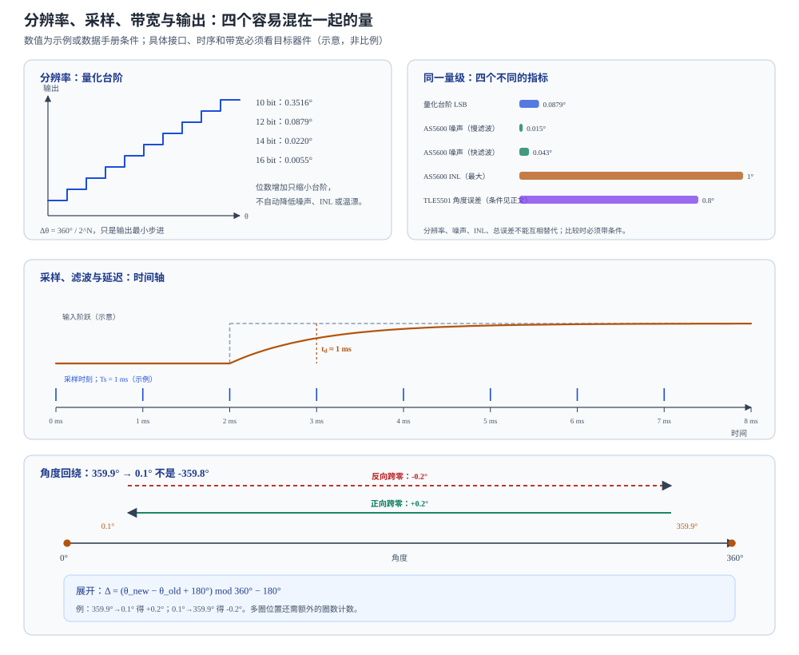

# 分辨率、采样、带宽与输出定义

状态：草稿整理：2026-10-26范围：输出与动态

> 本篇回答：两个都是“14 bit 编码器”，为什么一个角度抖动明显，另一个高速跟踪却滞后？
> 先修：[从磁场到角度](angle-sensing.md)、[极对数、机械角、电角度与编码器读数](motor-angle.md)；预计阅读 20 分钟。
> 读完能回答：① 分辨率、噪声、INL、重复性和总误差为什么不是一回事？② 采样周期、更新率、带宽和群延迟怎样变成角度滞后？③ 角度从 359.9° 跳到 0.1° 时，程序为什么不能直接相减？

## 适用范围

本文解释编码器输出和动态指标的工程含义，帮助读数据手册和排查“位数相同但表现不同”的问题。具体接口时序、寄存器、诊断位和协议细节必须看目标器件数据手册；本文不提供某型号的完整通信协议，也不把某一颗芯片的滤波/带宽配置推广到所有编码器。

## 先看一个现象

两只编码器都标 14 bit。第一只静止时角度末位不停跳，第二只静止时很稳，但电机一加速，角度就明显落后。两只的“分辨率”相同，为什么表现不同？

因为“14 bit”只说明量化步进，不说明噪声、INL、重复性、迟滞、采样率、滤波延迟或输出协议。第一只可能噪声大或滤波器很窄；第二只可能滤波很深、群延迟大，或者输出更新率低。**分辨率是静态台阶，动态表现由采样、滤波、延迟和协议共同决定。**

## 一张图建立直觉

<figure class="kb-figure" markdown="1">
  
  <figcaption>图 1　分辨率、噪声、采样延迟和角度回绕（示意，非按比例）。上左是量化台阶；上右把 AS5600 的 LSB、噪声、INL 与 TLE5501 的角度误差放在同一量级上比较，它们不是同一颗芯片，也不能直接排名；中排是采样与滤波延迟；下排是跨越 0°/360° 时的回绕。图中数值来自正文所引数据手册或为教学示例，不能直接套到其他型号。</figcaption>
</figure>

## 概念、符号与单位

### 六个容易混在一起的量

| 量 | 回答的问题 | 常见单位/条件 |
| --- | --- | --- |
| 分辨率 | 输出最小步进是多少？ | bit、°、LSB |
| 噪声 | 静止时角度随机抖动多大？ | ° RMS、1σ |
| INL | 输出与理想直线的最大偏差多大？ | °、%FS |
| 重复性 | 同一角度多次测量分散多大？ | ° |
| 迟滞 | 正反转在同一角度的输出差多大？ | ° |
| 总角度误差 | 在规定条件下，输出与真实角的最大偏差多大？ | °，必须带条件 |

**分辨率**只由位数或输出格式决定：

$$
\Delta\theta=\frac{360°}{2^N}
$$

| 位数 | 每圈计数 | 角度步进 |
| --- | --- | --- |
| 10 bit | 1024 | 0.3516° |
| 12 bit | 4096 | 0.0879° |
| 14 bit | 16384 | 0.0220° |
| 16 bit | 65536 | 0.0055° |

这张表只说明“台阶有多细”。它不告诉你台阶附近有没有噪声、INL 有多大、温漂多少。

### 采样、更新率、带宽与群延迟

- **采样周期 $T_s$**：两次测量之间的时间。
- **更新率**：单位时间输出新值的次数，通常与采样/处理/协议有关。
- **带宽**：系统能跟上的角度变化频率范围；它受传感器、滤波、ADC、算法和输出协议共同限制。
- **群延迟/相位滞后**：信号经过滤波和处理后，输出相对输入的时间延迟；在旋转系统中，延迟会变成角度滞后。

一个常见的误解是“带宽越高，延迟一定为零”。带宽高只说明能通过更高频率，不说明相位滞后为零；一阶低通在高频段的相位滞后仍会接近 90°。反过来，低带宽通常意味着更强的平均和更大的延迟。

### 输出定义不是“一个角度值”

- **绝对/增量**：绝对输出直接给单圈位置；增量输出给 A/B/Z 脉冲，需要计数和找零。
- **单圈/多圈**：单圈只给 0–360°；多圈还要圈数计数或电池/非易失存储。
- **模拟正余弦**：芯片给 SIN/COS 模拟电压，角度由主控 ADC + atan2 计算，如 TLE5x09/TLE5501 的差分输出 [ENC-02，p.10](../sources/vendor.md#ENC-02)；[ENC-03，p.4](../sources/vendor.md#ENC-03)。
- **PWM/模拟电压**：芯片内部算好角度，用占空比或比率电压输出，如 AS5600 的 12 位模拟/PWM 输出；PWM 典型频率 115/230/460/920 Hz，占空比 2.9%–97.1% [ENC-04，PDF p.3、p.9](../sources/vendor.md#ENC-04)。
- **SPI/I²C 等数字接口**：读寄存器得到角度/诊断，但寄存器定义、更新率、零点、方向和分辨率仍要看协议。

同样是“角度”，模拟正余弦、PWM 占空比、ABZ 计数和 SPI 寄存器值的含义不同；不读协议就直接比较，等于拿不同单位的数据做减法。

## 公式怎样使用（含完整算例）

### 例 1：分辨率与更新率，哪个先限制你？

某 14 bit 编码器的步进是：

$$
\Delta\theta=\frac{360°}{16384}=0.02197°\approx0.0220°
$$

电机以 $n=3000\ \text{r/min}$ 旋转，机械角速度：

$$
\omega_m=\frac{3000\times360°}{60}=18000°/s
$$

一个 LSB 对应的时间：

$$
t_{LSB}=\frac{0.0220°}{18000°/s}\approx1.22\ \mu s
$$

如果输出每 100 µs 才更新一次（10 kHz），两次更新之间轴已经转了：

$$
18000°/s\times100\ \mu s=1.8°
$$

约 82 个 LSB。也就是说，分辨率很细，但更新率可能才是高速跟踪的瓶颈。**看“位数”之前，先看更新率和延迟。**

### 例 2：延迟怎样变成角度滞后（必须带极对数）

某系统总延迟 $t_d=1\ \text{ms}$，电机 3000 r/min。机械角滞后：

$$
\Delta\theta_m=\omega_m t_d=18000°/s\times0.001\ \text{s}=18°
$$

若电机是 7 对极，电角度滞后（$\theta_e=p\theta_m$ 的关系见 [MOTOR-01](../sources/vendor.md#MOTOR-01)）：

$$
\Delta\theta_e=p\,\Delta\theta_m=7\times18°=126°
$$

如果转速翻倍到 6000 r/min，同样的 1 ms 延迟变成 36° 机械角、252° 电角度。126° 的电角度滞后足以让换相严重偏离，甚至导致转矩下降或过流。**延迟必须以“时间”给出，再结合转速和极对数换算；只说“延迟很小”没有意义。**

### 例 3：数据手册里的 1.62° 对应多长延迟？

TLE5x09 的数据手册给出：30,000 r/min 时，典型角度传播延迟误差为 1.62° [ENC-02，p.18](../sources/vendor.md#ENC-02)。30,000 r/min 的机械角速度是：

$$
\omega_m=\frac{30000\times360°}{60}=180000°/s
$$

若把 1.62° 全部看作时间延迟造成的机械角滞后，则：

$$
t_d\approx\frac{1.62°}{180000°/s}=9.0\ \mu s
$$

这是由数据手册数值反推的量级，不是另一项独立规格。若该角度是机械角，7 对极电机对应 $7\times1.62°=11.34°$ 电角度；如果数据手册指的是输出角，换算前要先确认它的定义。

### 例 4：RC 滤波的时间常数

TLE5x09 数据手册给出一个单端输出 RC 示例：$R=2.15\ \text{k}\Omega$、$C=47\ \text{nF}$，用于转速高达 10,000 r/min 的场景 [ENC-02，p.13](../sources/vendor.md#ENC-02)。一阶 RC 的时间常数：

$$
\tau=RC=2150\times47\times10^{-9}\approx1.01\times10^{-4}\ \text{s}=101\ \mu s
$$

截止频率：

$$
f_c=\frac{1}{2\pi RC}\approx\frac{1}{2\pi\times1.01\times10^{-4}}\approx1.57\ \text{kHz}
$$

这个截止频率是滤波器本身的，不是整机带宽；实际可用转速还取决于极对数、允许的相位误差和后续算法。**不要把 RC 截止频率直接当成“编码器带宽”。**

### 例 5：角度回绕

角度从 359.9° 变到 0.1°，实际变化是：

$$
\Delta=0.1°-359.9°=-359.8°
$$

直接相减会得到一个巨大的负速度尖峰。正确做法是先展开到 $(-180°,180°]$：

$$
\Delta=\left(\theta_{new}-\theta_{old}+180°\right)\bmod 360°-180°
$$

代入：

$$
\Delta=(0.1-359.9+180)\bmod 360-180
=(-179.8)\bmod 360-180
=180.2-180=0.2°
$$

反向从 0.1° 到 359.9° 时，同样得到 $-0.2°$。如果系统需要多圈位置，还要额外维护圈数计数；单圈展开不能恢复绝对多圈位置。

## 曲线和结构变化时会怎样

- **噪声和分辨率不是同一个方向。** AS5600 是 12 位输出，LSB 为 0.0879°；它的输出噪声在慢滤波（SF=00，2.2 ms）下约 0.015° RMS，快滤波（SF=11，286 µs）下约 0.043° RMS，而 INL 最大 ±1° [ENC-04，PDF p.10](../sources/vendor.md#ENC-04)。噪声可以小于 LSB（靠平均/滤波），但 INL 仍可能远大于 LSB。**用 LSB 判断精度会漏掉系统误差。**
- **滤波是噪声与延迟的交换。** AS5600 的稳定时间从 2.2 ms 到 0.286 ms 随滤波配置变化；TLE5501 的上电延迟在负载 <30 nF 时最大 1 ms、<100 pF 时最大 4 µs [ENC-04，PDF p.9](../sources/vendor.md#ENC-04)；[ENC-03，p.11](../sources/vendor.md#ENC-03)。更深的滤波通常更稳，但响应更慢。
- **输出协议决定“角度值”的时间含义。** PWM 的占空比更新率受 PWM 频率限制；模拟正余弦需要主控 ADC 采样和 atan2；SPI/I²C 寄存器有读取时刻和更新时刻的区别。比较两只编码器时，要同时问：角度什么时候采样、什么时候更新、主控什么时候读到。
- **上电和丢采样会引入瞬态。** 上电延迟、首次有效角度、丢帧后的保持/复位策略都会影响控制。TLE5501 没有内部安全机制，诊断需在外部执行 [ENC-03，p.10](../sources/vendor.md#ENC-03)；这类边界不能靠“分辨率”覆盖。
- **角度变化率上限不是机械 rpm 额定值。** TLE5501 的数据手册把角度速度上限标为 $1\times10^{6}\ ^\circ/\text{s}$ [ENC-03，p.9](../sources/vendor.md#ENC-03)。这是角度变化率，换算成机械转速还要看角度定义和极对数，不能直接当成电机 rpm 上限。
- **高分辨率不等于高重复性。** 重复性、迟滞和温漂是独立指标；TLE5501 的数据手册把迟滞最大 0.4° 与角度误差分开列出 [ENC-03，p.12](../sources/vendor.md#ENC-03)。即使分辨率是 16 bit，迟滞仍可能是 0.4°。

## 常见误区

| 常见误区 | 为什么不对 | 更稳妥的说法 |
| --- | --- | --- |
| “位数越多，系统精度越高” | 位数只决定量化步进；噪声、INL、迟滞、温漂和校准仍存在 | 把分辨率、噪声、INL、重复性和总误差分开 |
| “带宽越高，延迟一定为零” | 带宽高不等于相位滞后为零；滤波和处理仍产生群延迟 | 用时间延迟 + 转速 + 极对数换算角度滞后 |
| “不同接口的‘角度值’可以直接比较” | 模拟正余弦、PWM、ABZ、SPI 的定义、零点、方向和更新率不同 | 先读协议，再比较 |
| “分辨率等于重复性/噪声” | 分辨率是台阶，噪声是随机抖动，重复性是多次测量分散 | 用静止噪声、正反转和重复测量分别评估 |

## 自测

自测 1：16 bit 编码器的角度步进是多少？

答案：$360°/65536=0.00549°$。这只是量化步进，不代表实际误差。

自测 2：7 对极电机 3000 r/min，系统延迟 0.5 ms。机械角和电角度滞后各是多少？

答案：$\omega_m=18000°/s$；机械滞后 $18000\times0.0005=9°$；电角度滞后 $7\times9°=63°$。

自测 3：角度从 359.8° 变到 0.3°，实际变化是多少？

答案：展开后 $\Delta=(0.3-359.8+180)\bmod360-180=0.5°$；不是 $-359.5°$。

自测 4：AS5600 是 12 位输出，LSB 为 0.0879°，为什么 INL 可以标 ±1°？

答案：LSB 是量化步进，INL 是输出与理想直线的系统偏差；两者定义不同。12 位只说明码值分辨率，不限制 INL、噪声或温漂。读精度时必须看总角度误差及其条件。

## 本篇小结

- 分辨率是量化步进；噪声、INL、重复性、迟滞和总误差是不同指标，不能互相替代。
- 采样周期、更新率、带宽和群延迟共同决定动态跟踪；延迟要结合转速和极对数换算成角度。
- 模拟正余弦、PWM、ABZ、SPI 等输出定义不同，不读协议不能比较“角度值”。
- 跨 0°/360° 要先用 $(-180°,180°]$ 展开；多圈位置还需要额外计数。

## 工程出口

- [FAE 选型](../fae/selection.md)：把分辨率、更新率、延迟、接口和精度条件放进同一张选型表。
- [FAE 误差预算](../fae/error-budget.md)：把量化、噪声、INL、迟滞、温漂和动态滞后分项。
- [FAE 排障](../fae/troubleshooting.md)：角度抖动、滞后、回绕和丢采样时的分层排查入口。

## 来源与待确认项

- [ENC-02](../sources/vendor.md#ENC-02)：TLE5x09A16(D) V2.1，p.13 单端 RC 示例，p.18 转速、场窗口和 30,000 r/min 下典型角度传播延迟误差 1.62°。
- [ENC-03](../sources/vendor.md#ENC-03)：TLE5501 Rev.1.0，p.4 差分正余弦结构，p.9 角度速度上限，p.10 诊断边界，p.11 上电延迟，p.12 角度误差/迟滞。
- [ENC-04](../sources/vendor.md#ENC-04)：AS5600 v1-06，PDF p.3 输出类型，p.9 PWM/时序，p.10 分辨率、INL、噪声。
- [MOTOR-01](../sources/vendor.md#MOTOR-01)：Microchip MCAF R6 / v6.0.2，电角度与机械角、极对数的关系；用于延迟到电角度的换算。
- 待确认项：目标接口的实际更新率与读取时刻、主控 ADC 采样/滤波、协议中的角度零点与方向、丢采样/复位策略；这些必须按目标器件和固件确认。
