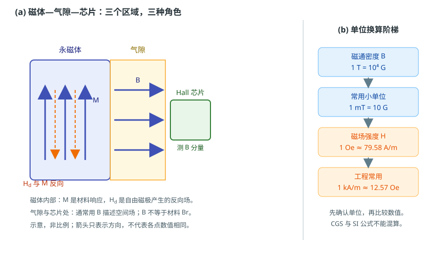

# 从磁场到材料响应：B、H、M、J 与磁通

状态：草稿（来源级待逐条终审）草稿日期：2026-10-26教材：§1.1–§1.4

> **本篇回答：** 同一只线圈放进铁芯后，为什么空间磁场会变？磁体表面读到的高斯值，为什么不能直接当成芯片处的磁通密度？
> **先修：** 无。只要知道“力、面积、单位”即可。
> **预计阅读：** 20 分钟。

读完你能回答：

1. $B$、$H$、$M$、$J$ 各是什么量，单位为什么不同？
2. 磁通 $\Phi$ 与磁通密度 $B$ 是什么关系？
3. 为什么“材料剩磁 $B_r$”不等于“气隙或芯片处的 $B$”？

## 先看一个现象

取一只匝数和电流都固定的线圈，在同一个位置测磁场。空芯时读到一个值；插入铁芯后，同一个位置的读数明显变大。电流没有变，线圈也没有变，变的是铁芯对磁场的响应。

再换一个场景：一块永磁体，用高斯计贴着表面测，读数可能是几百毫特斯拉；把同一块磁体装到编码器结构里，芯片敏感区的读数却可能只有几十毫特斯拉，而且换一个气隙就再变一次。这两个现象都提示：**空间里的磁场、材料内部的磁化、以及材料标签上的剩磁，不是同一个量。**

## 一张图建立直觉

<figure class="kb-figure" markdown="1" style="box-sizing:border-box;max-width:calc(100vw - 2rem);margin-left:auto;margin-right:auto">
  { style="width:100%;height:auto;max-width:100%" }
  <figcaption>示意：磁体内部看材料响应 $M$ 与退磁场 $H_d$，气隙和芯片处通常看磁通密度 $B$；右图为常用单位换算。图不按比例，箭头只表示方向。</figcaption>
</figure>

左图把空间分成三个区域。磁体内部有磁化强度 $M$，它来自材料内部磁矩的集体取向；磁体表面出现自由磁极后，会在内部产生一个大致与 $M$ 反向的退磁场 $H_d$。气隙里没有材料响应，主要用磁通密度 $B$ 描述；Hall 芯片测的也是它敏感体积内的 $B$ 分量。右图提醒：同一个物理量可以写成 SI 单位，也可以写成工程上常见的 G、Oe，但换算必须完整，不能只换数字。

## 概念、符号与单位

| 量 | 符号 | SI 单位 | 直观含义 | 常见误用 |
| --- | --- | --- | --- | --- |
| 磁通密度 | $B$ | T（Wb/m²） | 单位面积通过的磁通，决定 Hall 读数、感应电压等局部效应 | 把某点 $B$ 当成材料固有值 |
| 磁场强度 | $H$ | A/m | 磁路的“激励”量，便于写磁路和边界条件 | 与 $B$ 混用，或以为二者永远同向 |
| 磁化强度 | $M$ | A/m | 单位体积的磁矩，描述材料响应 | 以为高斯计能直接读出 $M$ |
| 磁极化强度 | $J$ | T | $J=\mu_0M$，永磁曲线常用 | 与 $B$ 当成同一个量 |

在 SI 中，三个量由下式联系：

$$
B=\mu_0(H+M)=\mu_0H+J
$$

其中 $\mu_0=4\pi\times10^{-7}\ \text{H/m}$ 是真空磁导率。在真空或近似空气中，$M=0$，所以 $B\approx\mu_0H$；在近似线性的材料中，常用 $B=\mu_0\mu_rH$ 和 $J=\mu_0M$ 描述，$\mu_r$ 是相对磁导率。**这些简化都有条件：** 材料要接近线性、各向同性、没有明显磁滞；永磁体在第二象限工作时，$M$ 与 $H$ 的关系由退磁曲线决定，不能用一个常数 $\mu_r$ 代替。

工程上常说“$H$ 是外加激励，$M$ 是材料响应，$B$ 是合成效果”。这个说法有助于建立直觉，但不要把它当成普遍因果定律：永磁体内部 $H$ 可以与 $M$ 反向；磁滞使 $M$ 不是 $H$ 的单值函数；同一材料在不同温度、应力和历史下的响应也不同。

### 磁通：把局部磁通密度累加成“总量”

磁通定义为磁通密度在某个面上的面积分：

$$
\Phi=\int_A \mathbf{B}\cdot d\mathbf{A}
$$

如果 $B$ 在面积 $A$ 上均匀、且与面法线平行，就简化为 $\Phi=BA$。磁通单位是韦伯（Wb），$1\ \text{Wb}=1\ \text{T}\cdot\text{m}^2$。$B$ 是“每平方米多少磁通”，$\Phi$ 是“这个面一共通过多少磁通”。磁力线是闭合的，进入一个闭合面的磁通等于离开它的磁通，所以磁路里常说“磁通连续”；但“连续”不等于“全部被限制在磁芯里”，漏磁和边缘效应会在 A05 展开。

### 永磁曲线上的三个词

| 符号 | 定义 | 不要混淆 |
| --- | --- | --- |
| $B_r$ | 规定条件下，外场回零后保留的磁通密度 | 不是任意工作点的 $B$，也不是芯片处场 |
| $H_{cB}$ | 使 $B=0$ 的反向磁场 | 不是使磁化完全消失的场 |
| $H_{cJ}$ | 使 $J=0$ 的反向磁场 | 不能与 $H_{cB}$ 互相替代 |

永磁材料通常有 $|H_{cJ}|\ge|H_{cB}|$，但实际退磁风险还取决于膝点、负载线、温度和最大反向场。教材从磁化曲线和退磁曲线引入这些量 [BOOK-01，§1.2，书 p.12 起 / PDF p.21 起](../sources/book.md#BOOK-01)，永磁参数的完整读法在 C04 展开。

### 单位换算

| 量 | SI | 工程常用 | 换算 |
| --- | --- | --- | --- |
| $B$ | T | G（高斯） | $1\ \text{T}=10^4\ \text{G}$ |
| $B$ | mT | G | $1\ \text{mT}=10\ \text{G}$ |
| $H$ | A/m | Oe（奥斯特） | $1\ \text{Oe}\approx79.58\ \text{A/m}$ |
| $H$ | kA/m | Oe | $1\ \text{kA/m}\approx12.57\ \text{Oe}$ |

单位不是装饰。“600 mT”和“600 G”相差 10 倍；“3000 G”和“3000 A/m”则是不同量纲，不能直接相等。CGS 单位制里还有 $B(\text{G})=H(\text{Oe})+4\pi M(\text{emu/cm}^3)$ 这类写法，必须整套使用；把 CGS 公式和 SI 数值混在一起，是现场换算错误的高发点。SI 中 T、Wb、A/m 的定义可查 BIPM 手册 [UNIT-01](../sources/vendor.md#UNIT-01)。

## 公式怎样使用：一个完整算例

**教学假设：** 一个直径 $d=10\ \text{mm}$ 的圆形气隙截面，平均磁通密度 $B=0.30\ \text{T}$，方向与截面法线平行。求磁通，并把 $B$ 与空气中的 $H$ 换成工程单位。

第一步，算面积：

$$
A=\pi\left(\frac{d}{2}\right)^2
=\pi(5\times10^{-3}\ \text{m})^2
=7.854\times10^{-5}\ \text{m}^2
$$

第二步，算磁通：

$$
\Phi=BA
=0.30\ \text{T}\times7.854\times10^{-5}\ \text{m}^2
=2.36\times10^{-5}\ \text{Wb}
\approx23.6\ \mu\text{Wb}
$$

第三步，换单位。$0.30\ \text{T}=300\ \text{mT}=3000\ \text{G}$。因为气隙近似为空气，$B\approx\mu_0H$，所以

$$
H\approx\frac{B}{\mu_0}
=\frac{0.30}{4\pi\times10^{-7}}
\approx2.39\times10^{5}\ \text{A/m}
\approx239\ \text{kA/m}
$$

而 $239\ \text{kA/m}\times4\pi\approx3000\ \text{Oe}$，与“空气中 $1\ \text{G}=1\ \text{Oe}$”的常用近似一致。

**结果解释：** 这个截面一共通过约 $23.6\ \mu\text{Wb}$ 的磁通；在气隙中，$0.30\ \text{T}$ 对应约 $239\ \text{kA/m}$ 的 $H$。如果同样的 $B$ 出现在磁体内部，就不能再用 $H=B/\mu_0$，因为磁体内部还有 $M$，必须回到 $B=\mu_0(H+M)$。这正是“气隙公式不能直接搬进磁体”的原因。

## 条件变化时会怎样

- **截面倾斜：** 若 $B$ 与法线夹角为 $\theta$，均匀场下 $\Phi=BA\cos\theta$。倾斜 60° 时，读到的磁通只有正对时的一半。
- **截面变小：** 忽略漏磁时，同一磁通穿过更小的面积，$B$ 近似按面积反比增大。这是“聚磁”与“磁通拥挤”的几何基础，但真实结构还要考虑饱和与边缘效应。
- **插入软磁材料：** 材料被磁化后产生 $M$，$B$ 在局部重新分布；高磁导率不等于“磁场被放大到任意大”，磁芯会饱和，气隙和漏磁也会分走磁通。A05 会用磁路语言继续。
- **磁体开路：** 磁体表面的 $B$ 受形状、气隙、附近软磁件和测量位置影响；$B_r$ 是规定测试条件下的材料参数，不能由一个表面读数唯一反推。形状与退磁场的定量关系见 A06。

## 常见误区

!!! warning "四个常见错误"
    1. **把 $B$ 和 $H$ 都笼统叫“磁场强度”。** 中文里“磁场强度”通常指 $H$（A/m），而数据表里的“magnetic field”常指 $B$（mT）。看单位，再看符号。
    2. **以为高斯计能直接读出材料内部的 $M$。** 多数 Hall 高斯计测的是探头敏感体积内的 $B$ 分量；有的仪器把读数除以 $\mu_0$ 后标成 A/m 或 Oe，那是显示换算，不是直接测了 $M$。
    3. **把 $B_r$ 当成芯片处磁通密度。** $B_r$ 是规定条件下的剩磁；芯片处的 $B$ 由磁体形状、气隙、软磁件和漏磁共同决定。$B_r=1.2\ \text{T}$ 不意味着气隙里也有 $1.2\ \text{T}$。
    4. **把 CGS 公式和 SI 数值混算。** 例如把 G 直接代入以 T 为单位的公式，或把 Oe 当 A/m。先统一单位制，再代入。

## 自测

**1.** $300\ \text{mT}$ 等于多少 G？

查看答案

$1\ \text{mT}=10\ \text{G}$，所以 $300\ \text{mT}=3000\ \text{G}$。若误算成 300 G，就小了 10 倍。

**2.** 空气中某点 $B=50\ \text{mT}$，近似对应的 $H$ 是多少？

查看答案

用 $H\approx B/\mu_0=0.050/(4\pi\times10^{-7})\approx3.98\times10^4\ \text{A/m}\approx39.8\ \text{kA/m}$。这是空气近似；若该点位于磁体或软磁内部，需要计入 $M$，不能直接这样算。

**3.** 某磁体标称 $B_r=1.2\ \text{T}$，能否据此判断芯片处有 $1.2\ \text{T}$？

查看答案

不能。$B_r$ 是材料在规定测试条件下的剩磁；芯片处的 $B$ 还取决于磁体尺寸与形状、充磁方向、气隙、附近软磁件、温度和漏磁。需要在实际结构、实际气隙和实际温度下测量或仿真。

## 本篇小结

- $B$（T）是磁通密度，$H$（A/m）是磁场强度，$M$（A/m）是材料磁化，$J=\mu_0M$（T）是磁极化强度。
- SI 关系是 $B=\mu_0(H+M)=\mu_0H+J$；空气近似 $B\approx\mu_0H$ 只在无材料响应时成立。
- 磁通 $\Phi=\int\mathbf{B}\cdot d\mathbf{A}$，均匀正对时 $\Phi=BA$；$B_r$ 不等于气隙场或芯片场。

## 工程出口

- 继续读 [A02：磁性从哪里来](magnetic-origin-and-classes.md)，建立“为什么有的材料响应大、有的材料响应小”的图像。
- 需要把“客户说的磁场”拆成结构、气隙、温度和测量位置时，用 [FAE 选型工作流](../fae/selection.md) 的“从结构反推磁体与芯片”步骤。
- 现场读数争议先按 [FAE 排障路径](../fae/troubleshooting.md) 区分“磁场条件不同”与“磁体或芯片异常”；仪器、几何和不确定度继续读 [B02：磁测量](magnetic-measurement.md)。

## 适用边界

本文只建立 SI 单位下的基本关系和量级直觉。它不提供具体牌号的 $B_r$、$H_{cB}$、$H_{cJ}$，也不提供芯片的场窗口或精度结论。公式默认材料响应可用 $M$ 描述、单位制统一；CGS 公式必须整套使用。局部 $B$ 与材料参数之间的桥接需要 A05、A06 和实际测量，不能靠一个表面读数完成。

## 来源与待确认项

- [BOOK-01](../sources/book.md#BOOK-01)：严密、彭晓领，《磁学基础与磁性材料》第 2 版；§1.1 书 p.3 起 / PDF p.12 起，§1.2 书 p.12 起 / PDF p.21 起，§1.4 书 p.22 起 / PDF p.31 起，§10.1 书 p.247 起 / PDF p.256 起。页码是章节起始页锚点，公式和单位已按 SI 定义自查，仍待逐条终审。
- [UNIT-01](../sources/vendor.md#UNIT-01)：BIPM，SI 单位制手册；支持 T、Wb、A/m 的定义。
- [MEAS-01](../sources/vendor.md#MEAS-01)：Arnold Magnetic Technologies，永磁材料磁性能与测量技术；支持“单点表面场不能反推材料参数”的边界。

待确认：客户仪器显示的“磁场”到底是 $B$ 还是经 $\mu_0$ 换算的 $H$；探头敏感体积与读数单位；教材扫描页无文本层，引用公式前的逐条复核记录。
