# 学科体系

建议按照“**量的定义 → 材料行为 → 传感机理 → 系统误差**”学习。每一层只引入下一层需要的概念，遇到客户问题时再回到对应节点。

第一次来，先看[学习路径](learning-paths.md)：那里按“零基础、材料选型、传感系统”给出三条带时间估算的阅读顺序。查符号和单位用[术语与符号](glossary.md)。

## 知识地图

<figure class="kb-figure">
  
  <figcaption>从磁学到编码器系统误差的知识地图</figcaption>
</figure>

## 磁学语言与物理图像

先统一“磁是什么、怎么描述、为什么有方向”。

| 文章 | 核心问题 | 对应 FAE 场景 |
| --- | --- | --- |
| [从磁场到材料响应：B、H、M、J 与磁通](field-and-measurement.md) | B 和 H 有何区别？单位怎样换？局部场能否代表材料？ | 看懂规格书、统一单位、判断测量争议 |
| [磁性从哪里来：磁矩、磁性分类与居里温度](magnetic-origin-and-classes.md) | 为什么只有部分材料表现强磁性？居里温度意味着什么？ | 理解材料分类、温度边界 |
| [磁畴与畴壁](magnetic-domains.md) | 宏观不显磁性的铁内部发生了什么？ | 理解磁化、退磁和局部异常的起点 |
| [磁各向异性与磁致伸缩](anisotropy.md) | 为什么有易磁化方向？为什么压装和灌封会改变性能？ | 磁体图纸、取向、装配应力 |
| [磁通、磁阻与磁路](magnetic-circuits.md) | 气隙为什么常占磁阻主导？磁路类比何时失效？ | 磁路估算、软磁件与聚磁设计 |
| [退磁场与形状效应](demagnetizing-field-and-shape.md) | 同一牌号换形状为什么抗退磁能力不同？ | 长径比、薄片、开路工作点 |

## 磁化、曲线与动态行为

再理解“材料怎样响应外场，以及如何测量”。

| 文章 | 核心问题 | 对应 FAE 场景 |
| --- | --- | --- |
| [技术磁化与磁滞回线](magnetization-and-hysteresis.md) | 怎样从回线读出 Br、Hc、Bs 和磁导率？ | 读材料曲线、区分软硬磁、判断饱和 |
| [磁测量：仪器读数与材料参数为何不同](magnetic-measurement.md) | 高斯计、磁滞仪、VSM 各能回答什么？ | 来料验收、读数争议、不确定度 |
| [反磁化与矫顽力](coercivity-mechanisms.md) | 形核、钉扎和磁矩转动怎样决定抗退磁能力？ | 解释牌号差异、避免只看 Br |
| [动态磁化、损耗与温度](loss-and-temperature.md) | 频率升高为什么发热？铁氧体为什么适合高频？ | 电机软磁、高速应用、热评估 |

## 软磁与永磁材料

然后进入材料家族和工作点。这里的结论必须绑定牌号、温度和测试条件。

| 文章 | 核心问题 | 对应 FAE 场景 |
| --- | --- | --- |
| [软磁性能参数](soft-magnetic-parameters.md) | 高磁导率为什么不等于适合所有工况？ | 软磁选型、磁芯参数比较 |
| [金属软磁、非晶与纳米晶](soft-magnetic-materials.md) | 硅钢、NiFe、非晶、纳米晶怎样按频段和形态取舍？ | 电机、磁屏蔽、磁路件 |
| [软磁铁氧体与高频磁芯](soft-ferrites.md) | MnZn 和 NiZn 怎么选？高频代价是什么？ | 高频磁芯、EMI 磁芯 |
| [永磁参数、退磁曲线与工作点](permanent-magnet-parameters.md) | Br、HcB、HcJ、(BH)max、负载线怎样一起读？ | 磁体选型、工作点校核 |
| [永磁材料家族](permanent-magnets.md) | 铁氧体、AlNiCo、SmCo、NdFeB 如何取舍？ | 成本、温度、腐蚀、加工权衡 |
| [温度稳定性与退磁](magnet-stability-and-demagnetization.md) | 可逆、不可逆和永久损失怎样区分？ | 高温/低温和反向场校核 |

## 角度传感与系统

最后连接磁体、传感器、安装和电机控制。

| 文章 | 核心问题 | 对应 FAE 场景 |
| --- | --- | --- |
| [磁电阻效应：AMR、GMR 与 TMR](magnetoresistance.md) | 电阻为什么随磁场变化？三种机理差在哪？ | 技术路线比较、理解周期差异 |
| [从磁场到角度：信号链](angle-sensing.md) | 桥路、ADC、atan2、校准怎样串起来？ | 芯片比较、场窗口确认 |
| [编码器磁体、充磁图形与安装几何](encoder-magnet-and-mounting.md) | 取向、充磁、气隙、偏心怎样进入信号？ | 磁体图纸、端轴/侧轴/多极环设计 |
| [角度误差从哪里来](angle-error-mechanisms.md) | 偏置、幅值、正交和 1×/2×/p× 谐波是什么关系？ | 误差预算、根因定位 |
| [极对数、机械角、电角度与编码器读数](motor-angle.md) | 机械角怎样变成电角度？四个“角”分别指什么？ | 电机换相、多极对安装 |
| [分辨率、采样、带宽与输出定义](encoder-output-and-dynamics.md) | 位数为什么不是精度？延迟怎样变成角度滞后？ | 接口选型、动态跟踪、数据解释 |

## 学习时不要跳过的三个区别

1. **材料参数 ≠ 成品磁体参数。** 牌号数据通常是特定温度、形状和测量条件下的结果；成品还受取向、尺寸、镀层和充磁影响。
2. **磁体性能 ≠ 芯片处磁场。** 气隙、偏心、倾斜、磁导材料和相邻电流都会改变空间场分布。
3. **传感器精度 ≠ 系统角度精度。** 数据手册的 INL 往往在指定磁场、温度和测试夹具下测得，系统还要叠加磁体、装配、校准和算法误差。

## 文章状态

- 本页 22 篇为正式学习文章，全部为 `草稿` 状态，正在逐条终审来源；正文已包含图、算例、误区、自测和工程出口。
- [磁化与损耗（已拆分）](magnetization-and-loss.md)保留为旧链接入口，不再作为正文维护。
- 来源登记见[教材](../sources/book.md)和[官方资料](../sources/vendor.md)；项目不存放教材或原厂 PDF 原件，查阅副本归档在项目外。
