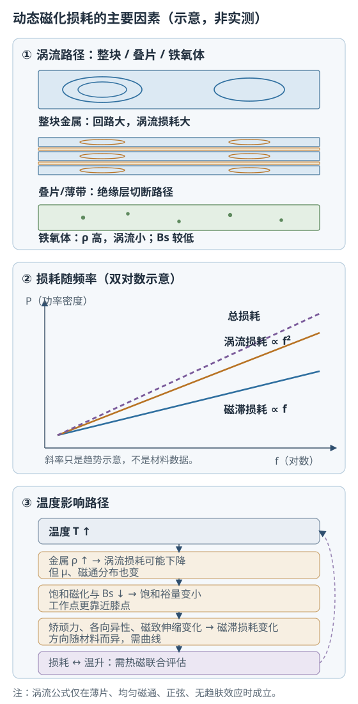

# 动态磁化、损耗与温度

状态：草稿整理：2026-10-26教材：第 6、7 章

> 本篇回答：同一个磁芯，频率升高后为什么更热？把金属材料做薄或换成铁氧体为什么有用？
> 先修：B01《技术磁化与磁滞回线》；预计阅读 25 分钟。
> 读完能回答：① 磁滞、涡流和剩余损耗分别从哪里来？② 涡流公式和趋肤深度在什么条件下才成立？③ 为什么 Steinmetz 系数不能跨频率、波形和温度照搬？

## 先看一个现象

同一个磁芯，在 50 Hz 下温升还可以，频率升到 1 kHz 后绕组没换、磁通摆幅也没明显变大，磁芯却明显更热。换成更薄的叠片，或者换成电阻率高的铁氧体，温升又降下来。这说明损耗不是“频率高了就大”这么简单，它还取决于磁通摆幅、材料厚度、电阻率、波形和温度。

教材把动态磁化中的损耗拆成磁滞、涡流和剩余三部分，并指出动态回线面积大于静态回线，交变场下 $B$ 会滞后 $H$ [BOOK-01，§6.1，书 p.146 / PDF p.155](../sources/book.md#BOOK-01)。先建立这个能量图像，再谈公式。

## 一张图建立直觉

<figure class="kb-figure" markdown="1">
  
  <figcaption>图 1　动态损耗的主要因素（示意，非按比例、非实测）。左：整块金属的涡流回路大，叠片的绝缘层把回路切断，铁氧体电阻率高、涡流小；中：磁滞约随 $f$ 增长，涡流约随 $f^2$ 增长，总损耗是多项叠加；右：温度同时改变电阻率、饱和磁化和各向异性，并通过温升形成反馈。曲线只表示趋势，不是材料数据。</figcaption>
</figure>

左图解释“为什么做薄有用”：涡流回路越大，感应电动势越大、损耗越高；叠片之间的绝缘把大回路切成小回路。中图解释“为什么高频时涡流项会主导”：在双对数坐标里，$f^2$ 的斜率比 $f$ 更陡。右图提醒：温度不是只影响一个参数，不能用“居里温度以下就安全”概括。

## 概念、符号与单位

### 动态回线与相位滞后

在正弦、小信号、稳态条件下，可写成

$$
H=H_m\sin(\omega t),\qquad B=B_m\sin(\omega t-\delta)
$$

其中 $H_m$ 是磁场强度峰值（A/m），$B_m$ 是磁通密度峰值（T），$\omega=2\pi f$ 是角频率（rad/s），$\delta$ 是 $B$ 滞后 $H$ 的相位角（rad 或 °）。用复数磁导率表示：

$$
\tilde{\mu}=\mu'-i\mu'',\qquad \tan\delta=\frac{\mu''}{\mu'}=\frac{1}{Q}
$$

$\mu'$ 对应储能分量，$\mu''$ 对应损耗分量，$Q$ 是品质因数。**适用条件：** 小信号、近似线性、正弦稳态；大信号、强非线性、方波/PWM 或存在直流偏置时，不能只用一个 $\mu'$、$\mu''$ 描述。不同教材对虚部符号的约定可能相反，比较时先看定义。

### 三类损耗

| 损耗 | 物理来源 | 典型频率趋势 | 关键条件 |
| --- | --- | --- | --- |
| 磁滞损耗 $P_h$ | 畴壁位移和磁矩转动的不可逆过程，回线面积 | 每周期面积近似固定时，$P_h\propto f$ | 回线必须闭合；大信号下面积随 $B_m$ 变 |
| 涡流损耗 $P_e$ | 交变磁通在导体中感应电流 | 薄片近似下 $P_e\propto f^2B_m^2d^2/\rho$ | 薄片、均匀磁通、正弦、无趋肤效应 |
| 剩余损耗 $P_{res}$ | 磁后效、畴壁弛豫/共振、扩散等 | 不是简单幂律 | 与材料、频率段、温度和样品尺寸有关 |

总损耗写成

$$
P=P_h+P_e+P_{res}
$$

这个分解是工程近似，不是把所有材料都严格分成三项。TDK 也把磁芯损耗分为磁滞、涡流和剩余损耗，并强调损耗随温度、频率、磁通密度和磁芯形状变化 [MAT-01，§5.1，PDF p.12](../sources/vendor.md#MAT-01)。

## 公式怎样使用（含完整算例）

### 磁滞损耗

准静态、一个周期、单位体积的磁滞能量为

$$
w_h=\oint H\,\mathrm{d}B\quad(\text{J/m}^3\cdot\text{cycle})
$$

频率为 $f$ 时，若每周期回线面积近似不变，

$$
P_h=f\,w_h\quad(\text{W/m}^3)
$$

**适用条件：** 周期稳态、回线闭合、忽略涡流和剩余损耗；$w_h$ 必须对实际回线积分。高频或大信号下，回线形状随频率改变，不能把低频面积直接乘频率。

### 涡流损耗：薄片近似

对总厚度为 $2d$ 的薄板，截面内磁通近似均匀、正弦、无趋肤效应时，单位体积的涡流损耗为

$$
P_e=\frac{2\pi^2d^2f^2B_m^2}{3\rho}\quad(\text{W/m}^3)
$$

其中 $d$ 是半厚（m），$f$ 是频率（Hz），$B_m$ 是峰值磁通密度（T），$\rho$ 是电阻率（Ω·m）。**适用条件：** 薄片、均匀磁通、正弦波形、$\mu$ 近似常数、样品厚度远小于趋肤深度、叠片绝缘良好。若用总厚度 $\delta=2d$ 代入，系数会不同；不能把不同定义的公式混用。

工程数据表常用 W/kg，并引入波形系数和密度；这时公式会多出 $K_f$、$\gamma$ 等因子 [BOOK-01，§7.6.1，书 p.180–181 / PDF p.189–190](../sources/book.md#BOOK-01)。比较两份损耗数据前，先确认单位是 W/m³ 还是 W/kg、$B_m$ 是峰值还是峰峰值。

### 趋肤深度

在均匀、线性、正弦条件下，场幅值衰减到表面值 $1/e$ 的深度近似为

$$
\delta_s=\sqrt{\frac{2\rho}{\omega\mu_0\mu_r}}
=503\sqrt{\frac{\rho}{\mu_r f}}\quad(\text{m})
$$

其中 $\rho$ 的单位是 Ω·m，$f$ 的单位是 Hz，$\mu_r$ 是无量纲相对磁导率。**适用条件：** 均匀线性介质、正弦稳态、$\mu_r$ 近似常数、良导体；$\rho$ 和 $\mu_r$ 要取工作频率和温度下的值，不能用直流电阻率随便代替。

**教学算例（材料参数为教学假设，不对应牌号）：** 取 $\rho=5.0\times10^{-7}\ \Omega\cdot\text{m}$、$\mu_r=1000$。在 $f=1\ \text{kHz}$ 时

$$
\delta_s=503\sqrt{\frac{5.0\times10^{-7}}{1000\times1000}}
=503\times7.07\times10^{-7}
\approx3.6\times10^{-4}\ \text{m}=0.36\ \text{mm}
$$

在 $f=50\ \text{Hz}$ 时，$\delta_s\approx1.6\ \text{mm}$。**结果解释：** 0.35 mm 厚的薄片在 50 Hz 下还远小于趋肤深度，均匀磁通假设大致可用；到 1 kHz 时厚度已与 $\delta_s$ 同量级，薄片近似变得勉强，实际损耗可能高于公式预测。这里只演示判断方法，真实材料必须用对应频率和温度下的 $\rho$、$\mu_r$。

### Steinmetz 形式：拟合，不是普适定律

工程上常把损耗写成

$$
P_v=k f^{\alpha}B_m^{\beta}\quad(\text{W/m}^3)
$$

其中 $B_m$ 是峰值磁通密度（T），$k$、$\alpha$、$\beta$ 是拟合系数。**适用条件：** 它们只对特定材料、频率段、波形、磁通范围和温度有效；换材料、换频率段、换波形或换温度，系数不能照搬。TDK 用 $P_V\propto f^{1+x}B^{2+y}$ 描述，并明确 $x$、$y$ 依赖磁芯形状和材料 [MAT-01，§5.1，PDF p.12](../sources/vendor.md#MAT-01)。这说明即使写成“幂律”，指数也不是跨材料常数。

### 完整敏感性算例

**教学假设：** 在某一工作点，$P_h=30\ \text{W}$、$P_e=70\ \text{W}$，总损耗 100 W；保持 $B_m$、温度、波形和几何不变，忽略趋肤效应和剩余损耗。若频率加倍、薄片厚度减半：

- 磁滞：$P_h'=30\times2=60\ \text{W}$；
- 涡流：$P_e'=70\times2^2\times(1/2)^2=70\ \text{W}$；
- 总损耗：$60+70=130\ \text{W}$，比原来增加 30%。

**结果解释：** 厚度减半把涡流的厚度因子降到 $1/4$，刚好抵消频率加倍的 $4$ 倍；但磁滞仍随频率线性增加，所以总损耗还是上升。这个结论只在上述假设下成立；若厚度已接近趋肤深度，或 $B_m$、温度、波形改变，就不能这样直接相乘。

## 曲线和结构变化时会怎样

- **频率：** 低频时磁滞常占重要部分；频率升高后涡流按 $f^2$ 增长，可能成为主项。但“哪个频率段由哪一项主导”随材料、厚度和 $B_m$ 变，教材给的典型分工不能当通用规则。
- **厚度与绝缘：** 薄片、薄带、粉末绝缘和铁氧体都是通过减小涡流回路或提高电阻率来降低 $P_e$。叠片绝缘破损、冲压毛刺、焊接连续导电会重新形成大回路，使实际损耗高于材料曲线。
- **磁通摆幅与波形：** $B_m$ 增大不仅提高涡流项，还可能把工作点推向饱和；PWM 的谐波和直流偏置会改变回线与损耗，不能只用正弦数据外推。
- **温度：** 金属电阻率通常随温度升高而增加，固定几何下 $P_e$ 可能下降；但 $M_s$、$B_s$ 下降会使饱和裕量变小，$H_c$、$K$、$\lambda_s$ 变化又会改变 $P_h$。铁氧体还可能出现损耗最低点温度，最低损耗点不等于系统最优点 [MAT-01，§6.1，PDF p.14](../sources/vendor.md#MAT-01)。
- **热反馈：** 损耗产生温升，温升改变材料参数，参数又改变损耗；热点温度不等于温度传感器读数。高频高磁通设计需要损耗曲线、散热条件和样机实测共同验证。

## 常见误区与自测

| 常见误区 | 为什么不对 | 更稳妥的做法 |
| --- | --- | --- |
| “总损耗只与频率有关” | 还取决于 $B_m$、波形、厚度、电阻率、温度、偏置和绝缘状态 | 比较损耗时同时记录 $f$、$B_m$、波形、温度、厚度和试样 |
| “Steinmetz 系数可以跨材料、跨频段照搬” | $k$、$\alpha$、$\beta$ 是拟合参数，条件和数据范围一变就失效 | 用目标材料、目标频段和目标温度下的曲线重新拟合或直接查曲线 |
| “铁氧体在所有频率和磁通下都优于金属” | 铁氧体 $B_s$ 较低，偏置、温度和磁通摆幅都会限制；金属在高 $B_s$ 场合仍有优势 | 按频率、$B_m$、偏置、温度、体积和成本一起比较 |
| “趋肤深度用直流电阻率算一下就行” | $\rho$ 和 $\mu_r$ 随频率、温度、磁通变化；公式还要求线性正弦条件 | 用工作条件下的材料数据，并检查厚度与 $\delta_s$ 的比值 |

自测 1：频率加倍、厚度减半，涡流损耗变成多少？总损耗一定不变吗？

答案：在薄片、均匀磁通、无趋肤效应且只考虑 $P_e\propto f^2d^2$ 时，$P_e$ 变为 $2^2\times(1/2)^2=1$ 倍，即不变。总损耗不一定不变：磁滞约随 $f$ 增加，剩余损耗也可能变化；本篇算例中总损耗从 100 W 升到 130 W。

自测 2：用 $\rho=5.0\times10^{-7}\ \Omega\cdot\text{m}$、$\mu_r=1000$、$f=1\ \text{kHz}$ 估算趋肤深度，并说明 0.35 mm 薄片处于什么状态。

答案：$\delta_s=503\sqrt{5.0\times10^{-7}/(1000\times1000)}\approx0.36\ \text{mm}$。0.35 mm 与 $\delta_s$ 同量级，截面内磁通已不再均匀，薄片均匀磁通公式只能作粗略估计，实际损耗可能更高。

自测 3：数据表给出 100 kHz、100 mT、100 °C 下 $P_v=100\ \text{kW/m}^3$。能否用 Steinmetz 形式直接推算 200 kHz、150 mT、120 °C？

答案：不能直接推算。频率、磁通和温度都变了，$k$、$\alpha$、$\beta$ 可能不再适用；应先确认数据表是否给出该频段/温度的曲线或系数，并用目标条件下的实测或厂商曲线验证。跨条件外推只能作为初步假设。

自测 4：温度升高时，为什么总损耗可能下降，也可能上升？

答案：金属电阻率升高可能降低涡流损耗，但 $B_s$ 下降、工作点接近饱和、$H_c$ 和各向异性变化又可能提高磁滞损耗；铁氧体还存在损耗最低点温度。几项竞争，方向取决于材料和工作点，必须看目标温度下的损耗曲线。

## 本篇小结

- 动态回线因相位滞后和涡流而变宽；$\mu'$、$\mu''$、$\tan\delta$、$Q$ 只在小信号正弦稳态下有简单定义。
- 总损耗分为磁滞、涡流和剩余；磁滞看回线面积，涡流看厚度、电阻率和频率，剩余损耗不能简单幂律化。
- 涡流公式和趋肤深度都有明确条件；厚度接近 $\delta_s$ 时，均匀磁通薄片模型失效。
- Steinmetz 系数是给定条件下的拟合参数，不是跨材料、跨频段、跨波形的常数。
- 温度通过多条路径改变损耗，并形成“损耗—温升—参数”反馈；必须做热磁联合评估。

## 工程出口

- [软磁性能参数](soft-magnetic-parameters.md)：$\mu_i$、$B_s$、$H_c$、损耗和测试条件怎样一起看。
- [金属软磁、非晶与纳米晶材料](soft-magnetic-materials.md)：叠片、薄带、粉末和合金怎样改变涡流路径。
- [软磁铁氧体与高频磁芯](soft-ferrites.md)：高电阻率、低 $B_s$ 和损耗—温度曲线怎样取舍。

## 来源与待确认项

- [BOOK-01](../sources/book.md#BOOK-01)：第 6 章动态磁化，书 p.146 起 / PDF p.155 起；§6.1 动态回线与相位滞后，书 p.146 / PDF p.155；§6.4 复数磁导率、磁谱、$Q$ 与损耗因子，书 p.157 起 / PDF p.166 起；§6.5 动态损耗，书 p.162 起 / PDF p.171 起；§6.5.2 涡流损耗与趋肤深度，书 p.163 / PDF p.172；§6.5.3 磁滞损耗，书 p.164 / PDF p.173；§6.5.4 剩余损耗，书 p.165 / PDF p.174；§7.6 磁损耗，书 p.179 / PDF p.188；§7.6.1 涡流损耗，书 p.180 / PDF p.189；§7.7 温度稳定性，书 p.181 / PDF p.190。本次查阅了这些节的起始页和相邻扫描页，未做全书 OCR；公式已回看对应扫描页，但不复制教材图。
- [MAT-01](../sources/vendor.md#MAT-01)：TDK，*General – Definitions*，2022-10。§5.1 磁芯损耗分量与条件依赖，PDF p.12；§6.1 磁导率—温度曲线、居里温度和损耗最低点，PDF p.14。
- 待确认项：目标材料在目标频率、$B_m$、波形、偏置和温度下的损耗曲线；片厚、叠压系数、绝缘状态和加工应力；趋肤深度计算所用的 $\rho$、$\mu_r$ 是否来自工作条件；散热边界和热点温度。本篇的 30 W/70 W 和 $\rho$、$\mu_r$ 均为教学假设，不是任何牌号的数据。
