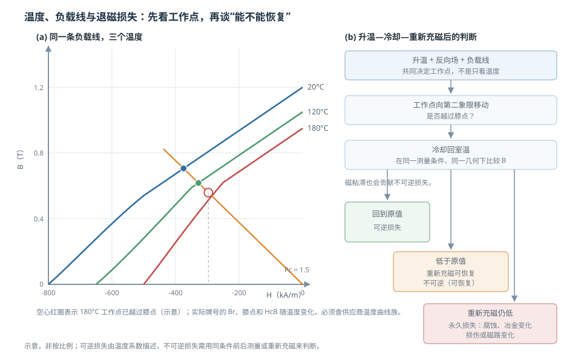

# 温度稳定性与退磁：可逆、不可逆和永久损失

状态：草稿（待主智能体终审）复核：2026-10-26教材：第 10、12、13 章

> 本篇回答：磁体高温后读数变低，回到室温有些恢复、有些不恢复，分别意味着什么？
> 先修：[《永磁参数、退磁曲线与工作点》](permanent-magnet-parameters.md)、[《永磁材料家族》](permanent-magnets.md)；预计阅读 25 分钟。

## 先看一个现象

一块磁体在高温下工作后，传感器读数变小；冷却回室温，读数恢复了一部分，但没有回到原值。再过一段时间重新充磁，有的能完全恢复，有的不能。客户常说“磁铁退磁了”，但这三个结果对应不同的物理过程：**可逆损失、不可逆损失、永久损失**。把它们混在一起，就会把温度问题、磁路问题和腐蚀问题都归错因。

## 一张图建立直觉

<figure class="kb-figure" markdown>

<figcaption>图 1 (a) 同一条负载线在 20 °C、120 °C、180 °C 下与退磁曲线的交点，高温工作点可能越过膝点；(b) 升温—冷却—重新充磁后的判断流程。图为示意，不对应实际牌号。</figcaption>

</figure>

## 工作点由三个因素共同决定

退磁不是“温度到了一个数字就发生”。它取决于：

1. **温度**：改变 $B_r$、$H_{cJ}$ 和膝点位置；
2. **负载线/形状**：决定工作点在第二象限的深度；
3. **反向场**：电枢反应、相邻磁体、外部线圈等把工作点进一步推深；
4. **时间**：恒温恒场下还可能有磁粘滞（随时间缓慢损失）。

PM-01 明确把磁化损失分为可逆、不可逆和永久三类，并指出不可逆损失取决于退磁曲线形状、应用负载线和温度行为 [PM-01](../sources/vendor.md#PM-01)。本篇采用这个分类，不把它冒充成教材原有分类。

## 三类损失：回到室温后怎样表现

| 类型 | 回温后 | 重新充磁 | 物理含义 | 常见触发 |
| --- | --- | --- | --- | --- |
| 可逆损失 | 恢复 | 不需要 | 温度改变使磁化暂时降低 | 温度升降，未越过膝点 |
| 不可逆损失 | 不恢复 | 通常可恢复 | 部分磁畴翻转，材料本身未变 | 温度/反向场越过膝点、磁粘滞 |
| 永久损失 | 不恢复 | 不能恢复 | 腐蚀、冶金变化、机械损伤等 | 镀层失效、氧化、冲击、辐射 |

关键区别不是“降了多少”，而是**路径**：可逆损失在温度回到原点后自动消失；不可逆损失在回到室温后仍保留，但通常可以通过重新充磁恢复；永久损失连重新充磁也回不来，或者磁路本身已经改变。

PM-01 还提醒，不可逆损失在施加反向场后大部分是“瞬时”的，但之后可能叠加随时间增长的磁粘滞损失；这意味着“刚降温时的读数”和“放置一段时间后的读数”可能不同 [PM-01](../sources/vendor.md#PM-01)。

## 温度曲线族怎样读

把同一牌号在 20 °C、120 °C、180 °C 的 B–H 曲线画在一起，再画上同一条负载线，你会看到：

- 温度升高，$B_r$ 下降，曲线整体向左下移动；
- 膝点可能提前出现，工作点更容易落到膝点以下；
- 即使 $H_{cJ}$ 还有余量，工作点也可能已经越过膝点。

PM-02 用一个 NdFeB 牌号的例子说明：同一条 $P_c=1$ 负载线，在 150 °C 时工作点越过膝点，产生不可逆损失；提高负载线后，工作点回到直线段，磁体可以承受同样的温度 [PM-02](../sources/vendor.md#PM-02)。这是一个**读图例**：判断安全与否，不是看“$H_{cJ}$ 还剩多少”，而是看目标温度下工作点与膝点的相对位置。

## 完整算例：一次升温—冷却—重新充磁

**教学假设（不对应任何牌号）**：某磁体 20 °C 时 $B_r=1.20\ \mathrm{T}$，在 20–140 °C 范围内的平均可逆温度系数取 $\alpha(B_r)=-0.10\%/^\circ\mathrm{C}$。这个 $\alpha$ 只用于演示算术，不是材料保证值。

**第一步：算可逆部分。** 升温到 140 °C，$\Delta T=120\ \mathrm{K}$：

$$
B_{r,\mathrm{rev}}(140)
=1.20\times\left[1+(-0.0010)\times120\right]
=1.20\times0.88=1.056\ \mathrm{T}
$$

**第二步：与实测比较。** 假设在同一几何、同一稳定条件下测得 140 °C 时对应 $B=1.026\ \mathrm{T}$。总下降为

$$
1.20-1.026=0.174\ \mathrm{T}\quad(14.5\%)
$$

其中可逆部分为 $1.20-1.056=0.144\ \mathrm{T}$（12.0%），超出可逆预期的部分为

$$
1.056-1.026=0.030\ \mathrm{T}\quad(2.5\%)
$$

这 2.5% 是高温下已经发生的不可逆分量。

**第三步：冷却回 20 °C。** 假设测得 $B=1.170\ \mathrm{T}$。可逆部分随温度恢复，剩下的

$$
1.20-1.170=0.030\ \mathrm{T}\quad(2.5\%)
$$

就是室温下仍然存在的损失。

**第四步：重新充磁。** 若重新充磁后回到 $1.20\ \mathrm{T}$，说明这是**可恢复的不可逆损失**；若仍停在 $1.17\ \mathrm{T}$ 或更低，则要查永久损失（腐蚀、冶金变化、机械损伤）或磁路变化（气隙、软磁件、装配）。

这个算例的数值是教学读数，不对应任何牌号；真实项目必须用供应商温度曲线、实测 $B$ 或磁通、以及同条件的前后对比。缺数据时，应保留下面的空表，而不是编造损失率。

| 项目 | 符号/条件 | 实测或来源 | 结果 |
| --- | --- | --- | --- |
| 室温剩磁 | $B_{r,20}$，闭合/规定几何 | 待填 | 待填 |
| 可逆温度系数 | $\alpha(B_r)$，20–140 °C 平均 | 待填 | 待填 |
| 高温预测剩磁 | $B_{r,\mathrm{rev}}(T)$ | 计算 | 待填 |
| 高温实测 | 同几何、同稳定条件 | 待填 | 待填 |
| 冷却后实测 | 回到 20 °C | 待填 | 待填 |
| 重新充磁后 | 同几何 | 待填 | 待填 |

## NdFeB 高温与铁氧体低温：两类校核场景

**NdFeB 高温**：$B_r$ 和 $H_{cJ}$ 随温度变化，晶界相、成分和工艺会影响高温矫顽力。教材在 NdFeB 章节强调主相与晶界相共同决定磁性能，具体牌号的温度曲线必须向供应商确认 [BOOK-01，§13.3 书 p.291 起 / PDF p.300 起](../sources/book.md#BOOK-01)。不能用一个“最高工作温度”概括所有 NdFeB。

**铁氧体低温**：PM-02 以 Ceramic 8 为例指出，铁氧体的矫顽力温度系数可以为正，因此低温下反而要关注退磁；该资料给出的实际使用下限约 $-40\ ^\circ\mathrm{C}$、上限约 $150\ ^\circ\mathrm{C}$ [PM-02](../sources/vendor.md#PM-02)。这两个数字绑定该文档的特定材料与条件，**不能泛化到所有铁氧体**；但它足以说明“铁氧体只需校核高温”是错的。教材也把铁氧体的温度特性和应用范围作为材料选择的一部分 [BOOK-01，§12.3 书 p.279 / PDF p.288](../sources/book.md#BOOK-01)。

## 居里温度、最高工作温度和允许损失

- **居里温度 $T_C$**：材料失去铁磁有序的温度，是材料属性。
- **最高工作温度**：供应商在特定牌号、形状、负载线、允许损失和测试方法下给出的建议值，不是材料常数。
- **允许损失**：项目能接受多少不可逆损失；同一个磁体，允许 1% 和允许 5% 损失，对应的“最高温度”可能不同。

教材在永磁稳定性部分把时间稳定性和温度稳定性分开讨论，并指出稳定性受成分、形状和工作环境共同影响 [BOOK-01，§10.4 书 p.251 / PDF p.260](../sources/book.md#BOOK-01)。这与 PM-01 的结论一致：**不要把居里温度当安全线，也不要把一个温度数字当材料常数。**

## 镀层/腐蚀与磁性能退化要分开

PM-01 把腐蚀、冶金变化、辐照和机械损伤归入永久损失 [PM-01](../sources/vendor.md#PM-01)。镀层起泡、盐雾后锈蚀、磁体开裂，可能先表现为“磁场变低”，但根因不是温度退磁。排查时要分开记录：外观/镀层、尺寸/裂纹、磁通/场分布、重新充磁后的恢复情况。否则会把腐蚀问题误判成“高温退磁”，选错改进方向。

## 常见误区

!!! warning "四个常见错误"
    1. **“回温没恢复就是永久冶金损伤”。** 多数情况是可恢复的不可逆损失，重新充磁可恢复；永久损失要另查腐蚀、损伤或磁路变化。
    2. **“低于居里温度就安全”。** 远低于 $T_C$ 也可能因膝点、负载线和反向场发生不可逆损失。
    3. **“所有 NdFeB 有同一个温度上限”。** 牌号、晶界扩散、镀层、形状和负载线都会改变允许温度。
    4. **“镀层坏了只是外观问题”。** 腐蚀可以造成永久磁性能退化；要与温度退磁分开评估。

## 自测

自测 1：高温后读数降低，冷却后恢复，属于哪类损失？

可逆损失。它由温度改变引起，温度回到原点后磁化恢复；没有越过膝点，也没有发生不可逆的磁畴翻转。

自测 2：冷却后仍低，但重新充磁能回到原值，说明什么？

说明发生了不可逆但可恢复的损失：部分磁畴在高温/反向场下翻转，材料本身没有永久损坏。重新充磁可以恢复磁化状态；但要把这次经历记录进工作点校核，避免再次发生。

自测 3：为什么“最高工作温度”不是材料常数？

它取决于牌号、形状/负载线、反向场、允许损失和测试方法。同一个材料，换气隙、长径比或允许损失，允许温度就会变。居里温度是材料属性，最高工作温度是系统级建议值。

自测 4：铁氧体为什么也要做低温校核？

部分铁氧体的矫顽力温度系数为正，低温下曲线和工作点会变化；在低工作点、大气隙或反向场下可能退磁。PM-02 的 Ceramic 8 例子说明低温风险存在，但具体限值不能泛化到所有铁氧体。

## 工程出口与适用边界

- 工作点与负载线计算回读[《永磁参数、退磁曲线与工作点》](permanent-magnet-parameters.md)。
- 材料家族定位回读[《永磁材料家族》](permanent-magnets.md)。
- 选型、仿真与失效排查见 [FAE 选型](../fae/selection.md)、[FAE 仿真](../fae/simulation.md)、[FAE 排障](../fae/troubleshooting.md)。

**适用边界：** 本篇的三类损失分类以 PM-01 为主要依据；教材提供稳定性与材料温度特性的背景，但不把 PM-01 的分类冒充为教材原文。所有温度限值、损失率和算例都必须绑定牌号、形状、负载线、反向场、测量几何和试验方法；缺少数据时应保留待填表，不能用经验数字代替。

## 来源与待确认项

- [BOOK-01](../sources/book.md#BOOK-01)：§10.4 永磁稳定性、§12.3 铁氧体性能、§13.3 NdFeB。
- [PM-01](../sources/vendor.md#PM-01)：可逆、不可逆、永久损失分类；负载线与温度对不可逆损失的影响；磁粘滞。
- [PM-02](../sources/vendor.md#PM-02)：NdFeB 高温工作点示例；铁氧体低温风险与温度系数示例。
- 待确认：目标牌号的温度曲线族、膝点、最大反向场、允许损失、镀层/盐雾和长期磁粘滞数据。
