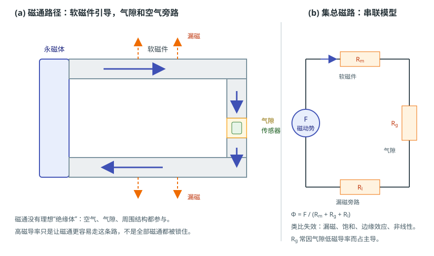

# 磁通、磁阻与磁路：从磁体到气隙

状态：草稿（来源级待逐条终审）草稿日期：2026-10-26教材：第 1、10 章（量与曲线锚点）

> **本篇回答：** 同一块磁体，接上不同形状的软磁件后，芯片处的磁场为什么明显改变？一段很小的气隙，为什么常常占总磁阻的大部分？
> **先修：** [A01：B、H、M、J 与磁通](field-and-measurement.md)。
> **预计阅读：** 20 分钟。

读完你能回答：

1. 磁通、磁通密度和截面积是什么关系？
2. 磁动势、磁阻、磁导怎样组成“磁路欧姆定律”？
3. 磁路与电路类比在哪些地方成立，在哪些地方会失效？

## 先看一个现象

同一块永磁体，单独放在空气中，芯片处读到某个场值；给它加一个软磁极靴，把磁通引到芯片附近，读数可能升高；如果把软磁件做成闭合回路，只在芯片处留一个小气隙，读数又会变成另一个值。磁体没有换，芯片没有换，改变的是**磁通走过的路径和路径上的磁阻**。

这说明：磁体提供的“源”与芯片处的“场”之间，隔着一个磁路。要看懂这段关系，先要会把空间里的磁通分布简化成几个磁阻。

## 一张图建立直觉

<figure class="kb-figure" markdown="1" style="box-sizing:border-box;max-width:calc(100vw - 2rem);margin-left:auto;margin-right:auto">
  { style="width:100%;height:auto;max-width:100%" }
  <figcaption>示意：左图软磁件引导磁通，气隙和空气旁路分走一部分磁通；右图把路径简化为磁动势 $F$ 与 $R_m$、$R_g$、$R_l$ 串联。图不按比例，漏磁路径只画趋势。</figcaption>
</figure>

左图里，永磁体提供磁通，软磁件把大部分磁通引到气隙和传感器，但空气、周围结构和边缘仍会形成漏磁。右图把这条路径简化成“源 + 三个磁阻”的串联模型：$R_m$ 代表软磁件，$R_g$ 代表气隙，$R_l$ 代表漏磁旁路。这个模型能解释“气隙为什么占主导”，但不能代替真实的三维场分布。

## 概念、符号与单位

### 磁通与磁通密度

磁通是磁通密度在截面上的面积分：

$$
\Phi=\int_A \mathbf{B}\cdot d\mathbf{A}
$$

若截面均匀、$B$ 与截面垂直，则 $\Phi=BA$，所以

$$
B=\frac{\Phi}{A}
$$

$\Phi$ 的单位是 Wb，$B$ 的单位是 T，$A$ 的单位是 m²。磁力线闭合，进入某区域的磁通等于离开该区域的磁通；在磁路里常说“磁通连续”。但**连续不等于全部被限制在磁芯里**：空气、气隙和周围结构都能分走磁通，这就是漏磁。教材对磁力线和磁通密度的讨论见第 1 章 [BOOK-01，§1.1，书 p.3 起 / PDF p.12 起](../sources/book.md#BOOK-01)。

### 磁动势、磁阻与磁导

对线圈，磁动势（magnetomotive force）为：

$$
F=NI
$$

其中 $N$ 是匝数，$I$ 是电流，$F$ 的单位是安匝（A）。对一段均匀截面、长度为 $l$、磁导率为 $\mu=\mu_0\mu_r$ 的磁路，磁阻为：

$$
R=\frac{l}{\mu A}
$$

$R$ 的单位是 A/Wb。磁导 $\Lambda$ 是磁阻的倒数：

$$
\Lambda=\frac{1}{R}=\frac{\mu A}{l}
$$

把源和磁阻串起来，就得到磁路欧姆定律：

$$
\Phi=\frac{F}{R_{\text{total}}}
$$

串联时 $R_{\text{total}}=R_1+R_2+\cdots$；并联时 $1/R_{\text{total}}=1/R_1+1/R_2+\cdots$。这套写法在**集总磁路**里成立：磁通集中在若干段均匀截面中，忽略漏磁、边缘效应和饱和。真实结构往往不满足这些条件。

### 磁路与电路：类比在哪里失效

| 电路 | 磁路 | 失效点 |
| --- | --- | --- |
| 电动势 $E$ | 磁动势 $F=NI$ | 永磁体的“源”不是理想电压源，工作点随负载变化 |
| 电流 $I$ | 磁通 $\Phi$ | 磁通可以漏到空气，没有理想“绝缘体” |
| 电阻 $R$ | 磁阻 $R=l/(\mu A)$ | $\mu$ 随场强、温度、应力变化，会饱和 |
| 欧姆定律 $I=E/R$ | $\Phi=F/R$ | 饱和后 $R$ 非线性，简单比例关系失效 |
| 导线绝缘 | 无对应 | 空气、间隙、周围结构都参与磁通路径 |

类比只负责建立直觉，不能把电路的所有直觉搬过来。最关键的两条边界是：**漏磁**和**饱和**。

### 气隙为什么常占主导

空气的 $\mu_r\approx1$，软磁材料的 $\mu_r$ 可能是 $10^3$ 甚至更高，但气隙的 $l$ 常常不能忽略。比较两段磁阻：

$$
\frac{R_g}{R_m}
=\frac{l_g/(\mu_0 A_g)}{l_m/(\mu_0\mu_r A_m)}
\approx\frac{l_g}{l_m}\mu_r
$$

（这里假设 $A_g\approx A_m$。）即使 $\mu_r=1000$，只要气隙长度达到磁路长度的千分之一，气隙磁阻就可以与软磁段相当；气隙再长，气隙就占主导。这就是“高磁导率材料也挡不住一个大气隙”的原因。

## 公式怎样使用：一个完整算例

**教学假设：** 一个近似闭合的软磁磁路，软磁段长度 $l_m=60\ \text{mm}$，截面积 $A=50\ \text{mm}^2$，相对磁导率 $\mu_r=1000$；气隙长度 $l_g=1\ \text{mm}$，忽略边缘效应，气隙面积也取 $50\ \text{mm}^2$。线圈 $N=100$ 匝，电流 $I=0.5\ \text{A}$。求气隙磁通密度。

先统一单位：$A=50\ \text{mm}^2=50\times10^{-6}\ \text{m}^2$，$l_m=0.060\ \text{m}$，$l_g=0.001\ \text{m}$。

软磁段磁阻：

$$
R_m=\frac{0.060}{(4\pi\times10^{-7})(1000)(50\times10^{-6})}
\approx9.55\times10^{5}\ \text{A/Wb}
$$

气隙磁阻：

$$
R_g=\frac{0.001}{(4\pi\times10^{-7})(50\times10^{-6})}
\approx1.59\times10^{7}\ \text{A/Wb}
$$

总磁阻：

$$
R_{\text{total}}\approx9.55\times10^{5}+1.59\times10^{7}
\approx1.69\times10^{7}\ \text{A/Wb}
$$

磁动势：

$$
F=NI=100\times0.5=50\ \text{A}
$$

磁通：

$$
\Phi=\frac{50}{1.69\times10^{7}}
\approx2.96\times10^{-6}\ \text{Wb}
$$

气隙磁通密度：

$$
B_g=\frac{\Phi}{A}
=\frac{2.96\times10^{-6}}{50\times10^{-6}}
\approx0.059\ \text{T}
=59\ \text{mT}
$$

**结果解释：** 气隙磁阻约占总磁阻的 $94\%$，尽管气隙只有 1 mm。把气隙加倍到 2 mm，气隙磁阻近似翻倍，总磁阻也接近翻倍，磁通和 $B_g$ 会降到约一半。这个算例忽略了边缘效应、漏磁和饱和，所以是教学估算；边缘效应会让有效气隙面积变大、气隙磁阻变小，而饱和会让“磁阻不变”的假设失效。

## 条件变化时会怎样

- **气隙增大：** 气隙磁阻近似按长度增加，磁通下降；但边缘效应会部分补偿，实际下降幅度需要仿真或实测。
- **软磁件变薄或变窄：** 截面积减小，磁阻增大；更危险的是局部 $B$ 升高，可能先饱和。高 $\mu$ 不等于高 $B_s$。
- **软磁件饱和：** 当局部 $B$ 接近饱和磁通密度 $B_s$ 时，$\mu_r$ 明显下降，磁阻不再是常数；磁通被“挤”向空气，漏磁增加，波形也可能畸变。
- **换成永磁体作为源：** 磁动势不再由 $NI$ 给定，而由磁体的工作点决定；磁体内部的 $H$ 与 $M$ 关系是非线性的。这时要用退磁曲线和负载线，C04 会展开。
- **从 2D 到 3D：** 轴对称或 2D 模型能算一些端轴结构，但倾斜、周向多极和端部漏磁需要 3D；有限元软件的选择和边界条件见 [SIM-01](../sources/vendor.md#SIM-01)、[SIM-06](../sources/vendor.md#SIM-06)。

## 常见误区

!!! warning "四个常见错误"
    1. **“磁通像电流一样被严格约束在磁芯里。”** 磁通可以漏到空气和周围结构；没有理想的磁绝缘体。磁路模型只是把主要路径集总起来。
    2. **“高磁导率材料不会饱和。”** 磁导率和饱和磁通密度是两个参数；高 $\mu$ 材料也可能在较小截面或较大磁通下饱和。
    3. **“集总磁路能直接给出芯片敏感区域的全部谐波。”** 集总模型只给出主要路径的平均量；局部饱和、边缘效应、三维几何和充磁分布会产生集总模型没有的谐波。
    4. **“气隙很小，所以气隙磁阻可以忽略。”** 气隙的 $\mu_r\approx1$，即使 1 mm 也可能占总磁阻的绝大部分；要比较 $l_g/\mu_0$ 与 $l_m/(\mu_0\mu_r)$。

## 自测

**1.** 在上面的算例中，气隙磁阻约占总磁阻的多少？如果气隙从 1 mm 增到 2 mm，磁通大约怎样变化？

查看答案

$R_g/(R_m+R_g)\approx1.59\times10^{7}/1.69\times10^{7}\approx94\%$。气隙加倍后 $R_g$ 近似翻倍，总磁阻从约 $1.69\times10^{7}$ 增到约 $3.28\times10^{7}$，磁通近似降到原来的一半。实际还要考虑边缘效应和饱和。

**2.** 为什么“高磁导率软磁件”不一定能让芯片处磁场更高？

查看答案

高 $\mu$ 只说明材料容易引导磁通，但磁通还受磁动势、气隙磁阻、截面积和饱和限制。如果软磁件截面太小而饱和，$\mu$ 会下降；如果气隙很大，气隙磁阻仍占主导；如果漏磁严重，真正到达芯片的磁通也不多。

**3.** 磁路类比在什么情况下不能直接用 $\Phi=F/R$？

查看答案

当漏磁、边缘效应、局部饱和、磁滞、涡流或三维分布不可忽略时，简单的 $R=l/(\mu A)$ 不再成立；永磁体作为源时，工作点还随负载变化。这时需要非线性磁路、有限元或实测。

## 本篇小结

- 均匀截面下 $B=\Phi/A$；磁通连续不等于磁通全部被约束在磁芯里。
- 磁路欧姆定律 $\Phi=F/R$，$R=l/(\mu A)$；气隙因 $\mu_r\approx1$ 常占总磁阻的大部分。
- 类比在漏磁、饱和、边缘效应和三维几何处失效；工程结论要用仿真和实测确认。

## 工程出口

- 想看形状、退磁因子和负载线怎样改变工作点，继续读 [A06：退磁场与形状效应](demagnetizing-field-and-shape.md)。
- 需要把磁路估算升级为 2D/3D 仿真时，用 [FAE 仿真建议](../fae/simulation.md) 选择模型、材料、边界和网格。
- 需要读永磁体退磁曲线、负载线和工作点时，读 [C04：永磁参数、退磁曲线与工作点](permanent-magnet-parameters.md)；材料家族取舍见 [C05：永磁材料家族](permanent-magnets.md)。

## 适用边界

本文的磁阻公式是**集总磁路教学模型**：假设截面均匀、磁通集中在指定路径、材料线性且不饱和、忽略漏磁和边缘效应。它适合做数量级估算和解释“气隙为什么重要”，不适合直接预测复杂磁芯的局部场、谐波或芯片角度误差。实际结构要用非线性有限元、材料曲线和实测验证；永磁体作为源时，还要结合 A06 和 C04。

## 来源与待确认项

- [BOOK-01](../sources/book.md#BOOK-01)：第 1 章磁力线与磁通密度，书 p.3 起 / PDF p.12 起；第 10 章永磁工作点与负载线，书 p.247 起 / PDF p.256 起。磁阻公式是本文的教学推导，教材用于量和曲线锚点，不声称教材给出该算例。
- [SIM-01](../sources/vendor.md#SIM-01)：FEMM 4.2 用户手册；支持 2D 平面/轴对称低频磁场、BH 曲线和开放边界，边界是不能表示端部、倾斜和周向多极。
- [SIM-06](../sources/vendor.md#SIM-06)：COMSOL 永磁模型；支持 $B=\mu_0\mu_{rec}H+B_r$ 一类永磁建模方式，具体边界和材料参数仍需项目验证。

待确认：客户结构的实际软磁 $\mu_r$、$B_s$、叠片/实心形态和饱和程度；气隙边缘效应与漏磁系数；2D 模型是否能代表实际三维几何；永磁体源的退磁曲线和温度。
