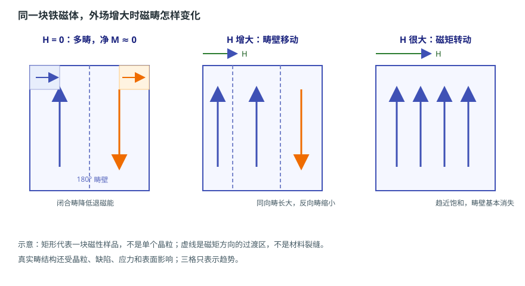

# 磁畴与畴壁：磁体内部为什么分区

状态：草稿（来源级待逐条终审）草稿日期：2026-10-26教材：第 4 章

> **本篇回答：** 一块没有明显磁性的铁，内部真的一点磁性都没有吗？为什么磁体内部会分成许多小区域，而不是整块同向磁化？
> **先修：** [A02：磁矩、磁性分类与居里温度](magnetic-origin-and-classes.md)。
> **预计阅读：** 15 分钟。

读完你能回答：

1. 磁畴和畴壁分别是什么，为什么会出现？
2. 交换能、各向异性能和退磁能怎样共同决定畴结构？
3. 为什么磁畴图不能直接给出芯片处的磁场数值？

## 先看一个现象

拿一块退磁状态的铁，它不会被另一块磁铁强烈吸引，表面高斯计也读不到明显磁场。但把这块铁放进外场，它会很快被磁化；撤掉外场后，它又可能回到接近原来的状态。若内部真的“什么都没有”，这种快速响应和记忆从哪里来？

原因之一是：铁内部早已存在许多自发磁化的小区域，只是它们的磁矩方向不同，宏观上相互抵消。这些区域叫**磁畴**。

## 一张图建立直觉

<figure class="kb-figure" markdown="1" style="box-sizing:border-box;max-width:calc(100vw - 2rem);margin-left:auto;margin-right:auto">
  { style="width:100%;height:auto;max-width:100%" }
  <figcaption>示意：左为零场附近的多畴与闭合畴，中为畴壁移动，右为磁矩转动并趋于饱和。矩形代表样品，不是单个晶粒；虚线是磁矩过渡区，不是材料裂缝。</figcaption>
</figure>

左图中，不同方向的磁畴彼此相邻，表面附近还可能形成闭合畴，让磁通在样品内部闭合。中间图中，外场增大，与外场同向的畴长大，反向畴缩小，畴壁发生移动。右图中，外场继续增大，剩余磁矩转向外场方向，样品趋于饱和。三格只表示趋势，真实畴结构会复杂得多。

## 概念、符号与单位

### 磁畴与畴壁

**磁畴**是自发磁化方向基本一致的区域。**畴壁**是两个相邻磁畴之间磁矩方向逐渐改变的过渡层。教材给出的典型量级是：畴宽约 $10^{-3}\ \text{cm}$（约 $10\ \mu\text{m}$），体积约 $10^{-9}\ \text{cm}^3$，内部约有 $10^{14}$ 个磁性原子；畴壁宽度约为 $10^2$ 个原子层的量级 [BOOK-01，第 4 章，书 p.94 起 / PDF p.103 起](../sources/book.md#BOOK-01)。这些是典型量级，不是所有材料的固定值。

畴壁不是“材料裂缝”，也不是晶界。它是磁矩方向连续过渡的区域；在 180° 畴壁两侧，磁化方向大致相反；在 90° 畴壁（或非 180° 畴壁）两侧，方向差约 90° 或其他角度。畴壁本身有能量，因为磁矩偏离易轴、且相邻磁矩不完全平行。

### 五种能量

磁畴结构由系统自由能取极小值决定，主要能量项可以写成：

$$
E_{\text{tot}}=E_{\text{ex}}+E_K+E_H+E_d+E_\sigma
$$

| 能量项 | 来源 | 它倾向于什么 |
| --- | --- | --- |
| $E_{\text{ex}}$ 交换能 | 近邻自旋的交换作用 | 让近邻磁矩平行（或按交换积分反平行） |
| $E_K$ 各向异性能 | 磁晶、形状、应力等 | 让磁矩沿易轴 |
| $E_H$ 外场能 | 外场与磁矩的作用 | 让磁矩转向外场 |
| $E_d$ 退磁能 | 表面自由磁极产生的反向场 | 减少表面自由磁极，倾向分畴或闭合 |
| $E_\sigma$ 弹性能 | 磁致伸缩与应力耦合 | 调整畴结构以降低弹性能 |

如果没有退磁能，整块材料可能倾向于一个方向磁化；但均匀磁化会在表面产生自由磁极，带来退磁能。把材料分成多个畴，可以降低退磁能；代价是增加畴壁能。因此，实际畴宽是“降低退磁能”和“增加畴壁能”之间的平衡结果。教材用单轴晶体的例子说明：$n$ 个畴时，退磁能可降到均匀磁化时的约 $1/n$，但畴壁数目和壁能同时增加 [BOOK-01，§4.1，书 p.94 起 / PDF p.103 起](../sources/book.md#BOOK-01)。

### 单畴与多畴

- **多畴：** 大块材料常见。分畴降低退磁能，但存在畴壁；外场下主要通过畴壁移动和磁矩转动磁化。
- **单畴：** 颗粒小到不足以容纳畴壁时，整个颗粒只有一个磁化方向。单畴颗粒没有畴壁移动，反磁化更依赖磁矩转动，因此可能具有较高的矫顽力。单畴的临界尺寸与材料、形状和畴壁能有关，不能用一个通用尺寸判断。

闭合畴是另一种降低退磁能的方式：主畴在表面附近弯折，形成闭合磁路，使表面自由磁极减少。教材的闭合型畴结构图给出这一图像 [BOOK-01，§4.3，书 p.100 起 / PDF p.109 起](../sources/book.md#BOOK-01)。

## 公式怎样使用：一个完整算例

**教学假设：** 一块薄片均匀磁化时的退磁能为 $E_{d0}=1.0\ \text{mJ}$；分成 $n$ 个条状畴后，退磁能近似降为 $E_{d0}/n$；每增加一道畴壁，壁能增加 $e_w=0.005\ \text{mJ}$。忽略其他能量变化。求总能量随 $n$ 的变化，并估计“分多少畴”更有利。

总能量近似为：

$$
E(n)=\frac{1.0}{n}+0.005(n-1)\ \text{mJ}
$$

代入几个值：

| $n$ | 退磁能 $1.0/n$ | 畴壁能 $0.005(n-1)$ | 合计 |
| --- | --- | --- | --- |
| 1 | 1.000 | 0.000 | 1.000 |
| 4 | 0.250 | 0.015 | 0.265 |
| 10 | 0.100 | 0.045 | 0.145 |
| 14 | 0.071 | 0.065 | 0.136 |
| 20 | 0.050 | 0.095 | 0.145 |

在这个教学模型里，$n$ 从 1 增加到约 14 时总能量下降；再继续增加，畴壁能开始占主导，总能量反而上升。**结果解释：** 分畴不是越多越好，而是退磁能与畴壁能的折中。真实材料的畴宽还受晶粒、缺陷、应力和表面影响，不能用这个模型直接算出某个样品的畴宽。

## 条件变化时会怎样

- **外场增大：** 先是畴壁可逆移动，随后可能出现不可逆移动，最后是磁矩转动。宏观磁化曲线因此有非线性、磁滞和饱和。技术磁化在 B01 展开。
- **加应力：** 磁致伸缩和应力改变各向异性能，畴结构会重新排列；软磁材料在应力下磁导率可能下降。A04 会讲各向异性和磁致伸缩。
- **温度升高：** 接近 $T_C$ 时自发磁化减弱，畴结构逐渐消失；$T_C$ 以上材料转为顺磁。
- **尺寸减小：** 颗粒小到单畴后，畴壁消失；更小可能受热扰动影响。具体临界尺寸需材料数据，不能用几何尺寸一刀切。

## 常见误区

!!! warning "四个常见错误"
    1. **“磁畴等于晶粒。”** 晶粒是晶体学上的单晶区域；一个晶粒里可以有多个磁畴，磁畴边界与晶界不必重合。两者不是同一个概念。
    2. **“磁畴边界一定是晶界。”** 畴壁可以位于晶粒内部；晶界可能钉扎畴壁，但晶界和畴壁不是同一种边界。
    3. **“磁畴图能直接给出芯片处磁场数值。”** 磁畴图通常只显示表面附近、微米尺度的磁化分布；芯片敏感体积可能更大，且气隙、磁体形状和软磁件会重新分布磁场。
    4. **“畴壁是固定不动的边界。”** 畴壁可以随外场、应力和温度移动；它的位置和宽度由能量平衡决定，不是材料里画好的线。

## 自测

**1.** 为什么闭合畴能降低退磁能？

查看答案

闭合畴让磁通在样品内部形成回路，减少表面自由磁极，从而降低退磁场和退磁能。代价是增加了畴壁和畴壁能，所以是否形成闭合畴仍要看总能量。

**2.** 外场从零逐渐增大时，磁畴结构一般怎样变化？

查看答案

先发生畴壁的可逆移动，与外场同向的畴长大；场更大时可能出现不可逆畴壁移动，随后磁矩转动，最后趋于饱和。具体顺序和可逆程度取决于材料、缺陷和应力。

**3.** 看到一张磁畴显微图，能否直接推断编码器芯片处的 $B$？

查看答案

不能。磁畴图给出的是表面附近的局部磁化结构，分辨率和视场有限；芯片处的 $B$ 还取决于磁体整体形状、充磁分布、气隙、软磁件和敏感体积。需要在实际几何下测量或仿真。

## 本篇小结

- 磁畴是自发磁化方向一致的区域，畴壁是方向逐渐改变的过渡层，不是晶界或裂缝。
- 畴结构由交换能、各向异性能、退磁能、弹性能和场能共同决定；分畴是降低退磁能与增加畴壁能的折中。
- 外场下磁畴通过畴壁移动和磁矩转动响应；磁畴图不能替代芯片处的场测量。

## 工程出口

- 想继续看磁化曲线、磁滞和饱和怎样从畴结构长出来，读 [B01：技术磁化与磁滞回线](magnetization-and-hysteresis.md)。
- 想理解矫顽力、钉扎和形核，读 [B03：反磁化与矫顽力](coercivity-mechanisms.md)。
- 现场怀疑“磁体局部磁化异常”时，按 [FAE 排障路径](../fae/troubleshooting.md) 先固定几何和测量条件，再判断是否需要微观观测。

## 适用边界

本文的畴结构和能量收支是入门级示意，不提供具体材料的畴宽、畴壁能或临界单畴尺寸。真实畴结构受晶粒、缺陷、应力、表面和制备工艺影响；粉纹法、克尔效应、磁力显微镜等观测方法各有分辨率和样品制备限制 [BOOK-01，§4.4，书 p.109 起 / PDF p.118 起](../sources/book.md#BOOK-01)。示意图不冒充显微图，也不能用于推算芯片处场强。

## 来源与待确认项

- [BOOK-01](../sources/book.md#BOOK-01)：第 4 章书 p.94 起 / PDF p.103 起；§4.1 同章起；§4.2 书 p.95 起 / PDF p.104 起；§4.3 书 p.100 起 / PDF p.109 起；§4.4 书 p.109 起 / PDF p.118 起。页码为章节起始页锚点，能量项和典型量级已对照扫描页，仍待逐条终审。

待确认：目标材料的实际畴宽与缺陷状态；观测方法的视场和分辨率；客户所谓“局部磁化异常”是否只是表面闭合畴或装配应力造成。
