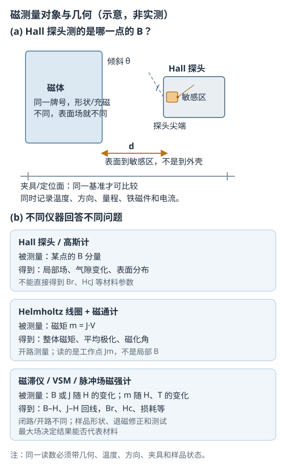

# 磁测量：仪器读数与材料参数为何不同

状态：草稿整理：2026-10-26教材：§1.5

> 本篇回答：同一块磁体，两家实验室给出的“高斯值”为什么不同，却可能都没有测错？
> 先修：A01《从磁场到材料响应》、B01《技术磁化与磁滞回线》、A05《磁通与磁路》；预计阅读 20 分钟。
> 读完能回答：① Hall 探头、Helmholtz 线圈、磁滞仪和 VSM 分别测什么？② 为什么单点表面场不能反推 $B_r$ 或 $H_{cJ}$？③ 重复测量的极差为什么不是标准不确定度？

## 先看一个现象

客户送来同一块圆柱磁体，A 实验室在磁体端面中心读到 300 mT，B 实验室读到 288 mT。两家都用了校准过的 Gauss 表，都没有“坏掉”。差异可能来自：探头敏感区到磁体的距离定义不同、探头倾斜几度、磁体温度不同、夹具基准不同，或者一家读的是轴向分量、另一家读的是横向分量。**在没有记录几何和方向之前，两个数不是同一个被测量。**

教材把磁测量分成“本征参量”和“非本征参量”两类：前者只由成分和晶体结构决定，后者还与晶粒大小、取向、完整性、密度、形状和应力有关 [BOOK-01，§1.5，书 p.25 起 / PDF p.34 起](../sources/book.md#BOOK-01)。工程上大量读数其实是后者，甚至只是某个结构中的局部场，因此必须先分清“测什么”，再谈“准不准”。

## 一张图建立直觉

<figure class="kb-figure" markdown="1">
  
  <figcaption>图 1　磁测量对象与几何（示意，非按比例、非实测）。Hall 探头读的是敏感体积内的 B 分量，不是探头尖端那一点；距离 d 应从磁体表面量到敏感区。右侧三种方法回答不同问题，不能用一个读数替代另一种测量。</figcaption>
</figure>

图 1(a) 的三个要点：探头敏感区通常不在外壳最尖端，而在内部若干毫米处；敏感区自身有面积，会对场做平均；探头通常只测一个方向的分量。因此“探头贴住磁体”并不等于“测到磁体表面”，更不等于“测到材料内部的 $B$”。[MEAS-01，§2.2.4，PDF p.20](../sources/vendor.md#MEAS-01)

## 概念、符号与单位

### 先分清被测量

同一个“材料参数”也有测试条件。例如初始磁导率 $\mu_i$ 的 TDK 定义要求闭合磁路、$f\le10\ \text{kHz}$、$B<0.25\ \text{mT}$、$T=25\ ^\circ\text{C}$ [MAT-01，§2.1，PDF p.4](../sources/vendor.md#MAT-01)。不写明条件的 $\mu_i$ 不能直接比较。

| 想回答的问题 | 应测的量 | 常用方法 | 不能直接得到 |
| --- | --- | --- | --- |
| 芯片位置有多少场？ | 某点的 $B$ 分量 | Hall 探头/高斯计 | 材料 $B_r$、$H_{cJ}$ |
| 整块磁体有多强？ | 磁矩 $m$，或平均极化 $J$ | Helmholtz 线圈 + 磁通计 | 局部场分布 |
| 材料的回线是什么样？ | $B$–$H$ 或 $J$–$H$ 曲线 | 磁滞仪、VSM、脉冲场磁强计 | 装配后的角度误差 |
| 温度改变多少？ | $m$–$T$ 或 $H_c$–$T$ | VSM/AGM、带温控的磁滞仪 | 客户结构中的热点温度 |

### 各方法的关键条件

- **Hall 探头：** 适合局部场、气隙变化和表面扫描；读数是敏感体积内的平均分量，定位重复性往往比探头分辨率更限制结果；它几乎不提供材料参数信息 [MEAS-01，§2.2.4，PDF p.20](../sources/vendor.md#MEAS-01)。
- **Helmholtz 线圈 + 积分磁通计：** 样品在开路中移动或翻转，磁通计对感应电压积分，得到磁矩。按定义 $m=J\cdot V$（单位 Wb·m）或 $m=M\cdot V$（单位 A·m²），两者用 $J=\mu_0M$ 换算。开路测量没有外加场，但磁体自身有退磁场，所以读到的是工作点极化 $J_m$，不严格等于 $J_r$ [MEAS-01，§1.2.2、§2.2.3，PDF p.11、p.17](../sources/vendor.md#MEAS-01)。
- **磁滞仪/磁导计：** 样品夹在电磁铁磁极之间，形成闭合磁路，扫场并记录 $B$、$J$ 随 $H$ 的变化。结果直观，但对样品厚度、平行面、样品与线圈对中、校准漂移敏感；铁磁极头约 2 T 饱和，$H$ 轴超过约 1600 kA/m 后场均匀性会变差，高 $H_{cJ}$ 样品可能测不到完整回线 [MEAS-01，§2.1，PDF p.14](../sources/vendor.md#MEAS-01)。
- **VSM：** 样品在拾取线圈间振动，测感应电压得到磁矩，适合 $m$–$H$、$m$–$T$ 和宽温区；样品小，开路测量需要退磁修正 [MEAS-01，§2.2.1，PDF p.15](../sources/vendor.md#MEAS-01)。
- **脉冲场磁强计：** 用短脉冲加高场，适合高 $H_{cJ}$ 样品；金属样品要修正涡流，且通常不能测初始磁化曲线 [MEAS-01，§2.2.2，PDF p.16](../sources/vendor.md#MEAS-01)。

### 开路与闭路

闭路测量（如磁滞仪）让样品成为磁路的一部分，退磁场较小，但样品形状受限；开路测量（VSM、Helmholtz、脉冲场）样品形状自由、可加很高场，却必须用退磁因子或负载线把外场修正为内场。修正本身是近似，尤其当样品形状不规则或磁化不均匀时 [MEAS-01，§2.2，PDF p.15](../sources/vendor.md#MEAS-01)。所以“同一材料”的 $B_r$、$H_c$ 在不同报告里不同，可能只是开路/闭路和修正方法不同。

## 公式怎样使用（含完整算例）

### 磁矩与平均极化

$$
m=J\cdot V
$$

其中 $m$ 的单位是 Wb·m，$J$ 的单位是 T，$V$ 的单位是 m³。若用磁化强度，则 $m=M V$，$m$ 的单位是 A·m²。

**单位核对例：** 一块体积 $V=1.0\ \text{cm}^3=1.0\times10^{-6}\ \text{m}^3$ 的样品，Helmholtz 线圈测得 $m=1.1\times10^{-6}\ \text{Wb·m}$。则平均极化

$$
J=\frac{m}{V}=\frac{1.1\times10^{-6}}{1.0\times10^{-6}}=1.1\ \text{T}
$$

**注意：** 这是样品在工作点的平均值，不是样品表面某点的 $B$，也不是材料在闭路条件下的 $B_r$。若样品形状改变，退磁状态改变，$J_m$ 也会变。

### 重复测量的均值与不确定度

对同一位置、同一夹具、同一温度的 5 次重复读数（单位 mT）：

| 次数 | 1 | 2 | 3 | 4 | 5 |
| --- | --- | --- | --- | --- | --- |
| 读数 | 252.1 | 252.4 | 251.9 | 252.3 | 252.0 |

均值

$$
\bar{x}=\frac{1}{n}\sum_{i=1}^{n}x_i=252.14\ \text{mT}
$$

样本标准差

$$
s=\sqrt{\frac{\sum_{i=1}^{n}(x_i-\bar{x})^2}{n-1}}\approx0.21\ \text{mT}
$$

均值标准不确定度（A 类）

$$
u_A=\frac{s}{\sqrt{n}}=\frac{0.21}{\sqrt{5}}\approx0.093\ \text{mT}
$$

极差是 $252.4-251.9=0.5\ \text{mT}$。**极差描述这 5 个数的分散范围，不是标准不确定度**；把它直接写成“±0.5 mT”会混淆“最大最小之差”和“均值的标准不确定度”。

若再假设：读数分辨率为 $0.1\ \text{mT}$，按矩形分布 $u_{res}=0.1/\sqrt{12}\approx0.029\ \text{mT}$；校准证书给出扩展不确定度 $U=0.5\ \text{mT}$（$k=2$），则 $u_{cal}=0.25\ \text{mT}$。忽略其他分量并假定互不相关，合成标准不确定度

$$
u_c=\sqrt{u_A^2+u_{res}^2+u_{cal}^2}
=\sqrt{0.093^2+0.029^2+0.25^2}\approx0.27\ \text{mT}
$$

取 $k=2$，扩展不确定度 $U\approx0.54\ \text{mT}$。报告可写成“$252.1\ \text{mT}\pm0.5\ \text{mT}$（$k=2$，教学简化）”。

**这个算例的假设必须说清：** 5 次读数独立、无漂移；分辨率按矩形分布；校准证书按正态分布；忽略探头非线性、温度、定位和样品不均匀等分量；没有按自由度取 $t$ 因子。正式报告应按适用的不确定度规程和校准证书执行，这里的数字只用于教学。

## 读数争议时先查什么

1. **被测量是否同一？** 是 $B_x$、$B_z$、$|B|$，还是磁矩、磁通、材料 $B_r$？
2. **几何是否同一？** 参考面、距离、探头方向、倾斜、横向位置、敏感区深度。
3. **环境是否同一？** 温度、附近铁磁物、电机电流、外部杂散场、样品是否刚被充磁或退磁。
4. **样品是否同一状态？** 批次、充磁状态、镀层、取向、尺寸公差、装配应力。
5. **仪器链是否可追溯？** 探头序列号、量程、校准日期、零点、积分器漂移、采样平均方式。

只有这些都记录，两个读数才有可比性。客户争议里最有用的往往不是“绝对真值”，而是**同一工装下的相对变化**和**可追溯的校准**。

## 常见误区与自测

| 常见误区 | 为什么不对 | 更稳妥的做法 |
| --- | --- | --- |
| “表面单点场可以反推 $B_r$ 或 $H_{cJ}$” | 局部场由磁体形状、气隙、漏磁和测量点决定；材料参数需要规定的闭路/开路测试和修正 | 要材料参数就做 $B$–$H$/$J$–$H$ 测试；要芯片处场就在目标结构里测 |
| “探头越靠近磁体越好” | 太近时敏感体积平均、探头厚度、倾斜和场梯度都会放大误差，重复性反而变差 | 固定距离和夹具，先验证重复性，再谈分辨率 |
| “不同夹具的读数可以直接比较” | 夹具改变距离、方向和杂散场，读数差异可能来自测量条件 | 比较前统一基准，或同时报告几何和条件 |
| “多次读数取平均就是真值” | 平均只降低随机分量，系统偏差（校准、距离、温度）仍在 | 同时评估系统不确定度，并用标准样品/校准链核查 |

自测 1：5 次读数的极差是 0.6 mT，能否直接报告“标准不确定度 0.6 mT”？

答案：不能。极差只是最大值与最小值之差。标准不确定度要由重复性标准差除以 $\sqrt{n}$ 得到 A 类分量，再与分辨率、校准、定位等分量合成；极差本身不是标准不确定度。

自测 2：Helmholtz 线圈测得 $m=1.1\times10^{-6}\ \text{Wb·m}$，样品体积 $1.0\ \text{cm}^3$，平均极化是多少？这个值能当表面场吗？

答案：$J=m/V=1.1\times10^{-6}/1.0\times10^{-6}=1.1\ \text{T}$。它是样品工作点的平均极化，不是表面某点的 $B$，也不是芯片处的场；表面场还取决于形状、充磁和距离。

自测 3：要得到某材料的 $B_r$、$H_{cJ}$ 和回线，应该优先用 Hall 探头还是磁滞仪/VSM？为什么？

答案：优先用磁滞仪（闭路）或 VSM（开路，需退磁修正）。Hall 探头只给某点的 $B$ 分量，不能给出完整回线和材料参数；它的优势在局部场和空间分布。

自测 4：两家实验室同一磁体读数差 4%，你先查哪三项？

答案：先查几何（参考面、距离、探头方向/倾斜、敏感区）、温度与样品状态（充磁/退磁、批次）、仪器链（探头型号、量程、校准日期、零点）。在这三项之前，不要先归因于材料差异。

## 本篇小结

- 测量方法没有“最好”，只有“回答哪个问题”：局部场、磁矩、材料回线是三类不同对象。
- Hall 探头测敏感体积内的 $B$ 分量；Helmholtz 线圈测磁矩；磁滞仪/VSM 测回线或 $m$–$H(T)$。
- 开路与闭路的退磁修正不同；同一材料在不同报告中的 $B_r$、$H_c$ 可能因此不同。
- 重复性、分辨率、校准和定位共同构成不确定度；极差不是标准不确定度。
- 任何读数都要带几何、温度、方向、夹具和样品状态，否则不能比较。

## 工程出口

- [FAE 选型中的磁场条件确认](../fae/selection.md)：把“磁场”拆成芯片处 $B$、材料参数和测试条件。
- [FAE 排障：读数与现场争议](../fae/troubleshooting.md)：按几何、温度、夹具和仪器链定位差异。
- [永磁参数与工作点](permanent-magnet-parameters.md)：从 $B_r$、$H_{cB}$、$H_{cJ}$ 到负载线的读图方法。

## 来源与待确认项

- [BOOK-01](../sources/book.md#BOOK-01)：§1.5 磁测量，书 p.25 起 / PDF p.34 起；本次查阅了该节起始页和单位换算表附近页面，教材只提供测量分类和概念框架，不提供具体仪器操作规程。未做全书 OCR。
- [MEAS-01](../sources/vendor.md#MEAS-01)：Arnold Magnetic Technologies，*Magnetic Properties of Permanent Magnets & Measuring Techniques*，2021-07-23。§1.2.2 磁矩、§2.1 磁滞仪、§2.2 开路测量与退磁修正、§2.2.1 VSM、§2.2.2 脉冲场、§2.2.3 Helmholtz 线圈、§2.2.4 Hall 探头，PDF p.11–20。
- [MAT-01](../sources/vendor.md#MAT-01)：TDK，*General – Definitions*，2022-10。§2.1 初始磁导率的测试条件，PDF p.4。
- 待确认项：客户所用探头型号、敏感区尺寸和距尖端深度；校准证书的 $U$ 与 $k$；测量距离的基准面；样品温度与充磁状态；正式不确定度报告所依据的规程。本库目前没有具体校准规程原文，不能把本篇教学算例当作项目保证值。
