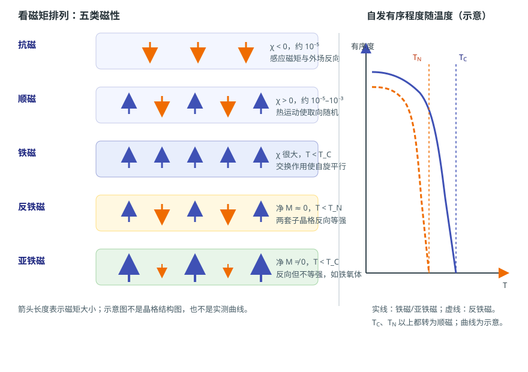

# 磁性从哪里来：磁矩、磁性分类与居里温度

状态：草稿（来源级待逐条终审）草稿日期：2026-10-26教材：第 2 章、§1.3

> **本篇回答：** 铜、铝、铁和铁氧体放进同一个磁场，响应为什么差这么多？铁氧体内部明明有反向磁矩，为什么还能表现出净磁性？
> **先修：** [A01：B、H、M、J 与磁通](field-and-measurement.md)。
> **预计阅读：** 15 分钟。

读完你能回答：

1. 原子磁矩从哪里来，为什么不是所有材料都表现为铁磁？
2. 抗磁、顺磁、铁磁、反铁磁、亚铁磁的磁矩排列和磁化率有什么不同？
3. 居里温度 $T_C$ 与“最高工作温度”为什么不是一回事？

## 先看一个现象

把铜片、铝片、铁片和一块铁氧体分别靠近同一块磁体。铜和铝几乎不被吸住；铁片会被明显吸住；铁氧体可能被吸住，也可能表现为一块永磁体。若只看“有没有磁矩”，铜原子也有电子，为什么铜不是铁磁体？

答案不在“有没有电子”，而在**磁矩如何排列、排列能否在热扰动下保持、以及排列是否产生净磁化**。

## 一张图建立直觉

<figure class="kb-figure" markdown="1" style="box-sizing:border-box;max-width:calc(100vw - 2rem);margin-left:auto;margin-right:auto">
  { style="width:100%;height:auto;max-width:100%" }
  <figcaption>示意：箭头表示原子磁矩的方向和相对大小；右图表示铁磁/亚铁磁在 $T_C$、反铁磁在 $T_N$ 以上失去自发有序。不是晶格结构图，也不是实测曲线。</figcaption>
</figure>

左图把五类磁性并排。抗磁材料的感应磁矩与外场反向；顺磁材料有永久磁矩，但热运动使它们随机取向；铁磁材料在 $T_C$ 以下自发平行排列；反铁磁材料两套子晶格反向且等强，净磁化接近零；亚铁磁材料也反向，但两套子晶格不等强，所以留下净磁化。右图只画“有序程度随温度下降”的趋势，不表示具体数值。

## 概念、符号与单位

### 原子磁矩

原子的磁矩主要来自电子的轨道运动和自旋，原子核的磁矩很小，通常可以忽略。材料单位体积内的磁矩总和就是磁化强度：

$$
M=\frac{\sum \mu_m}{V}
$$

其中 $\mu_m$ 是单个原子或离子的磁矩，$V$ 是体积，$M$ 的单位是 A/m。教材从原子磁矩和电子排布开始讲磁性起源 [BOOK-01，第 2 章，书 p.31 起 / PDF p.40 起](../sources/book.md#BOOK-01)。

单个原子有磁矩，并不自动等于铁磁体。要让磁矩在没有外场时也保持同向，需要近邻原子之间的交换作用。交换积分 $A>0$ 时，近邻自旋倾向于平行，容易形成铁磁；$A<0$ 时倾向于反平行，可能形成反铁磁或亚铁磁。教材用海森堡交换作用解释这一层 [BOOK-01，§2.4.3，书 p.46 起 / PDF p.55 起](../sources/book.md#BOOK-01)。

### 五类磁性

| 类型 | 磁矩排列 | 磁化率 $\chi$ 的符号与量级 | 有序温度 | 典型直觉 |
| --- | --- | --- | --- | --- |
| 抗磁 | 感应磁矩与外场反向 | $\chi<0$，约 $10^{-5}$ | 无 | 铜、水、惰性气体 |
| 顺磁 | 有磁矩，但热运动随机 | $\chi>0$，约 $10^{-5}$–$10^{-3}$ | 无（或极低） | 铝、稀土盐类 |
| 铁磁 | 自发平行 | $\chi$ 很大，常以 $\mu_r$ 表示 | $T_C$ 以下有序 | 铁、钴、镍 |
| 反铁磁 | 两套子晶格反向等强 | 在 $T_N$ 附近出现峰值 | $T_N$ 以下有序 | 部分过渡金属氧化物 |
| 亚铁磁 | 两套子晶格反向不等强 | $\chi$ 大，但通常低于铁磁 | $T_C$ 以下有序 | 铁氧体 |

表里的量级来自教材表 1.2 的示例 [BOOK-01，§1.3，书 p.15 起 / PDF p.24 起，表 1.2 书 p.16 / PDF p.25](../sources/book.md#BOOK-01)。要特别注意：铁磁和亚铁磁的 $\chi$ 不是常数，不能把某个“初始磁导率”线性外推到饱和；抗磁和顺磁的 $\chi$ 很小，通常也不会直接用于器件选型。

### 顺磁的居里—外斯关系

顺磁材料的磁化率随温度下降而增大，常用居里—外斯定律描述：

$$
\chi=\frac{C}{T-T_P}
$$

其中 $C$ 是居里常数，$T_P$ 是顺磁居里温度。对理想顺磁体，$T_P$ 接近 0；对铁磁体在 $T_C$ 以上，$T_P$ 接近 $T_C$。这条式子只适用于顺磁区，不能拿来预测铁磁区内的饱和磁化。

### 居里温度与奈尔温度

- **$T_C$（居里温度）：** 铁磁或亚铁磁材料在升温时，自发有序被热扰动破坏的温度。$T_C$ 以上，材料转为顺磁。
- **$T_N$（奈尔温度）：** 反铁磁材料的有序被破坏的温度；$T_N$ 以上也转为顺磁。

$T_C$ 是“自发有序消失”的物理温度，不是磁体的“最高工作温度”。磁体在远低于 $T_C$ 的温度下也可能因为反向场、负载线和时间发生不可逆损失；具体限值必须绑定牌号、形状和允许损失 [PM-01](../sources/vendor.md#PM-01)。

## 公式怎样使用：一个完整算例

**教学假设：** 取铜的 $\chi=-1.0\times10^{-5}$（教材表 1.2 的示例值），外场 $H=80\ \text{kA/m}=8.0\times10^{4}\ \text{A/m}$。求铜的磁化强度 $M$ 和磁极化强度 $J$。

在线性近似下：

$$
M=\chi H
=(-1.0\times10^{-5})(8.0\times10^{4}\ \text{A/m})
=-0.80\ \text{A/m}
$$

负号表示磁化方向与外场相反。再算

$$
J=\mu_0M
=(4\pi\times10^{-7})(-0.80)
\approx-1.0\times10^{-6}\ \text{T}
=-1.0\ \mu\text{T}
$$

也就是说，在约 $80\ \text{kA/m}$ 的外场下，铜的磁响应只有约 $1\ \mu\text{T}$ 的量级，远小于外场在空气中对应的约 $100\ \text{mT}$。作为对比，教材图 2.11 给出室温下铁、钴、镍的饱和磁极化强度 $\mu_0M_s$ 约为 $2.16\ \text{T}$、$1.79\ \text{T}$、$0.61\ \text{T}$ [BOOK-01，§2.4.1，书 p.42 起 / PDF p.51 起](../sources/book.md#BOOK-01)。同样是“有电子、有磁矩”，铁磁材料的响应可以高出许多个数量级。

**结果解释：** 铜的负号来自抗磁性；铁的 $2.16\ \text{T}$ 是室温下的饱和值，不是某个牌号的保证值，也不能用“$\chi$ 乘以场”外推得到。这个例子说明：**分类看的是磁矩排列和响应机制，不是简单比较“谁有磁矩”。**

## 条件变化时会怎样

- **升温：** 铁磁/亚铁磁在 $T_C$ 以上失去自发有序，变成顺磁；反铁磁在 $T_N$ 以上也变成顺磁。接近 $T_C$ 时，饱和磁化下降，磁体抗退磁能力通常变差。
- **换材料微结构：** 同样是铁氧体，可以是软磁铁氧体，也可以是永磁铁氧体；分类只说明磁矩排列，不决定矫顽力和应用。具体材料家族见 C03、C05。
- **加外场：** 顺磁的 $M$ 随 $H$ 近似线性增加；铁磁会出现畴壁移动、磁矩转动和饱和，不能再用一条直线描述。技术磁化在 B01 展开。
- **降尺寸：** 颗粒小到单畴甚至更小时，热扰动可能让磁矩翻转，出现超顺磁行为；这不是本文的入门范围，但提醒“分类”不等于“任何尺寸都稳定”。

## 常见误区

!!! warning "四个常见错误"
    1. **“有磁矩就一定是铁磁体。”** 很多原子和离子有永久磁矩，但热运动或反平行排列会让宏观净磁化很小；顺磁和反铁磁都有磁矩。
    2. **“反铁磁和亚铁磁都没有宏观磁性。”** 理想反铁磁的净磁化接近零；亚铁磁两套子晶格不等强，通常有净磁化，铁氧体就是典型。
    3. **“磁性分类可以直接当器件性能排序。”** 铁磁材料可以是软磁也可以是永磁；亚铁磁的铁氧体既能做高频磁芯，也能做永磁体。分类不等于 $B_r$、$H_c$ 或损耗。
    4. **“居里温度以下就安全。”** 不可逆损失、镀层退化、胶粘剂和装配应力都可能在 $T_C$ 以下发生；最高工作温度必须按牌号、负载线和允许损失定义。

## 自测

**1.** 一种材料有永久原子磁矩，但室温下没有自发磁化。它一定是铁磁体吗？

查看答案

不一定。它可能是顺磁体（热运动破坏取向）、反铁磁体（子晶格反向等强）或亚铁磁体在某个温度区间的表现。判断要看磁矩排列、磁化率随温度的变化，以及是否存在自发磁化，而不是只看“有没有磁矩”。

**2.** 铁氧体内部两套子晶格的反向磁矩为什么没有完全抵消？

查看答案

因为两套子晶格的磁矩大小不等。反向排列仍然存在，但净磁化不为零，所以表现为亚铁磁。典型例子是铁氧体；具体净磁化大小还取决于成分、温度和结构。

**3.** 某材料 $T_C=450\ ^\circ\text{C}$，能否说它在 $400\ ^\circ\text{C}$ 一定安全？

查看答案

不能。$T_C$ 只是自发有序消失的温度；在 $T_C$ 以下，磁体仍可能因反向场、负载线、时间和温度循环发生不可逆损失。能否在 $400\ ^\circ\text{C}$ 使用，要看牌号、工作点、允许损失和供应商曲线。

## 本篇小结

- 原子磁矩主要来自电子轨道和自旋；交换作用决定磁矩能否自发有序。
- 五类磁性的区别在磁矩排列、净磁化和磁化率；亚铁磁不是“没有磁性”，而是反向不等强。
- $T_C$ 和 $T_N$ 是自发有序消失的温度，不是器件的最高工作温度。

## 工程出口

- 需要看永磁材料的 $B_r$、$H_{cJ}$、温度和退磁曲线时，读 [C04：永磁参数、退磁曲线与工作点](permanent-magnet-parameters.md)和 [C06：温度稳定性与退磁](magnet-stability-and-demagnetization.md)。
- 需要比较软磁材料的高磁导率、饱和与损耗时，读 [C01：软磁性能参数](soft-magnetic-parameters.md)和 [C02：金属软磁、非晶与纳米晶](soft-magnetic-materials.md)；软磁铁氧体的高频取舍见 [C03：软磁铁氧体](soft-ferrites.md)。
- 需要把“材料磁性强弱”转成选型条件时，用 [FAE 选型工作流](../fae/selection.md)，不要只按材料名词排序。

## 适用边界

本文是分类和温度直觉的入门，不提供具体材料的 $\chi$、$T_C$、$T_N$ 或牌号性能。磁化率会随温度、场强、纯度、微结构和测量方向变化；表中量级只用于建立数量级感。铁氧体的软磁/永磁分野、温度稳定性和退磁校核需要 C03、C05、C06 及供应商数据。

## 来源与待确认项

- [BOOK-01](../sources/book.md#BOOK-01)：第 2 章书 p.31 起 / PDF p.40 起；§1.3 书 p.15 起 / PDF p.24 起；表 1.2 书 p.16 / PDF p.25；§2.4 书 p.42 起 / PDF p.51 起；§2.4.3 书 p.46 起 / PDF p.55 起。页码为章节起始页锚点，分类与公式已对照扫描页，仍待逐条终审。
- [PM-01](../sources/vendor.md#PM-01)：Arnold Magnetic Technologies，稀土永磁的磁化损失；支持“居里温度不是最高工作温度”及不可逆损失的边界。

待确认：教材图 2.11 的饱和值适用于何种纯度和温度条件；具体铁氧体牌号的 $T_C$ 与损耗曲线；客户所谓“磁性变弱”是温度、退磁还是测量条件变化。
