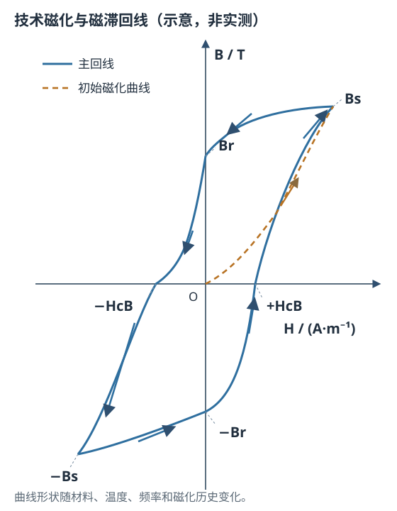

# 技术磁化与磁滞回线

状态：草稿整理：2026-10-26教材：第 5 章

> 本篇回答：外场已经回到零，材料为什么没有回到原来的状态？
> 先修：A03《磁畴与畴壁》、A04《磁各向异性与磁致伸缩》；预计阅读 25 分钟。
> 读完能回答：① 初始磁化曲线和磁滞回线为什么不是同一条线？② Br、HcB、Bs、μi 分别在图上的哪里？③ 怎样从一条回线读出参数，而不是背定义？

## 先看一个现象

把一段已经退磁的软磁环装入测量线圈，从零开始缓慢增加电流，再缓慢把电流降回零。记录每个时刻的 $B$ 与 $H$：上升时，$B$ 先缓慢增加，随后变陡，最后逐渐趋平；电流回零时，$B$ 却没有回到零，而是停在一个正值。继续反向增加电流，$B$ 才在某个反向场下过零；把反向场加到饱和再返回，轨迹才闭合成一个环。

这就是磁滞：材料的磁状态不仅取决于当前外场，还取决于它之前走过的路径。对软磁材料，这个环通常很窄；对永磁材料，环可以很宽。教材把从磁中性状态到饱和、再在交变场中反复磁化的过程分别称为静态磁化和动态磁化，并把由畴壁位移与磁矩转动实现的宏观磁化称为技术磁化 [BOOK-01，第 5 章，书 p.115 起 / PDF p.124 起](../sources/book.md#BOOK-01)。

## 一张图建立直觉

<figure class="kb-figure" markdown="1">
  
  <figcaption>图 1　完整 B–H 回线与初始磁化曲线（示意，非按比例、非实测）。实线箭头表示先把场升到正饱和、再降到负饱和、最后回到正饱和的测量路径；Br、HcB、Bs 是定义点，不是任意工作点。曲线形状随材料、温度、频率和磁化历史改变。</figcaption>
</figure>

先沿虚线从原点走到右上角的 $B_s$：这是从退磁态开始的初始磁化曲线。到达饱和后把场减小，$B$ 不沿原路返回，而是走上面那条实线，在 $H=0$ 处留下 $B_r$；继续反向加场，在 $B=0$ 处得到负的 $H_{cB}$；到负饱和后返回，走下面那条实线，形成闭合回线。

回线包围的面积不是装饰：在准静态、一个完整周期内，单位体积材料耗散的能量就是这块面积。环越宽、面积越大，每周期磁滞能量越高。软磁材料希望它小，永磁材料则更关心第二象限的退磁曲线，不能只拿“面积大”当性能好坏。

## 概念、符号与单位

| 量 | 符号 | 常用单位 | 读图位置或含义 |
| --- | --- | --- | --- |
| 磁场强度 | $H$ | A/m | 横轴，外加激励的量度 |
| 磁通密度 | $B$ | T（Wb/m²） | 纵轴，材料内外合成后的磁通密度 |
| 磁化强度 | $M$ | A/m | 材料单位体积的磁矩 |
| 磁极化强度 | $J$ | T | $J=\mu_0M$，永磁曲线常用 |

在 SI 中，三个量由下式联系：

$$
B=\mu_0(H+M)=\mu_0H+J,\qquad \mu_0=4\pi\times10^{-7}\ \text{H/m}
$$

这个式子说明 $B$ 同时包含“外场贡献”和“材料响应”。在真空或近似空气中 $M\approx0$，才有 $B\approx\mu_0H$；在磁体内部不能把 $B$ 和 $H$ 当成同一个量。

从图上读参数时，必须同时记住定义条件：

- **$B_s$（饱和磁通密度）：** 在给定温度和足够大的场下，$B$ 不再明显增加时的上限。它是“给定温度、给定最大场”的值，不是与温度无关的常数。
- **$B_r$（剩磁）：** 从饱和状态把外场降到零后保留的 $B$。它依赖饱和历史、取向、温度和样品形状；小回线在 $H=0$ 处的值不一定等于 $B_r$。
- **$H_{cB}$（磁感矫顽力）：** 在 $B$–$H$ 回线上使 $B=0$ 的反向场。
- **$H_{cJ}$（内禀矫顽力）：** 在 $J$–$H$（或 $M$–$H$）回线上使 $J=0$（或 $M=0$）的反向场。它与 $H_{cB}$ 的定义对象不同，一般不能互换；对永磁材料，第二象限里 $|H_{cJ}|$ 通常大于 $|H_{cB}|$。
- **$\mu_i$（初始磁导率）：** 很弱激励下、从退磁态开始的极限斜率。TDK 的定义要求在闭合磁路、$f\le10\ \text{kHz}$、$B<0.25\ \text{mT}$、$T=25\ ^\circ\text{C}$ 下测量 [MAT-01，§2.1，PDF p.4](../sources/vendor.md#MAT-01)。换一个偏置或频率，这个数不能直接沿用。
- **$\mu_{max}$（最大磁导率）：** 磁化曲线最陡处的斜率，不等于 $\mu_i$，也不代表大信号下仍保持。
- **$\mu_a$（幅值磁导率）：** 高激励下用峰值定义的 $B_m/(\mu_0H_m)$，需要写明 $B_m$、频率和温度条件。

还要区分三条“线”：

1. **初始磁化曲线：** 样品先被完全退磁，再从 $H=0$、$B=0$ 单调增加场得到的曲线。
2. **主磁滞回线：** 先把场加到足够大的正、负饱和，再闭合得到的回线。$B_r$、$H_{cB}$ 通常在这条回线上读。
3. **正常磁化曲线（换向曲线）：** 把一系列对称小回线的顶点连起来得到的曲线。对某些软磁铁氧体，它可能与初始磁化曲线近似重合；但不能把这个近似推广到所有材料 [MAT-01，§1.2.1，PDF p.3](../sources/vendor.md#MAT-01)。

## 公式怎样使用（含完整算例）

### 磁导率

在某个工作点附近，相对磁导率可写成

$$
\mu_r=\frac{B}{\mu_0H}
$$

更严格地说，非线性材料的“磁导率”应说明是割线、切线还是增量磁导率。微分磁导率可写成

$$
\mu_{diff}=\frac{1}{\mu_0}\frac{\mathrm{d}B}{\mathrm{d}H}
$$

**适用条件：** 先说明取哪个点、哪个方向、什么温度、什么频率和是否叠加直流偏置；否则同一个材料可以给出很多个“磁导率”。

**教学算例（闭合环形样品，均匀场假设）：** 环的平均磁路长度 $l=0.20\ \text{m}$，截面积 $A=1.0\times10^{-4}\ \text{m}^2$，绕组 $N=200$ 匝，通入 $I=10\ \text{mA}$。忽略漏磁和边缘效应，则

$$
H=\frac{NI}{l}=\frac{200\times0.010}{0.20}=10\ \text{A/m}
$$

在该点测得 $B=6.0\ \text{mT}=6.0\times10^{-3}\ \text{T}$，于是

$$
\mu_r=\frac{6.0\times10^{-3}}{4\pi\times10^{-7}\times10}\approx4.8\times10^{2}
$$

通过截面的磁通为

$$
\Phi=BA=6.0\times10^{-3}\times1.0\times10^{-4}=6.0\times10^{-7}\ \text{Wb}
$$

**结果解释：** 在这个很弱的激励点，材料表现为约 $4.8\times10^{2}$ 的相对磁导率；若把 $H$ 增大十倍，$B$ 不一定也增大十倍，不能把这个数当成全曲线常数。这个算例只验证“点参数”的算法，不代表任何牌号。

### 回线面积的含义

准静态、一个周期内单位体积的磁滞能量等于回线面积 $w_h=\oint H\,\mathrm{d}B$（单位 $\text{J/m}^3\cdot\text{cycle}$）。回线越宽、$H_c$ 越高，面积越大；软磁希望面积小，永磁则更关心第二象限的工作点。频率、涡流、趋肤效应和温度对损耗的影响，以及 Steinmetz 拟合的适用条件，集中在 [B04：动态磁化、损耗与温度](loss-and-temperature.md) 展开，本文不重复推导。

## 曲线和结构变化时会怎样

- **软磁与永磁的关注点相反。** 软磁要窄回线、低 $H_c$、高 $\mu$，让磁化和退磁都容易；永磁要宽回线、高 $B_r$ 和高 $H_{cJ}$，并重点读第二象限。把软磁的“低矫顽力”当成所有材料的优点，会得到错误结论。
- **温度改变参数，也改变定义条件。** 接近居里温度时 $B_s$ 明显下降；$H_c$、$B_r$ 的温度走向随材料而异。数据表若只给室温值，不能直接用于高温工作点。
- **应力、杂质和晶界会钉扎畴壁。** 这些不均匀性使畴壁运动出现不可逆跳跃，回线变宽、$H_c$ 升高、磁导率下降。退火可以降低内应力，但也会改变晶粒和尺寸，不能只看一个参数。
- **频率升高会把静态回线变成动态回线。** $B$ 滞后 $H$ 的相位增加，回线变宽，并叠加涡流和剩余损耗；这部分在 [动态磁化、损耗与温度](loss-and-temperature.md) 展开。
- **测量前状态决定起点。** 初始磁化曲线必须从磁中性状态开始；教材给出交流退磁和加热到居里温度以上再冷却两种方法 [BOOK-01，§5.1，书 p.116 / PDF p.125](../sources/book.md#BOOK-01)。对已装配的磁体，加热退磁可能不可行，应改用约定的交流退磁或直接测主回线。

## 常见误区与自测

| 常见误区 | 为什么不对 | 更稳妥的说法 |
| --- | --- | --- |
| “$B_r$ 就是任意 $H=0$ 处的 $B$” | $B_r$ 是饱和后回到零场、在规定条件下读的值；小回线、未饱和状态或不同温度都会给出别的零场值 | 说明“从什么饱和状态、什么温度、哪条回线读出的 $B_r$” |
| “$H_{cB}$ 和 $H_{cJ}$ 是一回事” | 一个定义在 $B$–$H$ 曲线，一个定义在 $J$–$H$ 曲线；两者一般不等 | 比较 $H_c$ 前先问“哪条曲线、什么温度、什么测试方法” |
| “初始磁化曲线就是退磁曲线” | 初始曲线从退磁态出发；退磁曲线从饱和态出发，路径和起点都不同 | 按测量目的选择曲线，不把两者互相替代 |
| “回线面积越大，材料越好” | 软磁希望面积小以降损耗，永磁关心第二象限的工作点；面积不是统一评分 | 先确定应用目标，再选参数 |

自测 1：一条回线给出 $B_r=1.15\ \text{T}$、$H_{cB}=850\ \text{kA/m}$、$B_s=1.30\ \text{T}$。客户说“芯片处应该也有 1.15 T”，这句话缺了什么？

答案：$B_r$ 是材料样品在指定测试条件、饱和后回到零场时的剩磁，不是客户结构里芯片位置的空间场。芯片处的 $B$ 还取决于磁体尺寸、气隙、形状、软磁件、漏磁和温度。不能把材料 $B_r$ 直接当成局部场。

自测 2：两条 $J$–$H$ 曲线的 $H_{cJ}$ 分别为 1600 kA/m 和 800 kA/m，$B_r$ 接近。哪一条更难发生本征退磁？能否据此判断高温下也更好？

答案：$H_{cJ}$ 较大的那条抵抗本征磁化反转的能力更强。但不能只凭室温 $H_{cJ}$ 判断高温性能；还要看 $H_{cJ}(T)$、膝点、负载线、最大反向场和允许损失。$B_r$ 接近也不能说明 $H_c$ 相同。

自测 3：用本篇环形样品算例，若 $I=20\ \text{mA}$、测得 $B=9.0\ \text{mT}$，求该点的 $\mu_r$。与 $10\ \text{mA}$ 时相比说明了什么？

答案：$H=200\times0.020/0.20=20\ \text{A/m}$；$\mu_r=9.0\times10^{-3}/(4\pi\times10^{-7}\times20)\approx3.6\times10^{2}$。场加倍而 $B$ 只增加到 1.5 倍，说明工作点已进入非线性区，局部磁导率下降；不能把低场 $\mu_i$ 当成全范围常数。

自测 4：为什么测初始磁化曲线前要先退磁？

答案：不退磁时样品带有剩余磁化，起点不是 $H=0$、$B=0$，记录的会是某条小回线或局部路径，而不是从磁中性状态出发的初始磁化曲线。初始曲线的“初始”指的是磁状态，不只是电流从零开始。

## 本篇小结

- 磁滞来自畴壁位移和磁矩转动的不可逆过程；回线是路径，不是一条普通函数曲线。
- $B_s$、$B_r$、$H_{cB}$、$H_{cJ}$、$\mu_i$、$\mu_{max}$ 都是带条件的定义，读图前先问“哪条曲线、什么状态、什么温度”。
- 回线面积给出每周期磁滞能量；软磁和永磁对回线形状的期望相反。
- 初始磁化曲线、主回线和正常磁化曲线不能混用；测量前状态会改变结果。

## 工程出口

- [磁测量](magnetic-measurement.md)：怎样用 Hall 探头、磁通计、磁滞仪或 VSM 得到这些曲线，以及读数不确定度。
- [软磁性能参数](soft-magnetic-parameters.md)：$\mu_i$、$\mu_{max}$、$\mu_a$、$H_c$ 与损耗、偏置和频率的关系。
- [永磁参数与工作点](permanent-magnet-parameters.md)：第二象限退磁曲线、负载线和 $H_{cB}/H_{cJ}$ 的工程用法。

## 来源与待确认项

- [BOOK-01](../sources/book.md#BOOK-01)：严密、彭晓领，《磁学基础与磁性材料》第 2 版。第 5 章技术磁化，书 p.115 起 / PDF p.124 起；§5.1 初始磁化曲线，书 p.115 起 / PDF p.124 起；§5.2 畴壁位移，书 p.117 起 / PDF p.126 起；§5.3 磁畴转动，书 p.127 起 / PDF p.136 起；§5.5 静态磁参数，书 p.135 起 / PDF p.144 起。本次只查阅了章节起始页和若干扫描页，未做全书 OCR；引用的是概念与定义，不复制教材图。
- [MAT-01](../sources/vendor.md#MAT-01)：TDK Electronics，*General – Definitions*，2022-10。§1.2 回线与基本参数、§2.1 初始磁导率定义，PDF p.2–4。
- 待确认项：目标材料在目标温度、频率和最大场下的实测 $B$–$H$ 与 $J$–$H$ 回线；$H_{cJ}$ 的测试方法和最大场是否足够；退磁状态和样品形状；回线面积积分所用的波形与单位。
