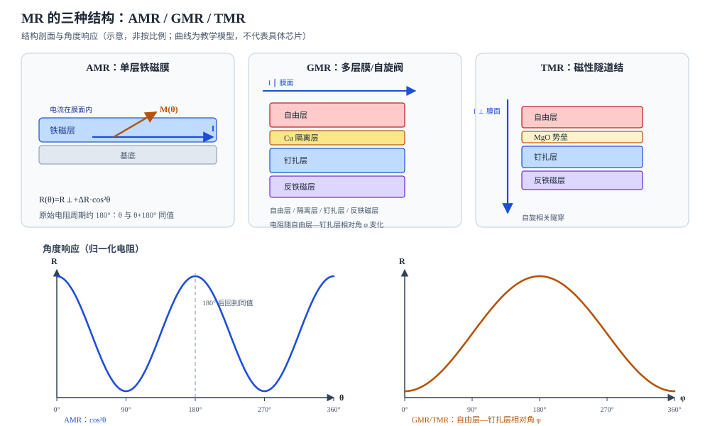

# 磁电阻效应：AMR、GMR 与 TMR

状态：草稿整理：2026-10-26教材：§19.2

> 本篇回答：外加磁场没有改变电路连接，为什么某些薄膜的电阻会变化？
> 先修：[磁各向异性与取向](anisotropy.md)；预计阅读 25 分钟。
> 读完能回答：① MR 比怎样定义、单位是什么？② AMR 为什么常表现为约 180° 周期，而 GMR/TMR 可以做到 360°？③ 材料 MR 比、桥路输出和芯片角度精度为什么不是一回事？

## 适用范围

本文只讲磁电阻的材料机理和“材料—桥路—芯片”的层级关系。Hall 的测量原理另作对照；具体型号的场窗口、输出周期、精度、带宽和接口放在 D02、D04、D06。文中出现的教材 MR 比是研究样品或教学示例，不能直接当作某个成品芯片的灵敏度或精度。

## 先看一个现象

1856 年，Thomson 在铁磁样品上就观察到：电流方向与外加磁场平行时电阻略微增加，垂直时略微减小，量级只有千分之几 [BOOK-01，§19.2.1，书 p.455 / PDF p.464](../sources/book.md#BOOK-01)。一百多年后，人们在 Fe/Cr 多层膜中测到超过 50% 的磁电阻变化，随后又在磁性隧道结中利用隧穿电流得到更大的电阻变化 [BOOK-01，§19.2.1，书 p.455 / PDF p.464](../sources/book.md#BOOK-01)。

这些实验的共同点是：**磁场主要改变的是电阻，而不是把电阻“接通”或“断开”。** 更准确地说，电阻取决于传导电子的自旋与材料磁化方向之间的相对取向。角度传感器利用的正是这种“方向—电阻”关系。

## 一张图建立直觉

<figure class="kb-figure" markdown="1">
  
  <figcaption>图 1　三种磁电阻结构的剖面与角度响应（示意，非按比例；曲线为教学模型）。AMR 的电流在膜面内，原始电阻随电流与磁化夹角 θ 呈 cos²θ；GMR 与 TMR 是多层膜，电阻随自由层与钉扎层的相对角 φ 变化，因此可以覆盖 360°。图中的层数和厚度不代表任何真实堆叠。</figcaption>
</figure>

AMR 可以看成“一层铁磁膜 + 面内电流”。电流方向固定，磁化方向随外场转动；两者夹角改变时，自旋相关散射改变，电阻随之变化。GMR 把铁磁层用非磁金属隔离层隔开，形成自由层/隔离层/钉扎层/反铁磁层的“三明治”；自由层随外场转，钉扎层被反铁磁层固定，电阻取决于两层磁化的相对角。TMR 把中间的非磁金属换成极薄绝缘势垒，电子靠隧穿通过，隧穿概率同样依赖两侧磁化的相对取向 [BOOK-01，§19.2.3，书 p.460 / PDF p.469；§19.2.5，书 p.467–468 / PDF p.476–477](../sources/book.md#BOOK-01)。

## 概念、符号与单位

**MR 比**描述“有场”和“零场”之间电阻变化的比例。教材给出两种常用定义：

$$
\eta=\frac{R(H)-R(0)}{R(0)},\qquad
\eta=\frac{R(H)-R(0)}{R(H)}
$$

其中 $R(H)$ 是磁场为 $H$ 时的电阻，$R(0)$ 是零场电阻；结果是无量纲的比例，通常写成百分数。分母取 $R(0)$ 还是 $R(H)$ 会给出不同的数，比较两个 MR 比之前必须先确认定义 [BOOK-01，式 19.1–19.2，书 p.454 / PDF p.463](../sources/book.md#BOOK-01)。教材还指出，金属的 MR 比通常只有百分之几，而多层膜和隧道结可以大得多；这是材料层级的比较，不是芯片精度排名。

对 AMR，常用的角度模型是：

$$
R(\theta)=R_\perp+\left(R_\parallel-R_\perp\right)\cos^2\theta
$$

$\theta$ 是电流方向与磁化方向的夹角，$R_\parallel$ 和 $R_\perp$ 分别是磁化平行、垂直电流时的电阻。因为 $\cos^2\theta$ 的周期是 180°，**原始 AMR 电阻无法区分 $\theta$ 和 $\theta+180°$**。坡莫合金的可用 MR 变化量在教材中约为 2%–3% [BOOK-01，§19.2.1，书 p.455 / PDF p.464](../sources/book.md#BOOK-01)。实际芯片会用两个正交桥和信号处理来消除方向二义性；某型号可能只给 0–180° 输出，另一型号可以给 360°，必须看具体型号 [ENC-02，p.1、p.10、图 9](../sources/vendor.md#ENC-02)。

对 GMR 自旋阀，常用教学模型写成：

$$
R(\varphi)=R_P+\frac{\Delta R}{2}\left(1-\cos\varphi\right)
$$

$\varphi$ 是自由层与钉扎层磁化的相对角，$R_P$ 是两层平行时的低电阻，$\Delta R$ 是高低电阻差。$\varphi$ 从 0° 走到 360° 才回到同一状态，所以**机理层面**可以覆盖 360°。TMR 的角响应形式类似，但中间是绝缘势垒，电阻通常更高、隧穿对相对取向更敏感；教材把 TMR 归为第四代磁电阻技术，并给出“灵敏度比霍尔效应高约三个数量级”的原理性比较 [BOOK-01，§19.2.5，书 p.467 / PDF p.476](../sources/book.md#BOOK-01)。这句话不能被改写成“某颗 TMR 芯片的精度是 Hall 的 1000 倍”。

还要把几个层级分开：

| 层级 | 典型量 | 回答的问题 |
| --- | --- | --- |
| 材料 | MR 比、$\Delta R/R$ | 这种堆叠能提供多大的电阻变化？ |
| 桥路 | mV/V、差分幅值、偏置、正交误差 | 电阻变化变成多大的电信号？ |
| 芯片 | 灵敏度、场窗口、噪声、INL、角度误差 | 成品在规定条件下能做到什么？ |
| 系统 | 安装、磁体、校准、温度、算法 | 客户结构里最终的角度误差是多少？ |

Hall 不属于 MR：Hall 元件利用载流子在磁场中受洛伦兹力产生的横向电压，测量的是磁场的一个分量；MR 元件利用磁化方向或磁性层相对取向改变电阻 [ENC-01，摘要](../sources/vendor.md#ENC-01)。两者都可以做角度传感器，但不要把“Hall”与“AMR/GMR/TMR”混成同一类机理。

## 公式怎样使用（含完整算例）

**教学算例：从两个电阻值算 MR 比，再看 AMR 的角度二义性。**

假设某 AMR 薄膜在零场附近测得 $R(0)=1.000\ \text{k}\Omega$，在平行饱和场下测得 $R_\parallel=1.030\ \text{k}\Omega$，垂直饱和场下 $R_\perp=1.000\ \text{k}\Omega$。按分母取 $R(0)$ 的定义：

$$
\eta=\frac{1.030-1.000}{1.000}=0.030=3.0\%
$$

再代入 AMR 角度模型，取 $\theta=30°$：

$$
R(30°)=1000+30\times\cos^2 30°
=1000+30\times0.750=1022.5\ \Omega
$$

取 $\theta=150°$ 时，$\cos^2 150°=0.750$，得到同样的 $1022.5\ \Omega$。这就是 180° 二义性：**只看这一个电阻值，无法判断磁化在 30° 还是 150°。** 实际芯片必须借助第二路正交信号、桥的符号或置位/复位来恢复方向。

如果把这颗电阻与一个 1.000 kΩ 的参考电阻串联，加 3.3 V 偏置，则输出为：

$$
V_{out}=3.3\times\frac{1022.5}{1022.5+1000}=1.668\ \text{V}
$$

在 $\theta=90°$（$R=1000\ \Omega$）时，$V_{out}=1.650\ \text{V}$。两者相差约 18 mV。这个数只说明“3% 的电阻变化经分压后还剩多少毫伏级信号”，不是芯片角度误差，也没有算桥路、放大器和 ADC。真实芯片的差分桥输出、偏置和噪声必须查数据手册。

## 曲线和结构变化时会怎样

- **AMR 的 180° 周期是材料层的性质，不是所有成品的输出范围。** 通过正交桥和方向判别，成品可以输出 0–360°；但原始 AMR 电阻本身仍不能区分相差 180° 的两个方向。
- **GMR/TMR 的 360° 是相对角 $\varphi$ 的周期，不是“任何安装都自动 360°”。** 磁体充磁、传感器敏感轴、桥路正交性和算法都会改变最终输出。TLE5x09 系列中 AMR 变体标 0–180°、GMR 变体标 0–360°，TLE5501 标 360° 差分正余弦输出，这些都是**具体型号**的定义 [ENC-02，p.1、图 9](../sources/vendor.md#ENC-02)；[ENC-03，p.1、p.4](../sources/vendor.md#ENC-03)。
- **MR 测的是方向，但仍需要足够的场使自由层饱和。** 场太弱，磁化没有跟随外场，角度信息不可靠；场太强，可能进入非线性、饱和或热风险区。具体窗口随型号和温度变化，不能用一个“越大越好”的规则。
- **材料 MR 比大，不等于角度精度高。** 桥路的偏置、幅值不等、正交误差、ADC 噪声、温漂和校准残差都会进入角度。TLE5501 的数据手册就分别给出桥电阻、差分输出幅值、正交误差、幅值同步率和角度误差表；这些量不能互相替代 [ENC-03，p.10–12](../sources/vendor.md#ENC-03)。

## 常见误区

| 常见误区 | 为什么不对 | 更稳妥的说法 |
| --- | --- | --- |
| “TMR 一定比所有 Hall 芯片精度高” | 教材的灵敏度比较是机理层面；成品精度还取决于前端、ADC、校准、磁体和安装 | 先看目标型号在指定场、温度、气隙下的角度误差 |
| “AMR/GMR/TMR 的输出周期由材料名词决定” | 原始 AMR 常为 180°，GMR/TMR 可 360°；但成品可能只给 180°、可能用桥路恢复 360°，也可能受算法限制 | 查具体型号的输出定义和磁场条件 |
| “教材的 MR 比就是芯片灵敏度” | MR 比是材料电阻变化比例；灵敏度是芯片输出电压/角度或角度/场，单位和测试条件都不同 | 把材料、桥路、芯片、系统四层分开 |
| “GMR/TMR 只对磁场大小敏感” | 自旋阀和隧道结的核心是自由层与钉扎层的相对取向，方向变化才是角度信号 | 用相对角 $\varphi$ 描述，并确认饱和条件 |

## 自测

自测 1：某 AMR 的 $R_\perp=800\ \Omega$、$R_\parallel=824\ \Omega$。求 MR 比（分母取 $R_\perp$），并说明为什么不能只凭一个电阻值判断 40° 和 220°。

答案：$\eta=(824-800)/800=3.0\%$。AMR 的角度项是 $\cos^2\theta$，$\cos^2 40°=\cos^2 220°$，两个角度给出同一电阻；要恢复唯一方向，需要第二路正交信号或桥路/置位复位信息。

自测 2：TMR 的电阻随自由层—钉扎层相对角变化。若相对角从 0° 转到 360°，电阻回到原值；这是否意味着成品芯片一定输出 360°？

答案：不一定。机理上相对角走满 360° 才回到同一状态，但成品可能只使用其中一段、只给 0–180° 输出，或用桥路和算法改变输出定义。必须查型号的数据手册。

自测 3：把 3% 的 MR 比直接当成“角度误差 3%”错在哪里？

答案：MR 比是电阻变化比例，不是角度误差。角度由至少两路信号经桥路、ADC、atan2、校准得到；3% 的电阻变化可能对应可接受的角度误差，也可能因为偏置、正交误差或噪声而更差。两者量纲和定义都不同。

## 本篇小结

- MR 比是电阻变化比例，分母取 $R(0)$ 或 $R(H)$ 会给出不同数值，比较前必须统一。
- AMR 的原始角度响应含 $\cos^2\theta$，周期约 180°；GMR/TMR 利用自由层与钉扎层的相对角，机理上可覆盖 360°。
- 材料 MR 比、桥路输出、芯片灵敏度和系统角度精度是四个层级，不能互相替代。
- 具体输出周期、场窗口和精度必须绑定型号与测试条件；教材示例不是芯片规格。

## 工程出口

- [从磁场到角度：Hall 与磁电阻传感信号链](angle-sensing.md)：把桥路、ADC、atan2、校准和输出连起来。
- [编码器磁体、充磁图形与安装几何](encoder-magnet-and-mounting.md)：磁化方向、气隙和偏心怎样改变传感器看到的场。
- [FAE 选型](../fae/selection.md)：把材料机理转成目标型号的场窗口、精度和接口问题。

## 来源与待确认项

- [BOOK-01](../sources/book.md#BOOK-01)：严密、彭晓领，《磁学基础与磁性材料》第 2 版。§19.2 磁电阻材料，书 p.454 起 / PDF p.463 起；§19.2.1 MR 比与 AMR，书 p.454–455 / PDF p.463–464；§19.2.2 金属超晶格 GMR，书 p.455 起 / PDF p.464 起；§19.2.3 自旋阀 GMR，书 p.460 / PDF p.469；§19.2.5 TMR，书 p.467–468 / PDF p.476–477。本次只查阅了这些扫描页，未做全书 OCR；引用的是概念、结构和定义，不复制教材图。
- [ENC-01](../sources/vendor.md#ENC-01)：Ausserlechner，*A Theory of Magnetic Angle Sensors with Hall Plates and Without Fluxguides*，PIER B 49 (2013)。归档文件是论文摘要页，不是全文；本文只使用摘要中“垂直系统用磁电阻或垂直 Hall、轴向系统用 Hall 板”的分类，不引用全文页码或具体误差曲线。
- [ENC-02](../sources/vendor.md#ENC-02)：Infineon TLE5x09A16(D) 数据手册 V2.1，2024-06-28。p.1 特性、p.10 框图、图 9 的 AMR 180°/GMR 360° 输出示例。
- [ENC-03](../sources/vendor.md#ENC-03)：Infineon TLE5501 数据手册 Rev.1.0，2018-07-24。p.1 特性、p.4 双 TMR 惠斯通桥、p.10–12 电气参数与角度误差条件。
- 待确认项：目标芯片的 MR 比未在数据手册中给出，不能由教材的 2%–3% 或研究样品数值反推；目标型号的场窗口、输出周期和角度误差需按现行数据手册与实测结构确认。
