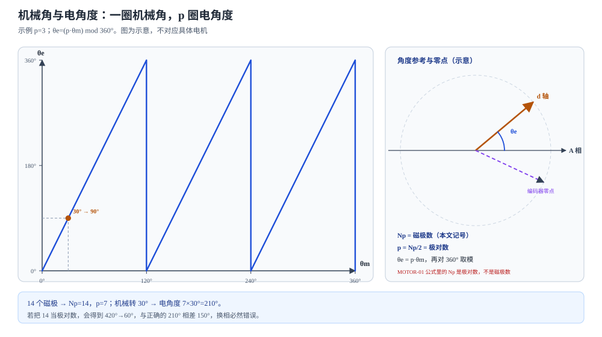

# 极对数、机械角、电角度与编码器读数

状态：草稿整理：2026-10-26适用：永磁同步电机/无刷电机

> 本篇回答：轴只转过 30°，为什么控制器里的电角度可能走了 210°？
> 先修：[从磁场到角度](angle-sensing.md)；预计阅读 20 分钟。
> 读完能回答：① 磁极数 $N_p$ 与极对数 $p$ 有什么区别？② 机械角、电角度、编码器原始角和控制用角分别由谁维护？③ 机械误差为什么会被极对数放大？

## 适用范围

本文解释永磁同步电机/无刷电机的极对数、机械角、电角度、电气零点和编码器读数之间的关系，用于换相、编码器安装和多极对系统排查。不覆盖感应电机转差控制、无感观测器和具体 FOC 固件实现；不同电机类型的“电角度”定义可能不同，必须结合控制方案确认。首次调试的限流、限速、相序和零点验证应按经审核的 FAE 指南执行，本文不展开通用操作规程。

## 先看一个现象

一只 14 极电机，编码器输出机械角 30°。控制器里的电角度却是 210°。再转 30°，电角度到 420°，取模后显示 60°。轴看起来只走了 60°，电角度却已经走完一个多周期。

这不是编码器坏了，而是电机有 7 对极：机械角每转一圈，电角度走 7 圈。**编码器读数、机械角、电角度和控制用角是四个不同的量。** 客户说“编码器角度不对”时，先问清楚他说的是哪一个。

## 一张图建立直觉

<figure class="kb-figure" markdown="1">
  
  <figcaption>图 1　机械角与电角度（示意，p=3 示例，不对应具体电机）。左图每 120° 机械角走完一个 360° 电周期，到 360° 时回到 0°；右图把 A 相轴线、d 轴、编码器零点和电角度放在同一个矢量图上。实际零点偏移和方向必须结合相序与固件定义标定。</figcaption>
</figure>

## 概念、符号与单位

### 记号约定（重要）

本文统一使用：

| 符号 | 含义 | 单位 |
| --- | --- | --- |
| $N_p$ | 磁极数（一圈内 N/S 极的总数） | 个 |
| $p$ | 极对数，$p=N_p/2$ | 对 |
| $\theta_m$ | 机械角 | ° 或 rad |
| $\theta_e$ | 电角度 | ° 或 rad |
| $\omega_m,\omega_e$ | 机械/电角速度 | rad/s |
| $n$ | 机械转速 | r/min |
| $f_e$ | 电频率 | Hz |

**记号冲突必须说清楚：** Microchip 的 FOC 文档写的是 $\theta_e=N_p\theta_m$，并在同一段明确说明该 $N_p$ 是**极对数**，例如六极电机 $N_p=3$ [MOTOR-01](../sources/vendor.md#MOTOR-01)。本文的 $N_p$ 是**磁极数**，所以本文写成：

$$
p=\frac{N_p}{2},\qquad \theta_e=p\,\theta_m
$$

阅读原厂文档时，先看它的符号定义，不能把“极数”和“极对数”两个 $N_p$ 混用。14 个磁极是 7 对极，不是 14 对极。

### 四个“角”

| 名称 | 定义 | 谁维护 |
| --- | --- | --- |
| 机械角 $\theta_m$ | 转子/轴的实际几何角度 | 机械结构与编码器 |
| 电角度 $\theta_e$ | 转子磁动势在电周期中的相位 | 电机极对数与机械角 |
| 编码器原始角 | 芯片输出的角度，可能含零偏、方向、非线性 | 芯片、磁体、装配 |
| 控制用角 | 固件经过零点、方向、极对数和校准后的角度 | 固件 |

客户说“角度不对”，先确认他说的是机械角、电角度、原始角还是控制用角。四个角混用，会导致完全不同的排查方向。

### 基本关系

电角度对 360° 取模：

$$
\theta_e=(p\,\theta_m)\bmod 360°
$$

角速度与电频率：

$$
\omega_e=p\,\omega_m,\qquad f_e=\frac{p\,n}{60}
$$

其中 $n$ 的单位是 r/min，$f_e$ 的单位是 Hz。机械转一圈，电角度走 $p$ 圈；机械转 1°，电角度走 $p$°。

## 公式怎样使用（含完整算例）

**例 1：7 对极的正算与反算。**

14 个磁极，$p=14/2=7$。

- 机械角 30°：$\theta_e=7\times30°=210°$，在 $[0°,360°)$ 内就是 210°。
- 机械角 60°：$\theta_e=7\times60°=420°$，取模后 $420°-360°=60°$。
- 机械转一圈 360°：电角度走 $7\times360°=2520°$，即 7 个电周期，取模后回到 0°。

如果固件误以为 $p=6$，30° 机械角会算成 180°，与正确的 210° 相差 30° 电角度；如果误把 14 当极对数，会算成 $14\times30°=420°→60°$，与正确值相差 150°。两种错误都会让换相明显偏离。

**例 2：转速与电频率。**

某 7 对极电机以 $n=3000\ \text{r/min}$ 运行：

$$
f_e=\frac{7\times3000}{60}=350\ \text{Hz}
$$

电周期为 $1/350\approx2.857\ \text{ms}$，机械周期为 $60/3000=20\ \text{ms}$。控制器按电角度做 Park 变换时，2.857 ms 就是它必须跟上的基本周期；这还没算滤波和采样延迟（见 D06）。

**例 3：机械误差被极对数放大。**

编码器有 0.1° 的机械角误差，在 7 对极电机中变成：

$$
\Delta\theta_e=7\times0.1°=0.7°
$$

在 12 对极电机中变成 1.2°。所以高极对数系统不能只看编码器数据手册的“机械精度”，还要把偏心、轴跳动、联轴器间隙和磁体误差一起乘进电角度预算。

## 电气零点与方向

FOC 需要知道转子磁极的 d 轴与定子 A 相轴线的相对位置。常见做法是：把转子固定到已知位置，施加已知电流矢量让转子对齐 d 轴，记录编码器在该位置的原始读数，把这个读数定义为电气零点偏移，然后验证正反转、不同电流和不同温度下的换相。**机械零位对齐不等于电气零点标定**：磁体充磁相位、传感器安装、相序定义和固件坐标变换都会影响零点。

方向错误比零点错误更危险：零点偏一点可能导致效率下降和电流增大；方向反了可能形成正反馈，导致过流或飞车。首次调试应按经审核的 FAE 指南限流、限速，并确认编码器计数方向与电机相序一致；本文不给出具体调试步骤。

## 分辨率不等于精度

一圈 $N$ bit 的角度分辨率为：

$$
\Delta\theta=\frac{360°}{2^N}
$$

| 位数 | 每圈计数 | 角度步进 |
| --- | --- | --- |
| 10 bit | 1024 | 0.3516° |
| 12 bit | 4096 | 0.0879° |
| 14 bit | 16384 | 0.0220° |
| 16 bit | 65536 | 0.0055° |

步进小不代表误差小。实际精度还受 INL、噪声、迟滞、温漂、磁体与装配影响；高分辨率但噪声大的系统，角度会持续抖动。带宽/延迟同样重要：滤波可以降低噪声，却会增加相位滞后；高速电机在加速/减速时，滞后会变成明显的角度误差。这些在 D06 展开。

## 常见误区

| 常见误区 | 为什么不对 | 更稳妥的说法 |
| --- | --- | --- |
| “极数就是极对数” | 极对数是磁极数的一半；14 极是 7 对极，不是 14 对极 | 图纸/铭牌写清磁极数，固件变量写清极对数 |
| “编码器原始输出天然就是电角度” | 原始输出通常是机械角，除非固件已经乘过极对数 | 记录变量名、单位和转换链 |
| “机械零位对齐等于电气零点完成” | 电气零点还涉及 d 轴、A 相、相序和方向 | 按控制方案验证零点与方向 |
| “分辨率高就等于精度高” | 分辨率只是步进；噪声、INL、迟滞和温漂仍存在 | 把分辨率、重复性、INL 和总误差分开 |

## 自测

自测 1：8 个磁极的电机，机械角 45°。极对数和电角度是多少？

答案：$p=8/2=4$；$\theta_e=4\times45°=180°$。

自测 2：4 对极电机以 3000 r/min 运行，电频率是多少？电周期是多少？

答案：$f_e=4\times3000/60=200\ \text{Hz}$；电周期 $1/200=5\ \text{ms}$。

自测 3：编码器报 10° 机械角，固件按 $p=12$ 算电角度，但电机实际是 7 对极。电角度差多少？

答案：固件算 $12\times10°=120°$；实际应为 $7\times10°=70°$；差 50° 电角度。

## 本篇小结

- 本文 $N_p$ 是磁极数，$p=N_p/2$ 是极对数；MOTOR-01 公式中的 $N_p$ 是极对数，不能混用。
- $\theta_e=p\theta_m$，取模后电角度回到 $[0°,360°)$；机械转一圈，电角度走 $p$ 圈。
- 机械角、电角度、编码器原始角和控制用角是四个量；排查前先确认变量定义。
- 机械误差、偏心、跳动和联轴器间隙会被 $p$ 放大；分辨率不等于精度。

## 工程出口

- [分辨率、采样、带宽与输出定义](encoder-output-and-dynamics.md)：位数、延迟、滤波和回绕对电角度的影响。
- [FAE 排障](../fae/troubleshooting.md)：电角度不对、抖动或过流时的分层排查入口。
- [编码器磁体、充磁图形与安装几何](encoder-magnet-and-mounting.md)：偏心、气隙和磁体相位怎样进入机械角误差。

## 来源与待确认项

- [MOTOR-01](../sources/vendor.md#MOTOR-01)：Microchip MCAF R6 / v6.0.2，FOC Introduction。明确 $\theta_e=N_p\theta_m$、$\omega_e=N_p\omega_m$，并说明该 $N_p$ 是极对数（六极电机 $N_p=3$）；本文按自己的记号写成 $p=N_p/2$。
- 待确认项：目标电机的磁极数/极对数、相序定义、编码器零点与方向、固件变量单位和极对数配置；这些必须按具体电机和控制方案确认，不能只看型号名。
