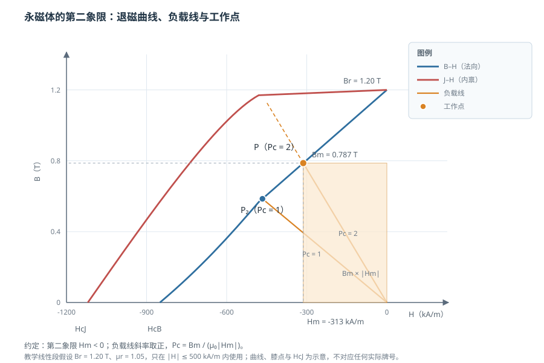

# 永磁参数、退磁曲线与工作点

状态：草稿（待主智能体终审）复核：2026-10-26教材：第 10 章

> 本篇回答：数据表写着 $B_r\approx1.2\ \mathrm{T}$，为什么芯片处的磁场不可能直接按 1.2 T 设计？
> 先修：[《技术磁化与磁滞回线》](magnetization-and-hysteresis.md)、[《磁通、磁阻与磁路》](magnetic-circuits.md)、[《退磁场与形状效应》](demagnetizing-field-and-shape.md)；预计阅读 30 分钟。

## 先看一个现象

同一块烧结 NdFeB 磁体，数据表 $B_r$ 约 1.2 T。把它做成细长棒、薄片或装进带气隙的磁路，表面不同位置测到的场可以差很多；把磁体从磁路上拆下来，读数又会变。$B_r$ 是材料在闭合条件附近的剩磁，不是任意气隙、任意位置的磁通密度。要回答“芯片处到底有多少场”，必须先学会读**第二象限的退磁曲线、负载线和温度曲线族**。

## 一张图建立直觉

<figure class="kb-figure" markdown>

<figcaption>图 1 在第二象限示意 B–H 与 J–H 曲线、两条不同斜率的负载线、工作点、Br、HcB、HcJ 和工作点能量矩形。图为教学示意，不对应实际牌号。</figcaption>

</figure>

图中有三个容易混淆的点：

1. 蓝色 B–H 和红色 J–H 是**材料曲线**，形状由材料与温度决定；
2. 橙色直线是**负载线**，由磁体形状、气隙和外部磁路决定；
3. 两条线的交点是**工作点**，它才是这块磁体在这个结构里的实际 $B_m$、$H_m$。

## 第二象限的符号约定：先定符号，再谈曲线

永磁体工作时，内部磁场方向与磁化方向相反，所以第二象限的磁场强度常写成负值：

$$
H_m<0,\qquad B_m>0
$$

内禀磁化（极化）满足

$$
J=\mu_0 M=B-\mu_0 H
$$

因此第二象限里 $J>B$。这条关系是后面区分 $H_{cB}$ 与 $H_{cJ}$ 的基础。教材用 $B=\mu_0(M+H)$ 和退磁曲线说明两种矫顽力的差别 [BOOK-01，§10.2 书 p.248 起 / PDF p.257 起](../sources/book.md#BOOK-01)。

## B–H 与 J–H：两条曲线回答不同问题

- **B–H（法向/表观曲线）**：描述“外部可观测的磁通密度”与反向场的关系。$B=0$ 处的反向场是 $H_{cB}$。
- **J–H（内禀曲线）**：描述材料自身磁化还剩多少。$J=0$ 处的反向场是 $H_{cJ}$，更能反映抵抗本征退磁的能力。

因为第二象限 $J=B-\mu_0H>B$，所以 $J$ 要比 $B$ 更晚降到零：

$$
|H_{cJ}|\ge |H_{cB}|
$$

教材还给出 $B=0$ 时 $\mu_0H_{cB}=-M\le M_s$，因此 $\mu_0H_{cB}\le B_r$ [BOOK-01，§10.2 书 p.249 / PDF p.258](../sources/book.md#BOOK-01)。这条关系适合做量级检查：如果某数据表声称 $H_{cB}$ 对应的 $\mu_0H_{cB}$ 大于 $B_r$，就要怀疑定义或单位。

## 四个参数在图上在哪里

| 参数 | 图上定义 | 工程含义 |
| --- | --- | --- |
| $B_r$ | B–H 曲线与 $H=0$ 轴的交点 | 闭合/近似闭合条件下的剩磁；不是气隙场 |
| $H_{cB}$ | B–H 曲线与 $B=0$ 轴的交点 | 使表观磁通为零的反向场 |
| $H_{cJ}$ | J–H 曲线与 $J=0$ 轴的交点 | 使本征磁化为零的反向场，通常大于 $H_{cB}$ |
| $(BH)_{\max}$ | 第二象限内 $B\cdot|H|$ 的最大矩形 | 材料级最大磁能积，不等于实际工作点能量 |

$(BH)_{\max}$ 是材料曲线上的一个点，不是任意工作点的乘积。教材在理想矩形回线、$M_r=M_s$ 且 $H_{cJ}$ 足够大的条件下给出 $(BH)_{\max}=\mu_0M_s^2/4$ 的上限 [BOOK-01，§10.3 书 p.251 / PDF p.260](../sources/book.md#BOOK-01)。这个式子用来说明“为什么高 $M_s$ 与高 $H_{cJ}$ 都重要”，不能拿来给某个牌号“算”保证值。

## 负载线和工作点：磁导系数的符号陷阱

负载线经过原点，描述磁体形状与外部磁路允许的 $B$ 与 $|H|$ 比例。工程上定义磁导系数（负载线斜率）为

$$
P_c=\frac{B_m}{\mu_0|H_m|}
$$

注意分母是 $|H_m|$。第二象限的 $H_m$ 本身是负的；如果直接把有符号的 $H_m$ 代入 $B_m/(\mu_0H_m)$，会得到负数，再拿它去和正的表值比较就会出错。教材用有符号定义写成

$$
P=\frac{B_d}{\mu_0H_d}=1-\frac{1}{N}
$$

其中 $N$ 是退磁因子。由于 $H_d<0$，这个 $P$ 是负的；取幅值后

$$
P_c=|P|=\frac{1}{N}-1
$$

才与工程上“负载线斜率取正”的约定一致 [BOOK-01，§10.1 书 p.248 / PDF p.257](../sources/book.md#BOOK-01)。PM-02 也明确提醒：负载线斜率在图上为负，但按惯例 $P_c$ 取正数 [PM-02](../sources/vendor.md#PM-02)。**本篇统一用 $P_c=B_m/(\mu_0|H_m|)>0$。**

$N$ 由几何和磁化方向决定，不是材料常数。细长方向 $N$ 小，$P_c$ 大，工作点靠近 $B_r$、$|H_m|$ 小；薄片或大开路磁体 $N$ 大，$P_c$ 小，工作点向第二象限深处移动。气隙、相邻软磁件和外部反向场也会改变实际负载线。

## 完整算例：从负载线求工作点

**教学假设（不对应任何牌号）**：某永磁体在工作温度下，第二象限的 B–H 曲线在 $|H|\le500\ \mathrm{kA/m}$ 内可近似为直线

$$
B_m=B_r+\mu_0\mu_rH_m
$$

取 $B_r=1.20\ \mathrm{T}$、回复相对磁导率 $\mu_r=1.05$。这个 $\mu_r$ 的量级参照 PM-02 给出的烧结铁氧体、SmCo、NdFeB 典型回复磁导率约 1.05，但这里只是教学取值 [PM-02](../sources/vendor.md#PM-02)。曲线在 $|H|>500\ \mathrm{kA/m}$ 后会出现膝点，本算例的直线段不能外推到膝点以外。

负载线为 $B_m=P_c\mu_0|H_m|=-P_c\mu_0H_m$。与材料直线联立：

$$
B_r+\mu_0\mu_rH_m=-P_c\mu_0H_m
$$

解得

$$
H_m=-\frac{B_r}{\mu_0(P_c+\mu_r)}
$$

$$
B_m=\frac{P_cB_r}{P_c+\mu_r}
$$

**当 $P_c=2$**：

$$
B_m=\frac{2\times1.20}{2+1.05}=0.787\ \mathrm{T}
$$

$$
H_m=-\frac{1.20}{4\pi\times10^{-7}\times3.05}
\approx-3.13\times10^5\ \mathrm{A/m}
=-313\ \mathrm{kA/m}
$$

核对：材料线给出 $1.20-1.319\times10^{-6}\times313000\approx0.787\ \mathrm{T}$；负载线给出 $2\times4\pi\times10^{-7}\times313000\approx0.787\ \mathrm{T}$。两式一致。工作点能量矩形为 $0.787\times313\approx246\ \mathrm{kJ/m^3}$，但这不是材料的 $(BH)_{\max}$。

**当 $P_c=1$**：

$$
B_m=\frac{1.20}{2.05}=0.585\ \mathrm{T},\qquad
|H_m|=\frac{1.20}{4\pi\times10^{-7}\times2.05}\approx466\ \mathrm{kA/m}
$$

工作点更深，能量矩形约 $0.585\times466\approx273\ \mathrm{kJ/m^3}$。在这个教学直线模型里，$P_c$ 从 2 降到 1，$B_m$ 下降、$|H_m|$ 增加，乘积反而略增；这说明“工作点能量”和“材料最大能积”不是一回事，不能拿一个工作点的乘积去替代 $(BH)_{\max}$。

**当 $P_c=0.5$**：公式会给出 $B_m=0.387\ \mathrm{T}$、$|H_m|\approx616\ \mathrm{kA/m}$。但 616 kA/m 已超过教学直线段 500 kA/m 的适用上限，**这个结果不能继续用于判断退磁安全**；真实曲线在膝点附近会弯曲，必须查该温度下的完整退磁曲线。

## 形状、气隙和温度怎样移动工作点

- **形状**：长径比增大，沿长轴 $N$ 减小，$P_c$ 增大，工作点靠近 $B_r$；薄片沿厚度方向 $N$ 接近 1，$P_c$ 接近 0，$B_m$ 很小。
- **气隙**：气隙增加通常使负载线变“平”（$P_c$ 减小），工作点向更深的第二象限移动，退磁风险增加。
- **反向场**：电枢反应、相邻磁体、外部线圈会在工作点上叠加反向场，把工作点推过膝点。
- **温度**：$B_r$ 和 $H_{cJ}$ 随温度变化，膝点也会移动；必须用目标温度下的曲线族，而不是 20 °C 单条曲线。

PM-01 用图示说明：同一条低负载线在高温下可能越过膝点并产生不可逆损失，而高负载线磁体可以承受同样的温度变化 [PM-01](../sources/vendor.md#PM-01)。这也是“最高工作温度不是材料常数”的原因：它依赖形状、负载线、反向场和允许损失。

## 从材料参数到气隙场：边界在哪里

$B_r$ 是材料参数；芯片处的 $B$ 是**几何、磁化分布、软磁件、气隙、漏磁和外部场共同作用的结果**。即使用有限元算出了工作点，也要用实测校准；单点表面场读数更不能反推出 $B_r$ 或 $H_{cJ}$ [MEAS-01](../sources/vendor.md#MEAS-01)。工程上应把“材料曲线校核”和“气隙场/角度验证”分成两步。

## 常见误区

!!! warning "四个常见错误"
    1. **把 $H_{cB}$ 和 $H_{cJ}$ 混用。** 前者是 $B=0$，后者是 $J=0$；数据表必须写清定义、温度和测试方法。
    2. **把 $B_r$ 当成气隙场。** $B_r$ 是材料在闭合条件附近的剩磁；开放磁体的表面场受 $P_c$、漏磁和几何影响。
    3. **只按 $B_r$ 判断抗退磁。** 高温、反向场和膝点位置由 $H_{cJ}$、曲线形状和负载线共同决定。
    4. **把“最高工作温度”当材料常数。** 同一牌号换形状、气隙或允许损失，允许温度就会变。

## 自测

自测 1：按本篇教学直线（$B_r=1.20\ \mathrm{T}$、$\mu_r=1.05$），$P_c=3$ 时 $B_m$ 和 $|H_m|$ 是多少？

$B_m=3\times1.20/(3+1.05)=3.60/4.05\approx0.889\ \mathrm{T}$；$|H_m|=1.20/[4\pi\times10^{-7}\times4.05]\approx2.36\times10^5\ \mathrm{A/m}=236\ \mathrm{kA/m}$。仍在 500 kA/m 的教学直线范围内。

自测 2：为什么第二象限里 $|H_{cJ}|\ge|H_{cB}|$？

因为 $J=B-\mu_0H$。第二象限 $H<0$，所以 $J$ 比 $B$ 大。反向场增大时，$B$ 先到零（$H_{cB}$），$J$ 要到更深的负场才到零（$H_{cJ}$）。因此内禀矫顽力通常不小于表观矫顽力。

自测 3：如果把有符号的 $H_m=-300\ \mathrm{kA/m}$ 直接代入 $P_c=B_m/(\mu_0H_m)$，会得到什么？为什么错？

会得到负的 $P_c$，与数据表和工程约定中的正斜率不一致。负载线斜率的幅值应使用 $|H_m|$：$P_c=B_m/(\mu_0|H_m|)$。符号约定要在整篇计算中保持一致。

自测 4：同一磁体，气隙增大后负载线和工作点怎样移动？

气隙增大使磁路磁阻增加，负载线通常变得更平（$P_c$ 减小），工作点向更深的第二象限移动，$B_m$ 降低、$|H_m|$ 增大，越靠近膝点的风险上升。最终要用实际几何的仿真或实测确认。

## 工程出口与适用边界

- 温度、反向场和三类损失继续读[《温度稳定性与退磁》](magnet-stability-and-demagnetization.md)。
- 材料家族与选材继续读[《永磁材料家族》](permanent-magnets.md)。
- 工作点与气隙场仿真见 [FAE 仿真](../fae/simulation.md)。

**适用边界：** 本篇的教学直线只用于演示 $B_r$、$P_c$ 和 $B_m/H_m$ 的关系，不是任何牌号的退磁曲线，也不能用来求 $H_{cJ}$ 或判断膝点安全。实际校核必须使用目标温度下的 B–H 与 J–H 曲线、真实几何的负载线、最大反向场和允许损失；单点表面场不能替代材料曲线 [MEAS-01](../sources/vendor.md#MEAS-01)。

## 来源与待确认项

- [BOOK-01](../sources/book.md#BOOK-01)：第 10 章永磁材料性能参数；§10.1 剩磁与磁导系数、§10.2 矫顽力、§10.3 最大磁能积、§10.4 稳定性。
- [PM-01](../sources/vendor.md#PM-01)：负载线与温度共同决定不可逆损失；膝点与重新充磁。
- [PM-02](../sources/vendor.md#PM-02)：负载线斜率符号约定、回复磁导率量级、温度与负载线对工作点的影响。
- [MEAS-01](../sources/vendor.md#MEAS-01)：表面场、磁通与 B/J–H 曲线的测量边界。
- 待确认：目标牌号在目标温度下的 B–H/J–H 曲线、膝点、最大反向场和真实几何的 $P_c$。
