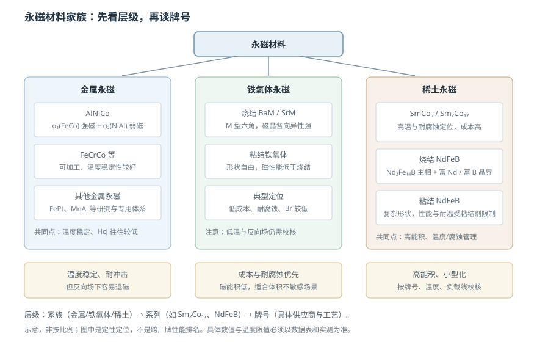

# 永磁材料家族：铁氧体、AlNiCo、SmCo、NdFeB

状态：草稿（待主智能体终审）复核：2026-10-26教材：第 11–13 章

> 本篇回答：NdFeB 磁能积高，为什么高温、腐蚀或成本敏感场合仍可能选择其他材料？
> 先修：[《永磁参数、退磁曲线与工作点》](permanent-magnet-parameters.md)；预计阅读 20 分钟。

## 先看一个现象

同样大小的磁体，NdFeB 往往能提供最强磁场，但高温电机、户外设备、低成本编码器和高温仪器并没有全部改用 NdFeB。原因不是“NdFeB 不好”，而是选材要同时满足**磁性能、温度、腐蚀、加工、成本和供应**。磁能积只回答“同样体积能提供多少磁能”，不回答“在 150 °C、盐雾和反向场下还能不能稳定工作”。

## 一张图建立直觉

<figure class="kb-figure" markdown>

<figcaption>图 1 按家族、系列和牌号层级展示金属永磁、铁氧体永磁与稀土永磁的结构关系。图为定性示意，不是跨厂牌性能排名。</figcaption>

</figure>

## 三条材料主线

### 金属永磁：AlNiCo 与 FeCrCo

AlNiCo 是最典型的金属永磁之一。教材解释它的高矫顽力来自 Spinodal 分解：富 Fe、Co 的 $\alpha_1$ 相是强磁性相，富 Ni、Al 的 $\alpha_2$ 相弱磁或非磁；两相在空间上周期性排列，再通过磁场处理形成细长单畴颗粒，产生形状各向异性 [BOOK-01，§11.1.1，书 p.255 / PDF p.264](../sources/book.md#BOOK-01)。AlNiCo 的温度稳定性好，但 $H_{cJ}$ 相对低，遇到较强反向场容易退磁；它更适合高温、对温度稳定要求高但反向场可控的仪表和传感器磁路。FeCrCo 等合金可加工性更好，定位更专门。

### 铁氧体永磁：BaM 与 SrM

铁氧体永磁以 M 型六角钡/锶铁氧体为代表，矫顽力主要来自磁晶各向异性。它的优势是原材料丰富、成本低、耐腐蚀、电阻率高；短板是 $B_r$ 和 $(BH)_{\max}$ 低、脆、温度系数较大。教材表 12.1 给出室温典型值：$M_s$ 约 320–380 kA/m，$(BH)_{\max}$ 约 35.8–43 kJ/m³，$H_{cJ}$ 理论值约 429–644 kA/m，$T_C$ 约 450–460 °C [BOOK-01，§12.3 书 p.279 / PDF p.288](../sources/book.md#BOOK-01)。这些是教材典型值，不是具体牌号保证；铁氧体的低温退磁风险仍需单独校核。

### 稀土永磁：SmCo 与 NdFeB

SmCo 系列包括 SmCo$_5$ 和 Sm$_2$Co$_{17}$。它们的共同优势是磁性能高、居里温度高、温度稳定性和耐腐蚀性较好；代价是钴和钐的成本、脆性和加工难度。Sm$_2$Co$_{17}$ 通过 Fe、Cu、Zr 等元素和时效处理形成胞状结构，靠畴壁钉扎提高矫顽力 [BOOK-01，§13.2 书 p.291 / PDF p.300](../sources/book.md#BOOK-01)。

NdFeB 的主相是 Nd$_2$Fe$_{14}$B，另有富 Nd 相和富 B 相晶界。主相提供高饱和磁化与强单轴各向异性，晶界相影响烧结与矫顽力；腐蚀风险则与镀层和环境有关。教材指出 NdFeB 的理论 $(BH)_{\max}$ 可达 512 kJ/m³（约 64 MGOe），是第三代稀土永磁的代表 [BOOK-01，§13.1，书 p.285–286 / PDF p.294–295](../sources/book.md#BOOK-01)。它的短板是温度稳定性、耐腐蚀和牌号间差异：高温退磁、镀层完整性和成分/晶界相差异都会影响实际表现。Proterial 的资料把 NdFeB 定位为高磁性能电机磁体，把铁氧体定位为成本敏感应用 [PM-03](../sources/vendor.md#PM-03)。

## 比较矩阵：只作定性定位

| 家族/系列 | 磁能积 | 温度稳定性 | 耐腐蚀 | 加工与成本 | 常见定位 |
| --- | --- | --- | --- | --- | --- |
| 烧结 NdFeB | 最高 | 中到低，依牌号/镀层 | 较低，需镀层 | 脆、加工难；成本中高 | 高性能电机、紧凑编码器 |
| 粘结 NdFeB | 中 | 受粘结剂限制 | 依体系 | 形状自由、批量一致 | 小型电机、传感器磁环 |
| SmCo（5/2:17） | 高 | 高 | 高 | 脆、成本高 | 高温、航天、特殊电机 |
| 烧结铁氧体 | 低 | 中，低温需校核 | 高 | 成本低、脆 | 成本敏感、中低精度 |
| 粘结铁氧体 | 低到中 | 依粘结剂 | 高 | 形状自由、成本低 | 风扇、低转矩电机 |
| AlNiCo | 中 | 高 | 高 | 可加工、成本中 | 高温仪表、传感器磁路 |

这张表只表达相对定位，不是跨厂牌排名。同一格里的不同牌号可以差很多；例如“NdFeB”既可能是低温高能积牌号，也可能是为高温提高 $H_{cJ}$ 的牌号。

## 一个选材推演：什么时候放弃 NdFeB

设一个 150 °C 附近的电机项目，要求体积小、磁场强。第一步仍可看 NdFeB：如果供应商的高温牌号在目标负载线、最高温度和最大反向场下，工作点仍在膝点之上，并且镀层/盐雾/成本可接受，NdFeB 往往是最紧凑的方案。若温度裕量、耐腐蚀或长期可靠性不够，就转向 SmCo：磁能积低一些、成本高，但高温稳定性和耐腐蚀性更好。若项目对成本极敏感、体积不敏感、温度接近室温，铁氧体可能更合适。

关键不是背“150 °C 必须用 SmCo”，而是用 C04 的方法检查：**目标温度曲线 + 实际负载线 + 最大反向场 + 允许损失**。只有这些条件都满足，材料家族的选择才有意义。

## 家族、系列、牌号是三个层级

- **家族**：NdFeB、SmCo、铁氧体、AlNiCo。
- **系列**：SmCo$_5$ 与 Sm$_2$Co$_{17}$；烧结与粘结；BaM 与 SrM。
- **牌号**：供应商的具体成分、工艺、镀层和性能等级，例如某个“N42SH”或“N38UH”标识。

“N42SH”不是家族名，也不是所有供应商都完全相同的通用保证。不同供应商的成分、晶界相、氧含量和镀层会改变高温曲线。选型必须落到牌号数据表，而不是停在“NdFeB”三个字。

## 常见误区

!!! warning "四个常见错误"
    1. **“NdFeB 全能”。** 高温退磁、腐蚀、镀层和成本都可能让它不适合；高磁能积不等于系统最优。
    2. **“SmCo 就是一个统一牌号”。** SmCo$_5$ 与 Sm$_2$Co$_{17}$ 的曲线、温度稳定性和成本不同，供应商牌号也有差异。
    3. **“铁氧体性能低，所以不用做温度校核”。** 铁氧体在低温和反向场下也可能退磁，且温度系数较大。
    4. **“$(BH)_{\max}$ 排名就是系统性能排名”。** 工作点、温度、气隙、漏磁、镀层和成本都会改变实际输出。

## 自测

自测 1：高温电机为什么可能选 SmCo 而不是 NdFeB？

SmCo 的温度稳定性和耐腐蚀性通常更好，居里温度高；NdFeB 虽然磁能积更高，但高温下需要靠牌号、晶界扩散和镀层管理退磁与腐蚀。若 NdFeB 高温牌号在目标工作点仍安全且成本可接受，也可以选 NdFeB；这是条件判断，不是材料教条。

自测 2：AlNiCo 温度稳定，为什么还会退磁？

AlNiCo 的 $H_{cJ}$ 相对低，遇到较强反向场或不良磁路时，工作点容易越过膝点。温度稳定不等于抗反向场能力强；两者要分开评估。

自测 3：为什么铁氧体也要做低温校核？

铁氧体的矫顽力温度系数可能为正，低温下曲线形状和工作点会变化；在低工作点、大气隙或强反向场下仍可能退磁。具体风险取决于牌号、形状和负载线，不能只用“铁氧体耐高温”一句概括。

自测 4：客户说“用 NdFeB，N42”，这句话缺少什么？

缺少供应商、系列/工艺（烧结或粘结）、镀层、温度等级、工作点、允许损失和测试条件。N42 只是牌号级标识的一部分，不能代表完整材料保证。

## 工程出口与适用边界

- 工作点、负载线和 $H_{cB}/H_{cJ}$ 回读[《永磁参数、退磁曲线与工作点》](permanent-magnet-parameters.md)。
- 温度与三类损失继续读[《温度稳定性与退磁》](magnet-stability-and-demagnetization.md)。
- 选型比较与验证见 [FAE 选型](../fae/selection.md)。

**适用边界：** 本篇只给材料家族与选材逻辑，不给具体牌号保证值。教材中的 $M_s$、$(BH)_{\max}$、$T_C$ 和 $H_{cJ}$ 是教材条件下的典型值；供应商数据也必须绑定牌号、温度、镀层和测试方法。最终选材要用目标工作点、温度曲线、腐蚀/盐雾和成本一起验证。

## 来源与待确认项

- [BOOK-01](../sources/book.md#BOOK-01)：第 11 章金属永磁、第 12 章铁氧体永磁、第 13 章稀土永磁；§12.3 铁氧体性能、§13.1–§13.3 稀土与 NdFeB。
- [PM-02](../sources/vendor.md#PM-02)：NdFeB 高温应用、铁氧体低温风险与材料温度特性对比。
- [PM-03](../sources/vendor.md#PM-03)：NdFeB 与铁氧体的应用定位。
- 待确认：目标牌号在目标温度下的退磁曲线、镀层/盐雾、长期老化、批次一致性和供应周期。
