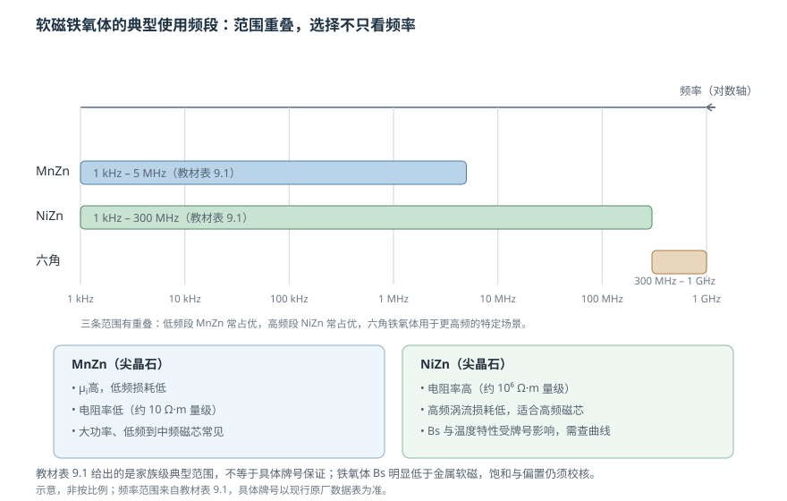

# 软磁铁氧体与高频磁芯

状态：草稿（待主智能体终审）复核：2026-10-26教材：第 9 章

> 本篇回答：金属磁芯磁导率高、饱和也高，为什么高频磁芯反而常用电阻率高的铁氧体？
> 先修：[《软磁性能参数》](soft-magnetic-parameters.md)、[《动态磁化、损耗与温度》](loss-and-temperature.md)；预计阅读 15 分钟。

## 先看一个现象

把同一只 100 kHz 变压器分别装上金属磁芯和铁氧体磁芯，金属磁芯可能效率更低、温升更高；但把频率降到 50 Hz、功率做大，铁氧体又容易饱和。材料没有“绝对更好”，只有**在某个频率、磁通、偏置和温度组合下更合适**。

## 一张图建立直觉

<figure class="kb-figure" markdown>

<figcaption>图 1 用对数频率轴示意教材表 9.1 给出的家族级典型范围：MnZn 约 1 kHz–5 MHz，NiZn 约 1 kHz–300 MHz，六角铁氧体约 300 MHz–1 GHz。范围有重叠，不能只按频率一个指标选材。</figcaption>

</figure>

铁氧体的关键优势不是“磁导率最高”，而是**电阻率高**。金属软磁的电阻率很低，交变磁通会在材料内部感应较大涡流；铁氧体的电阻率可以高出很多个数量级，因此在高频下涡流损耗更容易控制。代价是饱和磁通密度低、温度特性和机械脆性需要额外校核。

## 概念：尖晶石、MnZn 与 NiZn

软磁铁氧体通常由 $\mathrm{Fe_2O_3}$ 与二价金属氧化物组成，常见的是尖晶石结构的 MnZn 和 NiZn 铁氧体；更高频还有平面六角铁氧体。教材把三类材料的典型使用范围列在表 9.1 中 [BOOK-01，第 9 章书 p.226 / PDF p.235](../sources/book.md#BOOK-01)。

- **MnZn 铁氧体**：产量大、低频性能好，起始磁导率高，1 MHz 以下常比 NiZn 更有优势；但电阻率低，高频涡流损耗会成为限制。教材表 9.4 所列功率 MnZn 铁氧体，在 25 °C、$H=1194\ \mathrm{A/m}$ 下的 $B_s$ 约 0.35–0.51 T，电阻率约 5–26 $\Omega\cdot\mathrm{m}$，具体随牌号变化 [BOOK-01，§9.1 书 p.231 / PDF p.240](../sources/book.md#BOOK-01)。
- **NiZn 铁氧体**：电阻率高，教材称一般可达 $10^6\ \Omega\cdot\mathrm{m}$ 量级，适合 1 MHz 以上的高频场景；但起始磁导率通常低于 MnZn，居里温度和温度稳定性也受牌号影响 [BOOK-01，§9.2 书 p.231 起 / PDF p.240 起](../sources/book.md#BOOK-01)。
- **平面六角铁氧体**：用于更高频的特定场景，教材表 9.1 给出的家族范围到 300 MHz–1 GHz。它属于进阶选项，不能拿家族范围替代具体牌号曲线。

需要强调：上表是**家族级典型范围**，不是某个牌号的保证。同一类 MnZn 里，高磁导率牌号、低损耗功率牌号、宽温牌号的曲线可以差很多。

## 公式怎样使用：气隙改变有效磁导率

带小气隙磁芯的有效磁导率可近似为

$$
\mu_e \approx \frac{\mu_i}{1+\dfrac{s}{l_e}\mu_i}
$$

其中 $s$ 是气隙总长度，$l_e$ 是有效磁路长度。这个近似忽略边缘漏磁和饱和，适合 $s\ll l_e$ 的估算 [MAT-01](../sources/vendor.md#MAT-01)。

**教学算例**：设一只 MnZn 磁芯 $\mu_i=2500$，$l_e=60\ \mathrm{mm}$。先不开气隙，$\mu_e=\mu_i=2500$。若磨出 $s=0.8\ \mathrm{mm}$ 的气隙：

$$
\mu_e \approx \frac{2500}{1+\dfrac{0.8}{60}\times2500}
=\frac{2500}{1+33.3}\approx 73
$$

若气隙减半到 $s=0.4\ \mathrm{mm}$：

$$
\mu_e \approx \frac{2500}{1+\dfrac{0.4}{60}\times2500}
=\frac{2500}{1+16.7}\approx 141
$$

气隙从 0.4 mm 增到 0.8 mm，$\mu_e$ 约减半。气隙的代价是有效磁导率下降、漏磁增加；收益是磁芯更难饱和、能储存更多能量、对材料 $\mu_i$ 的批次波动不那么敏感。这就是功率电感和变压器常开气隙的原因。若再给出匝数和截面积，可用 $L\approx\mu_0\mu_e N^2A/l_e$ 估算电感，但必须把气隙公差、边缘场和饱和一起考虑。

## 损耗—温度曲线怎样读

铁氧体的损耗随频率、磁通摆幅、波形和温度变化。教材表 9.4 的功率损耗主要在 100 °C 下给出，并包含部分 500 kHz 的温度点；不同频率/磁通组合的 $P_v$ 必须逐项对照，这提醒我们：**比较损耗时必须同频、同磁通、同温度、同波形** [BOOK-01，§9.1 书 p.231 / PDF p.240](../sources/book.md#BOOK-01)。

功率铁氧体常在某温度附近出现损耗最低点，但“最低损耗点”不等于“系统最优点”。绕组铜损、偏置、散热、磁芯体积和温升都会改变最优工作温度。数据表若只给 25 °C 或只给一个频率点，不能直接用于高温、大摆幅设计。

## 选材：先问场景，再看材料

| 场景 | 优先关注 | 常见选择倾向 |
| --- | --- | --- |
| 低频大功率变压器 | $B_s$、饱和裕量、低频损耗、成本 | MnZn 功率牌号 |
| 高频开关电源 | 目标频率损耗、温升、气隙、绕组 | MnZn 高频/低损耗牌号或 NiZn |
| 高频 EMI 滤波 | 高频阻抗、损耗、偏置、封装 | NiZn 或专用 EMI 牌号 |
| 高频小信号 | $\mu$、频率特性、温度稳定性 | NiZn 高频牌号 |
| 更高频特定场景 | 频率上限、损耗、加工 | 平面六角铁氧体等进阶材料 |

EMI 磁芯和功率磁芯不能只凭外观互换。EMI 磁芯可能强调高频损耗和阻抗，功率磁芯强调低损耗和高 $B_s$；外形相同不代表曲线相同。

## 常见误区

!!! warning "四个常见错误"
    1. **只按频率选 MnZn/NiZn。** 还要看 $B_s$、偏置、损耗、温度、气隙和成本；频段范围本身有重叠。
    2. **认为铁氧体永不饱和。** 铁氧体 $B_s$ 明显低于金属软磁，大电流、大气隙或高温下仍会饱和。
    3. **把教材家族范围当成牌号保证。** 表 9.1 是家族级典型范围；具体牌号必须查原厂曲线和测试条件。
    4. **把最低损耗温度当成所有系统的最优点。** 铜损、散热、偏置和温升会改变最优温度。

## 自测

自测 1：为什么高频常用铁氧体，而不是高 $B_s$ 的硅钢？

高频下涡流损耗随 $f^2$ 增长，硅钢电阻率低、片厚受限，涡流和趋肤效应会迅速增加损耗。铁氧体电阻率高，涡流路径被大幅抑制；代价是 $B_s$ 低、脆、温度特性需要校核。选材是在频率、磁通和损耗之间取舍。

自测 2：$\mu_i=2500$、$l_e=60\ \mathrm{mm}$、气隙 1.2 mm，估算 $\mu_e$。

$s/l_e=0.02$，分母 $1+0.02\times2500=51$，$\mu_e\approx2500/51\approx49$。气隙再大时，边缘漏磁和 $s\ll l_e$ 近似变差，应改用仿真或实测。

自测 3：数据表说某 MnZn 牌号 100 °C、100 kHz、50 mT 下损耗低，能否直接用于 25 °C、200 kHz、100 mT？

不能。频率、磁通摆幅和温度都变了，损耗会按材料曲线变化；还需要看波形、偏置和磁芯几何。必须找覆盖目标条件的损耗曲线，或做样机实测。

自测 4：为什么同一尺寸的 EMI 磁芯不能直接替换功率磁芯？

两者的材料配方、损耗目标和 $B_s$ 不同。EMI 磁芯可能强调高频损耗/阻抗，功率磁芯强调低损耗和高饱和；尺寸相同不代表电感、损耗、温升和饱和行为相同。替换要重新核对曲线和工况。

## 工程出口与适用边界

- 参数定义与气隙估算回读[《软磁性能参数》](soft-magnetic-parameters.md)。
- 损耗、频率和温度的通用机理见[《动态磁化、损耗与温度》](loss-and-temperature.md)。
- 磁芯选型与热评估见 [FAE 选型](../fae/selection.md)。

**适用边界：** 本篇只讲软磁铁氧体的家族定位与气隙估算，不给具体牌号保证。教材表 9.1 是家族级范围，表 9.4 是特定功率 MnZn 牌号在标定条件下的数据；实际设计必须使用目标牌号在目标频率、磁通、温度、偏置和波形下的曲线，并验证饱和与温升。

## 来源与待确认项

- [BOOK-01](../sources/book.md#BOOK-01)：第 9 章软磁铁氧体；§9.1 MnZn、§9.2 NiZn、表 9.1 与表 9.4。
- [MAT-01](../sources/vendor.md#MAT-01)：初始磁导率、有效磁导率、复磁导率与损耗定义。
- 待确认：目标牌号的频率—损耗—温度曲线、$B_s(T)$、气隙公差、偏置下的 $\mu$ 与温升。
