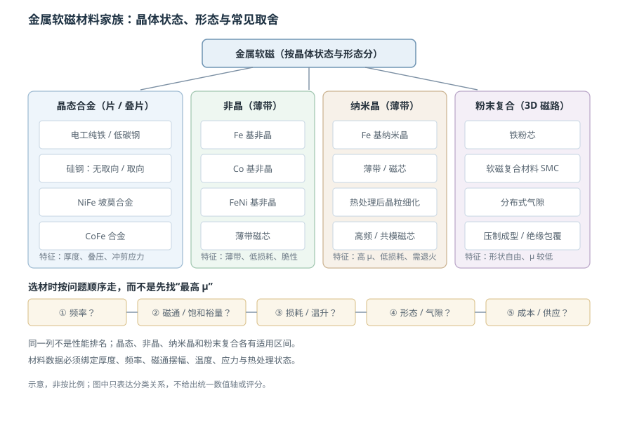

# 金属软磁、非晶与纳米晶材料

状态：草稿（待主智能体终审）复核：2026-10-26教材：第 8 章

> 本篇回答：工频电机、弱场屏蔽和高频高磁通磁芯，为什么不能只用一种“最好软磁”？
> 先修：[《软磁性能参数》](soft-magnetic-parameters.md)；预计阅读 25 分钟。

## 先看一个现象

同一台设备里，工频电机定子用硅钢片，弱信号磁屏蔽用 NiFe 合金，高频变压器用非晶或纳米晶薄带，小电感又可能用铁粉芯。它们都属于“软磁”，却没有一种材料能在频率、磁通、损耗、形状和成本上同时拿第一。选材的本质，是**在一条互相牵制的约束链里找可行解**。

## 一张图建立直觉

<figure class="kb-figure" markdown>

<figcaption>图 1 按晶体状态和形态把晶态合金、非晶、纳米晶与粉末复合材料并列。图为结构示意，不是性能排名，也不给统一数值轴。</figcaption>

</figure>

图中的四列对应不同的“形态起点”：晶态合金通常做成片材再叠压，非晶和纳米晶从薄带出发，粉末复合则把绝缘粉末压成三维磁路。形态一变，涡流路径、填充系数、加工方式和成本都会变。

## 概念：金属软磁的几条主线

### 电工纯铁与低碳钢

纯度 99.8% 以上的电工纯铁是最早、最常用的金属软磁之一。教材给出退火态典型量级：$\mu_i$ 约 300–500，$\mu_{\max}$ 约 6000–12000，$H_c$ 约 39.8–95.5 A/m [BOOK-01，§8.1 书 p.185 / PDF p.194](../sources/book.md#BOOK-01)。碳、氮、硫等杂质会钉扎畴壁，使 $H_c$ 升高、$\mu$ 下降；因此需要脱碳、纯净化与退火。它的优点是饱和高、成本低、加工成熟，缺点是电阻率低、涡流损耗大，主要用于低频磁路、电磁铁和继电器。

### 硅钢

在铁中加入硅可以提高电阻率、降低涡流损耗，并影响各向异性。无取向硅钢适合电机定转子这类磁化方向分散的磁路；取向硅钢沿轧向性能好，适合变压器这类方向明确的磁路。教材表列出了不同牌号的厚度、铁损和磁感，例如高磁感取向硅钢的 $B_{800}$ 约 1.88–1.89 T、$P_{1.7/50}$ 约 0.90–1.20 W/kg [BOOK-01，表 8.8（续），书 p.195 / PDF p.204](../sources/book.md#BOOK-01)。这些数字绑定厚度、频率、磁通和测试方向，不能抽出来当“硅钢性能”使用。

硅钢的工程难点不在材料名字，而在**冲剪、叠压、绝缘和应力**。冲剪边缘会引入应力与毛刺，毛刺短路会形成片间涡流通路；压装和焊接也会改变局部损耗。材料数据表上的曲线，不等于冲剪叠压后的成品磁芯曲线。

### NiFe 坡莫合金与 CoFe

NiFe 合金以高磁导率、低矫顽力著称，适合弱场、精密磁屏蔽和小信号磁路。教材表 8.12 所列中镍坡莫合金（Ni 约 45%–65%），$\mu_i$ 约 900–12000、$B_s$ 约 1.25–1.60 T，电阻率约 20–60 $\mu\Omega\cdot\mathrm{cm}$，不同牌号差异很大 [BOOK-01，§8.3.4，表 8.12，书 p.200 / PDF p.209](../sources/book.md#BOOK-01)。它的短板是饱和低于硅钢、对应力和热处理敏感、含镍成本高。CoFe 合金追求更高饱和，适合高功率密度场景，但成本、加工和脆性限制明显。

### 非晶与纳米晶

非晶合金通过急冷把熔融合金凝固成薄带，没有长程晶格周期。Fe 基非晶饱和较高、成本相对低；Co 基非晶磁导率高、损耗低。教材指出，铁基非晶带在电力工业应用中的空载损耗可降到传统 Fe-Si 合金的约 1/3–1/4 [BOOK-01，第 8 章书 p.209 / PDF p.218](../sources/book.md#BOOK-01)。这个比较绑定“空载损耗、工频、特定带材与结构”，不能外推成所有频率下的固定比例。

纳米晶软磁在非晶薄带基础上经晶化热处理，让晶粒细化到纳米尺度。教材概括它的定位是：兼顾铁基非晶的较高饱和与钴基非晶的高磁导率、低损耗，并且成本相对可控 [BOOK-01，第 8 章书 p.209 / PDF p.218](../sources/book.md#BOOK-01)。但“纳米晶”不是全频段通行证：它需要热处理，薄带脆、加工受限，饱和仍低于硅钢，具体损耗必须看频率、磁通摆幅、偏置和温度。

### 软磁复合材料

铁粉芯和软磁复合材料（SMC）把绝缘包覆的粉末压制成形，形成分布式气隙和三维磁路。它们磁导率较低、损耗受颗粒绝缘和压制密度限制，但形状自由、可做轴向磁通电机和特殊电感。选它通常是为了几何与三维磁路，而不是为了最高 $\mu$。

## 一个完整算例：薄片厚度对经典涡流损耗的影响

经典涡流损耗的薄片近似为

$$
P_e \propto \frac{f^2 B^2 d^2}{\rho}
$$

其中 $f$ 是频率，$B$ 是磁通密度，$d$ 是片厚，$\rho$ 是电阻率。设同一合金、同一频率、同一磁通摆幅和同一电阻率，只把片厚从 $d_1=0.35\ \mathrm{mm}$ 换成 $d_2=0.20\ \mathrm{mm}$。两种厚度的经典涡流损耗之比为

$$
\frac{P_{e2}}{P_{e1}}
=\left(\frac{d_2}{d_1}\right)^2
=\left(\frac{0.20}{0.35}\right)^2
\approx 0.327
$$

即经典涡流分量降到约 33%，该分量本身减少约 67%。但这不是“总损耗降低 67%”：总损耗还包含磁滞、剩余损耗、表面加工和片间短路效应；而且频率升高到趋肤深度接近片厚时，薄片近似本身也会失效。正确结论是：**在薄片近似成立、只比较经典涡流项的前提下，厚度减到 0.20/0.35 倍，涡流项按平方降到约 33%。**

## 按“频率—磁通—损耗—形态—成本”选材

1. **频率**：工频大功率优先硅钢；高频小功率考虑铁氧体、非晶/纳米晶薄带或粉末材料。
2. **磁通与饱和**：高饱和场景（电机、功率磁路）先看 $B_s$ 和饱和裕量，再看 $\mu$。
3. **损耗与温升**：必须用目标频率、波形、磁通摆幅、偏置和温度下的损耗曲线比较。
4. **形态**：片材适合叠压，薄带适合环形/切割磁芯，粉末适合三维形状；形态决定涡流路径和填充系数。
5. **成本与供应**：CoFe、NiFe、纳米晶的性能优势可能被材料价、热处理、加工良率和交期抵消。

在编码器附近，软磁件可能承担聚磁、磁通回流或屏蔽作用，也可能引入新的谐波和饱和。任何新增铁磁件都要在目标几何与干扰场下复测，不能只按“高 $\mu$”推断改善。

## 常见误区

!!! warning "四个常见错误"
    1. **“NiFe 永远优于硅钢”。** NiFe 强在弱场高 $\mu$，但饱和、成本、应力和加工限制明显；大功率电机不适用这条结论。
    2. **“纳米晶适合所有频率”。** 纳米晶有频段、磁通摆幅、偏置和热处理条件；高频、大磁通、低成本场景未必最优。
    3. **“高 $\mu$ 就等于更好的屏蔽”。** 屏蔽还取决于饱和、厚度、层数、开口、接缝和干扰场方向。
    4. **“叠片越薄越好”。** 薄片降低涡流，但增加加工、绝缘和填充系数成本；毛刺短路还会让实际损耗高于预期。

## 自测

自测 1：为什么电工纯铁不直接用于 10 kHz 变压器？

电工纯铁饱和高、成本低，但电阻率低、矫顽力相对高。10 kHz 下涡流损耗随 $f^2$ 增长，厚片还会受趋肤效应影响；同时磁滞损耗与 $H_c$ 相关。高频变压器通常需要更薄、更高电阻率或更低损耗的材料与结构。

自测 2：片厚从 0.35 mm 减到 0.20 mm，经典涡流损耗降到多少？

按 $P_e\propto d^2$，比值为 $(0.20/0.35)^2\approx0.327$，即经典涡流分量降到约 33%。总损耗不会同比例下降，因为磁滞、剩余损耗和加工效应仍在；且薄片近似需要趋肤深度远大于片厚。

自测 3：客户想用一块高 $\mu$ 坡莫合金屏蔽电机漏磁，先检查什么？

先检查干扰场强度和方向、屏蔽件是否饱和、开口和接缝、层数与厚度、是否有高频分量，以及屏蔽件是否改变传感器处的有效场。高 $\mu$ 只在未饱和、低频、闭合磁路条件下有优势；强漏磁可能先让屏蔽件饱和。

自测 4：为什么非晶/纳米晶常做成薄带而不是厚板？

它们的制造工艺本身以急冷薄带为基础；薄带还能降低涡流路径。但薄带带来脆性、叠片/切割、填充系数和热处理成本。选它们通常是为了低损耗或高 $\mu$，不是为了让磁路更便宜或更结实。

## 工程出口与适用边界

- 参数含义与气隙估算回读[《软磁性能参数》](soft-magnetic-parameters.md)。
- 高频铁氧体磁芯继续读[《软磁铁氧体与高频磁芯》](soft-ferrites.md)。
- 磁路饱和、损耗与几何优化见 [FAE 仿真](../fae/simulation.md)，材料初选见 [FAE 选型](../fae/selection.md)。

**适用边界：** 本篇给材料家族与取舍逻辑，不给具体牌号保证值。教材中的 $\mu_i$、$H_c$、损耗和频率范围都绑定材料状态、厚度、频率、磁通、温度与测试方法；供应商数据也必须带条件阅读。非晶/纳米晶的脆性、热处理和切割影响需要样件验证。

## 来源与待确认项

- [BOOK-01](../sources/book.md#BOOK-01)：第 8 章金属软磁材料；§8.1 电工纯铁、§8.3 坡莫合金、非晶与纳米晶部分。
- [SOFT-01](../sources/vendor.md#SOFT-01)：VAC 的 NiFe、CoFe、非晶、纳米晶等软磁系列与选型维度。
- 待确认：目标牌号的厚度、热处理状态、频率/磁通/温度损耗曲线；冲剪、叠压和压装后的成品磁芯数据。
