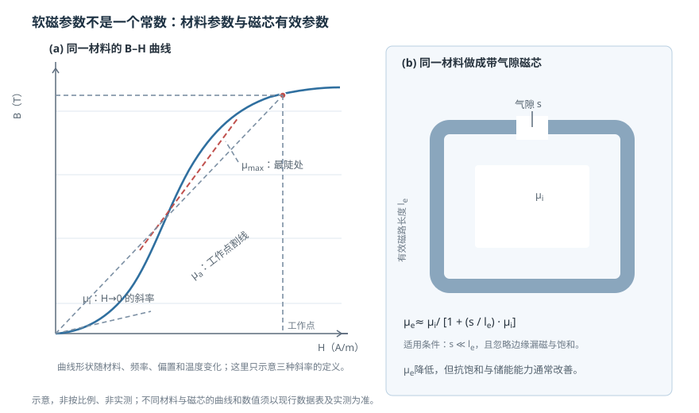

# 软磁性能参数：高磁导率为什么不是唯一目标

状态：草稿（待主智能体终审）复核：2026-10-26教材：第 7 章

> 本篇回答：弱场下磁导率很高的材料，为什么换到大磁通、直流偏置或高频场景未必合适？
> 先修：[《技术磁化与磁滞回线》](magnetization-and-hysteresis.md)、[《动态磁化、损耗与温度》](loss-and-temperature.md)；预计阅读 20 分钟。

## 先看一个现象

采购选了一只标称初始磁导率 $\mu_i=10000$ 的磁环，装在 100 kHz 电感里，感值只有按“10000”估算的一半，温升还比预期高。材料没有假冒，问题出在把**材料在特定小信号条件下的一个数字**，当成了整个工作范围内的常数。

软磁材料的“软”是磁学意义：容易磁化和退磁，不是机械柔软。真正决定系统表现的，不只是一项 $\mu$，还包括饱和磁通密度、矫顽力、损耗、频率、偏置、温度、应力和磁芯几何。

## 一张图建立直觉

<figure class="kb-figure" markdown>

<figcaption>图 1 (a) 同一条 B–H 曲线上的初始磁导率、最大磁导率和幅值磁导率；(b) 同一材料做成带气隙磁芯后，有效磁导率下降。图为示意，非实测、非按比例。</figcaption>

</figure>

图 (a) 说明：同一条曲线上，不同位置切出来的斜率不同。图 (b) 说明：即使材料没变，磁芯多了气隙，测到的“磁导率”也会明显下降。**材料参数、磁芯参数和工况参数必须分开看。**

## 概念：同一个磁导率至少有几种含义

- **初始磁导率 $\mu_i$**：$H\to 0$ 时的斜率。它回答“极弱场、无直流偏置、低频小信号下，材料响应有多灵敏”。
- **最大磁导率 $\mu_{\max}$**：B–H 曲线最陡处的斜率。它只说明曲线某一段很陡，不保证大信号下仍保持。
- **幅值磁导率 $\mu_a$**：从原点到某个工作点连线的割线斜率，随磁通摆幅变化。
- **有效磁导率 $\mu_e$**：带气隙磁芯由电感和几何反算出来的等效值，包含气隙、漏磁和磁芯形状。
- **可逆磁导率 $\mu_{rev}$**：在直流偏置上叠加一个小交流信号测得的斜率，常用于开关电源的偏置分析。

TDK 的定义资料明确说明：初始磁导率按 IEC 60401-3 用闭合磁路测量，条件为 $f\le 10\ \mathrm{kHz}$、$B<0.25\ \mathrm{mT}$、$T=25\ ^\circ\mathrm{C}$ [MAT-01](../sources/vendor.md#MAT-01)。这组条件很关键：它既不是大磁通条件，也不是高温或带气隙磁芯条件。教材第 7 章把起始磁导率、有效磁导率、矫顽力和损耗作为软磁材料的核心性能参数展开 [BOOK-01，第 7 章书 p.173 起 / PDF p.182 起](../sources/book.md#BOOK-01)。

| 参数 | 回答的问题 | 必须同时记录的条件 |
| --- | --- | --- |
| $\mu_i$ | 弱场小信号有多灵敏？ | 闭合磁路、频率、磁通密度、温度 |
| $\mu_{\max}$ | 曲线最陡处有多陡？ | 材料、热处理、频率、测试方法 |
| $\mu_a$ / $\mu_e$ | 实际工作点或带气隙磁芯的等效响应？ | 磁场/磁通幅值、气隙、几何、匝数 |
| $B_s$ | 磁芯能支撑多少磁通？ | 温度、定义场强（如 1200 A/m 或 1194 A/m） |
| $H_c$ | 抵抗退磁和自热的能力？ | 温度、波形、测量方向 |
| $P_v$ | 单位体积损耗和温升？ | 频率、磁通摆幅、波形、温度、厚度 |
| $T_C$ | 何时失去铁磁有序？ | 它是材料温度，不是允许工作温度 |

## 公式怎样使用：带气隙磁芯的完整算例

对小气隙磁芯，常用近似：

$$
\mu_e \approx \frac{\mu_i}{1+\dfrac{s}{l_e}\mu_i}
$$

其中 $s$ 是气隙总长度，$l_e$ 是有效磁路长度，$\mu_i$ 是材料初始磁导率。适用条件是 $s\ll l_e$，并忽略边缘漏磁、饱和与磁芯形状带来的附加磁阻 [MAT-01](../sources/vendor.md#MAT-01)。

**教学算例**：设闭合磁环 $\mu_i=2000$，$l_e=50\ \mathrm{mm}$，开一个 $s=0.5\ \mathrm{mm}$ 的气隙。先算比值 $s/l_e=0.5/50=0.01$，再代入：

$$
\mu_e \approx \frac{2000}{1+0.01\times 2000}
=\frac{2000}{21}\approx 95
$$

也就是说，材料还是那只材料，但带 0.5 mm 气隙后，按磁芯整体反算的 $\mu_e$ 从 2000 降到约 95。若气隙加倍到 1.0 mm，则

$$
\mu_e \approx \frac{2000}{1+0.02\times 2000}
=\frac{2000}{41}\approx 49
$$

气隙从 0.5 mm 增到 1.0 mm，$\mu_e$ 大约再减半。这个结果不是“材料变差了”，而是磁路中多了一段低磁导率的空气。气隙还会带来两个副作用：漏磁增加、边缘场改变；所以上式只适合小气隙估算，不能代替三维场分析。

若再给出匝数 $N=50$、截面积 $A=100\ \mathrm{mm^2}=1.0\times10^{-4}\ \mathrm{m^2}$，可用

$$
L \approx \frac{\mu_0\mu_e N^2 A}{l_e}
$$

核对量级：

$$
L \approx \frac{4\pi\times10^{-7}\times95\times50^2\times1.0\times10^{-4}}{0.05}
\approx 6.0\times10^{-4}\ \mathrm{H}=0.60\ \mathrm{mH}
$$

这里的 $0.60\ \mathrm{mH}$ 是教学几何下的估算值，不对应任何成品磁芯。它的意义是：**看到“$\mu_i=2000$”不能直接拿来做电感计算，必须先换成带气隙的 $\mu_e$。**

## 条件一变，参数就变

- **直流偏置**：偏置电流把工作点推高，增量磁导率下降；数据表应给出 $\mu$ 随直流偏置的曲线。
- **频率**：涡流、畴壁阻尼和寄生电容使 $\mu$ 随频率下降，并出现损耗分量；手册若只给 10 kHz 的 $\mu_i$，不能外推到 1 MHz。
- **温度**：居里点附近磁化能力快速下降；功率铁氧体还可能出现损耗最低点，但最低损耗温度不等于系统最优点。
- **应力**：冲剪、压装、过盈配合、灌封会改变磁导率和损耗；高 $\mu$ 的 NiFe 往往更敏感。
- **几何**：气隙、叠压系数、绕组窗口和屏蔽件都会改变实际磁路。

因此，选软磁材料时至少要同时问：**工作磁通多大？频率和波形是什么？有没有直流偏置？允许温升多少？磁芯是什么形状和气隙？** 只比 $\mu_i$ 的“最高值”，回答不了这些问题。

## 常见误区

!!! warning "四个常见错误"
    1. **把 $\mu$ 当成不随工况变化的常数。** 同一材料在不同 $H$、$f$、$T$ 和偏置下可以差出一个数量级。
    2. **把材料试样数据当成成品磁芯数据。** 带气隙、切割、叠压和压装后的 $\mu_e$ 与试样 $\mu_i$ 不是一回事。
    3. **把“软磁”理解成机械柔软。** 软磁指低矫顽力、易磁化；材料可能又硬又脆。
    4. **认为高 $\mu$ 一定带来更好的屏蔽。** 屏蔽还取决于饱和、厚度、层数、开口、接地和干扰场方向。

## 自测

自测 1：$\mu_i=5000$、$l_e=40\ \mathrm{mm}$、气隙 $s=0.4\ \mathrm{mm}$，估算 $\mu_e$。

$s/l_e=0.01$，分母 $1+0.01\times5000=51$，所以 $\mu_e\approx5000/51\approx98$。气隙把有效磁导率压低到约原来的 1/51。这个结果只在 $s\ll l_e$ 且忽略漏磁、饱和时成立。

自测 2：为什么 $\mu_i$ 的测试条件里要写 $B<0.25\ \mathrm{mT}$？

因为 $\mu_i$ 描述的是接近零场的小信号斜率。B–H 曲线是非线性的，弱场斜率不能代表大磁通下的幅值磁导率，更不能代表饱和附近的行为。看到 $\mu_i$ 时必须同时看测试频率、磁通密度和温度。

自测 3：设计 100 kHz、有直流偏置的功率电感，先看哪几个参数？

先看目标频率、磁通摆幅和偏置下的**损耗与 $\mu$ 曲线**，再看 $B_s$ 和饱和裕量，然后才是几何、气隙、温升和成本。$\mu_i$ 只能作为弱场筛选的起点，不能单独决定选型。

自测 4：磁屏蔽件选了高 $\mu$ 材料，为什么仍可能失效？

高 $\mu$ 只说明弱场分流能力强。如果干扰场很强，屏蔽件可能先饱和；如果开口、接缝或线缆入口形成磁通泄漏，内部场仍会升高；高频下还要看导电层的涡流屏蔽。必须按真实源方向、强度和频率测量屏蔽效能。

## 工程出口与适用边界

- 需要把参数变成具体材料与形态时，继续读[《金属软磁、非晶与纳米晶材料》](soft-magnetic-materials.md)。
- 高频、高电阻率场景继续读[《软磁铁氧体与高频磁芯》](soft-ferrites.md)。
- 选型与验证流程见 [FAE 选型](../fae/selection.md)，复杂气隙或饱和问题见 [FAE 仿真](../fae/simulation.md)。

**适用边界：** 本篇只建立参数含义与估算方法，不给具体牌号曲线。$\mu_e$ 近似式只适用于小气隙、无严重饱和和漏磁的磁路；实际磁芯必须以目标频率、偏置、温度和几何下的数据表或实测为准。教材第 7 章给出参数框架和损耗定义 [BOOK-01，§7.6 书 p.179 起 / PDF p.188 起](../sources/book.md#BOOK-01)，但具体数值不能跨材料、跨频率照搬。

## 来源与待确认项

- [BOOK-01](../sources/book.md#BOOK-01)：第 7 章软磁材料性能参数；§7.6 磁损耗。
- [MAT-01](../sources/vendor.md#MAT-01)：初始磁导率、有效磁导率、复磁导率与损耗定义；初始磁导率测试条件。
- 待确认：目标磁芯在客户频率、偏置、温度和波形下的 $\mu$ 与损耗曲线；气隙加工公差和叠压/压装应力。
